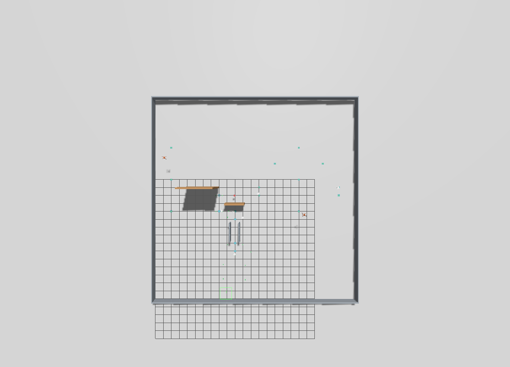

# 共域 · 空地无人系统协同仿真

《无人系统导论》课程设计题目二《一条通道上的两支队伍：空地无人系统协同靶场的设计与复盘》。

6 辆差速地面车和 2 架无人机执行侦察与运输任务，共用一条容量为一的通道。地面车通过 AMCL、NavFn 和 DWB 完成定位、全局规划和局部控制。任务层用带有效期的观测、岗位调整与通道预约协调多台机器人。岗位分配借鉴军蚁活桥，将抽调平台承担临时岗位的机会成本纳入选择。

上图截自 phase46 历史演示。完整录屏与 v9 报告可在[课程归档发布页](https://github.com/16stone/gongyu-ros2-gazebo/releases/tag/v9-course)下载。

## 从哪里开始

| 路径 | 内容 |
| --- | --- |
| [source/gongyu](source/gongyu) | 任务规划、消息、岗位和共享资源调度 |
| [source/ros](source/ros) | ROS 2 / Gazebo 场景生成、启动、任务执行和反馈 |
| [scenes](scenes) | phase124 冻结场景卡及相关配置 |
| [evidence/fp124-ent-ind-01](evidence/fp124-ent-ind-01) | 整机主回合摘要、原始指标、事件和关闭回执 |
| [复现说明](docs/reproduce.md) | 从图模型快速检查到 Gazebo 整机运行 |

## 主回合

`fp124-ent-ind-01` 使用 phase124-wslgpu 冻结版本、P3 策略与中绕行独立场景。原始回执记录了 **14/14 项任务按期、0 条记录违例、5 次通道资源持有与释放**。每个实体在独立进程中决策，无人机使用仿真位姿反馈。

该回合验证了联合机制在独立场景中的整机执行。对抗效果的物理配对来自报告中的历史版本。 [指标](evidence/fp124-ent-ind-01/result/metrics.json) · [事件](evidence/fp124-ent-ind-01/result/events.jsonl) · [关闭回执](evidence/fp124-ent-ind-01/result_launch/shutdown.json)
