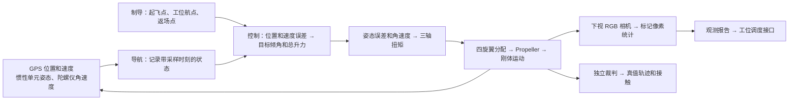

# B3 多旋翼与工位观测

阶段 C 使用一架 B3 完成起飞、飞至工位、驻留、返场和降落。Webots R2025a 的刚体求解器处理飞行和接触，四个 `Propeller` 根据带符号的电机转速产生升力和反扭矩。独立裁判记录运动真值和接触，真值参考工况才向控制器发送位姿包。

## 自主飞行与报告



世界坐标采用 ENU，机体系 +x 向前、+y 向左、+z 向上。电机按左前、右前、左后、右后排列，对角同向旋转。水平外环把 ENU 位置及速度误差换算到机体系，然后用所需水平加速度确定小角度目标姿态。高度外环给出总推力，姿态内环用滚转、俯仰、航向及角速度给出各轴力矩。混控根据推力作用点和反扭矩方向求四个转速。电机上限为 360 rad/s，转速爬升上限为 3000 rad/s²；Webots 的 Propeller 更新路径使用电机 maxTorque 字段的数值进一步限制这一爬升速率。飞行器初始偏航 20°，航向指令为 0°；漂移范围由仿真记录核对。

导航直接使用 Webots 的局部 GPS 定位、GPS 速度向量、惯性单元姿态和陀螺仪数据。GPS 每 32 ms 更新，位置噪声标准差为 0.006 m。惯性单元与陀螺仪每 16 ms 更新，模型的惯性单元噪声参数为 0.001，陀螺仪分辨率为 0.001 rad/s；固定偏置为零。相机每 160 ms 采一帧，水平视场 1 rad，输出 96×72 的彩色图像。位置反馈超过 96 ms 未更新时，控制器把水平目标姿态恢复到水平，暂缓航点推进与图像报告，沿用上一份位置和速度反馈维持高度指令；有效采样恢复后继续。该分支验证短时定位中断。

工位标记是一块洋红色方板。驻留期间，B3 从相机 BGRA 数据统计满足红、蓝通道至少 100 且均高于绿通道至少 50 的像素。达到 40 个像素时，B3 发布一次工位可见报告，附采样时间、发送时间、有效期、像素数、原始 RGB 数据哈希和证据帧名。驻留结束时仍未达到阈值则记录报告缺失并返场。这个判据适用于课程场地规定的标记和背景。报告写入 JSONL，总线文件名及采样时间、帧大小和图像签名字段与现有地面观测门控的输入兼容。

## AMAX 复现

从仓库根目录调用以下命令。每条命令使用一个新的输出目录，采用已有的 Webots 和私有 Xvfb 启动器。单回合共享互斥锁、最多两 CPU 逻辑核、低调度优先级和软件渲染。

```bash
bash webots/tools/run_uav_course.sh truth     b3-ref-01
bash webots/tools/run_uav_course.sh visible   b3-visible-01
bash webots/tools/run_uav_course.sh occluded  b3-occluded-01
bash webots/tools/run_uav_course.sh dropout   b3-dropout-01
python3 webots/tools/check_uav_course.py ~/pandaoxi/gongyu-enhance-evidence/uav/runs/b3-visible-01
```

`truth` 在相同的物理环境下从裁判发出的参考包控制位姿，载荷仍来自相机。`visible` 和 `occluded` 只改变遮挡板位置，其他初始条件一致。`dropout` 和 `visible` 只改变 4.480–5.056 s 的 GPS 样本是否交给控制器。回合验收核对五个动作的顺序、独立轨迹的到位、驻留距离、地面接触、状态等待、图像阈值和报告时序。这里的 5/5 指单机动作。

输出文件包括 `uav_config.json`、`shutdown.json`、`result/metrics.json`、`bus/uav_telemetry.jsonl`、`bus/uav_truth.jsonl`、`bus/uav_events.jsonl`、`bus/uav_frames.jsonl`、可见工况的 `bus/observation_B3.jsonl` 和 `evidence/worksite_*.ppm`。仿真统一使用毫秒、米和弧度，真值、控制输出和相机采样可按 `t_ms` 对齐。两路误差分别来自控制用状态与同一控制时刻的真值，以及原始定位样本与采样时刻的真值。

Webots 模型参考手册见 [Propeller](https://raw.githubusercontent.com/cyberbotics/webots/R2025a/docs/reference/propeller.md)、[InertialUnit](https://raw.githubusercontent.com/cyberbotics/webots/R2025a/docs/reference/inertialunit.md) 和 [Camera](https://raw.githubusercontent.com/cyberbotics/webots/R2025a/docs/reference/camera.md)。
