# 摘要

本课程设计在一条两端都有任务点的狭窄通道上布置六辆地面无人车与两架无人机。两队各有交付和观察任务，需要在满足时间窗的同时决定谁先穿越通道、何时放行下一辆车。设计把课程讲到的单体运动控制与多体任务规划分成两层：地面车根据传感反馈调节差速轮速，队伍根据车体净空和观察报告的时效放行运输。正式整机在 Webots R2025a 中以混合后端实跑，六辆地面车由电机驱动，两架无人机采用航点运动学；正常、首份观察延迟、侦察车起点变化三组完整回合均完成 14 项任务、通道 5 进 5 清、无占用重叠。延迟回合拒收过期观察并重新取帧，蓝方第二批交付比正常回合晚约 8.1 s；同条件的专项对照显示，仅拒收过期帧时为 13 项按期，允许主动补采后恢复到 14 项。报告另用军蚁活桥的机会成本思想设计岗位分配算例，说明调出一辆车支援队友时原任务可能付出的代价。文中把 Webots 整机、单体专项、Gazebo 归档与离散图模型分层引用，并写明哪些结论尚待进一步验证。

**关键词**　无人地面车辆、空地协同、差速控制、任务时间窗、Webots

# 1 任务与总体设计

## 1.1 场地与设计目标

这次课程设计从一个问题开始。几辆车和无人机都能执行自己的动作时，怎样让它们在同一场地按时完成任务？我选了一条狭窄通道作为两队共用资源。同一时间只应有一辆车占用它，上一辆车何时让出通道会改变下一辆车的出发计划。这样，协同是否有效，可以在实际轨迹和任务时刻上直接检查。

两队分别进行交付、观察和巡察。对抗体现在两队对有限通行资源的竞争，双方均遵守各自任务规定的时窗和同一套通行规则。课题的主要自主行为是地面车沿给定路线运动、根据测量反馈修正行驶、到点停车，以及多车按车体占用和信息时效协调发车。场地图标出主要运输节点。红蓝两队都需要经过通道，装货、转向和停车尽量安排在导轨之外。

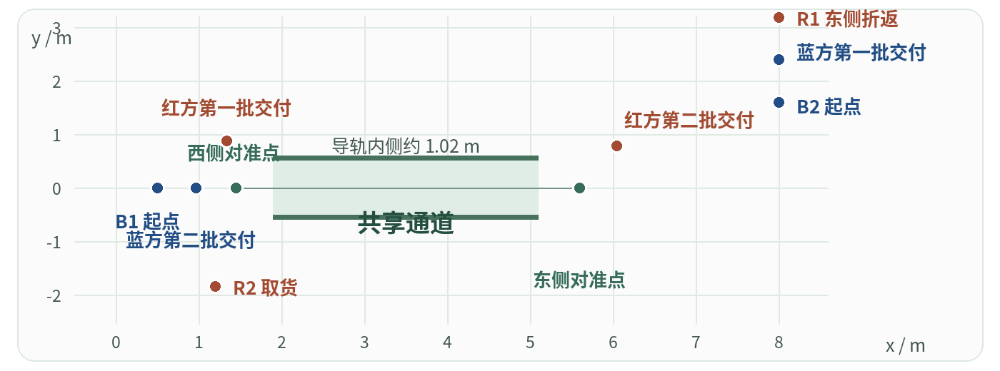

取直达路线可以少走路，通道窄口却只能让一台车占用。取外侧路线能回避中央通道上的等待，同时会增加走行和期限压力。空中单元不受地面导轨的通过方向限制，它能用一次巡察给地面车提供近期观察。把运输、巡察和资源限制放到同一张任务卡上以后，队伍竞争有了量化的比较对象，分别是各自任务的期限余量、共享通道等待和可观察的实际交付时刻。

## 1.2 八个实体与十四项任务

地面无人车（UGV）适合沿通道运输，也能到观察点侦察后返回。无人机（UAV）在场景中承担巡察和观察，其中蓝方 B3 的相机给第二批运输提供起步条件。下表列出各实体在完整回合里的职责。红方 R1 的运输要等到仿真 120 s 才允许启动，四次主要交付的期限在运行前确定。

**表1 八个实体的职责与任务期限**

| 实体 | 平台 | 登记任务 | 绝对期限 / s |
| --- | --- | --- | --- |
| B1 | 地面车 | 蓝方第一批运输交付 | 350 |
| B2 | 地面车 | 蓝方第二批运输交付 | 350 |
| B3 | 无人机 | 蓝方巡察，另按请求提供观察 | 40 |
| R1 | 地面车 | 红方第一批交付，120 s 释放 | 250 |
| R2 | 地面车 | 红方第二批交付 | 100 |
| R3 | 地面车 | 侦察、报告、返场 | 60、70、86 |
| R4 | 地面车 | 侦察、报告、返场 | 60、70、130 |
| R5 | 无人机 | 红方空中巡察、巡逻、返场 | 10、60、180 |

任务卡单独声明释放时刻、期限与验收。释放时刻限制何时可开始，期限限制何时要结束。B3 的起步观察和途中装载是其他任务成立所需的过程事件，十四项任务的分母在运行前固定。计算按期数时，每项任务只算一次，缺失回执仍留在分母里。

## 1.3 把课上的原理用到设计中

总体设计课讲到先弄清使用任务，再把任务转换成各分系统的要求 [1]。在这个例子里，我先写下车和无人机分别要交付什么，再确定控制器、协同规则和裁判各需要知道哪些信息。功能结构图表示这几部分之间的信息如何流动。地面控制器关心位置、航向和近处障碍。协同层关心任务何时可以开始、通道是否实际清空、报告是否还能用。裁判从仿真场景读取车体状态，记录是否到点、是否超期，以及两辆车有无同时占用通道。

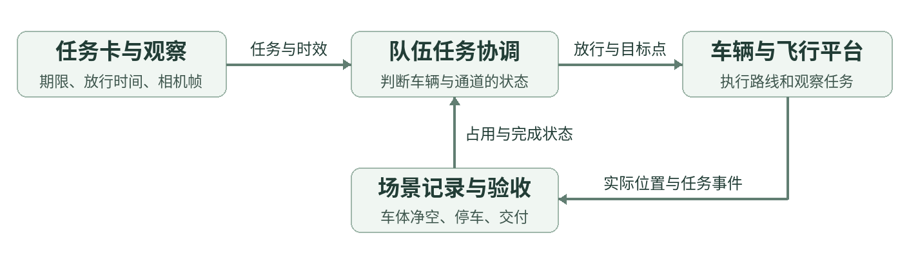

**表2 从任务要求到实现与检查**

| 任务需要 | 本设计采用的办法 | 仿真中检查什么 |
| --- | --- | --- |
| 地面车能沿路线通过窄口并停稳 | 走行反馈、通道外对准、到点减速 | 轨迹、到位、低速和驻留 |
| 两队能共享同一通道 | 依据车体范围判空，按顺序放行运输 | 车辆占用区间有无重叠 |
| 第二批运输使用近期观察 | 相机帧带采样时刻，过期后重新请求 | 收帧、拒收、发车的先后关系 |
| 队伍可以在期限内完成职责 | 预先设任务时间窗，在线判断实际放行时机 | 登记任务数、按期任务数和时间余量 |

地面车辆课讲了全局路径和局部控制的分工 [2]，第六讲在无人水面艇关键技术中把自主决策、多体协同与任务载荷并列 [4]，两处都强调先分层、再定接口 [1]。两者合起来，给了我一个具体划分：上层管选哪辆车、什么时候允许走，下层管车怎么到点。这样，车还在纠正姿态时，上层不会仅凭预计时间就判它已经交付。

**表3 课程原理与设计选择**

| 课程中讨论的原理 | 在靶场中的取舍 | 可检查的证据 |
| --- | --- | --- |
| 第一讲 总体设计与功能分解 | 先规定各实体要完成的行为，再安排感知、控制和验收接口 | 任务卡和仿真记录 |
| 第二讲 地面车辆导航与控制 | 以栅格选路，依据位置和航向反馈调节差速轮速 | 单车轨迹、扩展节点和到位回执 |
| 第三讲 无人机任务与载荷 | 相机帧按采样时刻生效，过期则补采 | 帧记录、放行事件和运输交付 |
| 第六讲 自主决策与多体协同 | 上层管理岗位、时间窗与通道，下层按反馈执行 | 岗位事件、通道区间和任务完成账 |

## 1.4 主版本、证据分层与阅读口径

这份报告同时用到整机实跑、单体专项、规则归档和诊断回合，先把它们的边界说清，后面的数字才有共同的读法。正式提交的主版本是仓库 `evidence/course_final/` 下 normal、delay、holdout 三组 Webots 整机回合：同一冻结场景、同一任务卡，只改变观察传递时间或两辆侦察车的起点。三组关闭回执中 `physical_actuation` 为真、`motion_backend` 为 hybrid、`kinematic_actors` 为 B3 与 R5，即六辆地面车由电机驱动，两架无人机留在航点运动学层；本后端没有旋翼动力学，用运动学代替比给出一个未经检验的气动模型更诚实。

**表4 全文引用的四层证据及其边界**

| 层次 | 回答什么问题 | 不回答什么问题 | 仓库入口 |
| --- | --- | --- | --- |
| 整机实跑（主版本） | 八实体在同一冻结场景能否按期、通道是否互斥 | 大规模统计显著性、旋翼动力学 | `evidence/course_final/{normal,delay,holdout}/` |
| Webots 专项 | 感知、定位、UAV 反馈、报告时效、放行规则的单条件对照 | 全队规模下的调度优劣 | `evidence/webots/<run-id>/`，清单见 `docs/evidence_index.md` |
| Gazebo 归档与图模型 | 岗位协商、机会成本、通信与规模扩展的机制筛选 | 与 Webots 秒数的直接比较 | `evidence/fp124-ent-ind-01/`、`source/scenarios/` |
| 执行器层诊断 | 指令到轮速、到点与脱困是否成立 | 正式验收结论 | `evidence/webots/p-*`，说明见 `docs/webots/PHYSICAL_LAYER.md` |

表4 是全文数字的前提。第 4 章只报主版本及其同条件对照，第 5、6 章的 Gazebo 与图模型结果按原平台时间单独陈述，第 7 章的早期物理回合只用于说明设计怎样被修改，不与主版本的 14 项按期相加。两套仿真的质量、摩擦、传感噪声和控制周期都不同，因此本文只做同平台内改变一个条件的配对比较；跨平台只描述行为是否复现，不并列秒数。

阅读时可按题目要求的顺序核对：场地与规则见 1.1、1.2 节，单体自主行为与关键技术途径见第 2 章，多体协同与仿生理论参考见第 3 章，行为仿真 Demo 与结果见第 4 章，对照设计与结论范围见 4.3—4.6、7.3、7.4 节；复现步骤、逐回合清单与同源视频分别在 `docs/reproduce.md`、`docs/evidence_index.md` 和 `docs/demo/`。每项结果都能从正文找到对应的回合目录与回执字段，而不只是给一张汇总表。

## 1.5 从状态到执行和验收

我把系统划分为感知、任务管理、决策、执行和通信。感知给出位姿、局部障碍和载荷观测。任务管理器保存任务卡、目标点、期限和前置条件。决策层利用这些信息安排路线、岗位和共享资源。执行层收目标点并调节运动，完成情况再返回任务层。通信负责传递报告、申请、确认、释放和回执，用消息编号和时间戳保留因果次序。两个平台都采用这套总体分层，具体执行接口随平台改变。

**表5 共享资源及其状态**

| 资源 | 关键状态 | 合法转移 | 主要记录 |
|---|---|---|---|
| 中央通道 | free、reserved、in_use | 申请、授权、进入、清空、释放 | slot_id、方向、起止时刻、revision |
| 入口与泊位 | free、occupied、aligning | 到位、对准、占用、清空 | 实体、姿态、占用区间 |
| 交付目的地 | free、loading、unloading | 装载、服务、卸载、离开 | 任务、服务回执、目的地状态 |
| 信息报告 | pending、delivered、expired、failed | 创建、送达、使用、过期 | 采样时刻、接收时刻、消息编号 |
| 岗位与服务 | free至active、released | 请求、提议、确认、激活、释放 | proposal_id、provider、consumer |

通道预约记录包含名义起止时刻。名义窗用于预约时的冲突检查，实际清空事件用于提前释放未使用部分。泊位和目的地单独记录，避免车辆虽然持有通道时间窗，却在出口处与另一项服务发生冲突。

报告和岗位也有生命周期。报告到期后不再参与有效服务边的判断。岗位在服务完成、请求者不再需要或继续占用已不合理时释放。释放不是日志末尾的补充动作，而是任务管理器必须处理的状态，否则后续候选会一直把已经空闲的实体视为不可用。

主场景的 Webots 裁判把上述设计收敛到能直接观察的三个条件。第一看任务是否已经释放，第二看车体是否完整清空，第三看下一车需要的观察是否新鲜。Gazebo 的岗位提议、泊位与预约记录用来解释更丰富的协同过程。表中的状态名来自 Gazebo 记录。

## 1.6 四类时间各回答什么问题

报告把下列四个概念分开记录。

（1）**预测。** 决策器根据路线、速度参数、等待和服务动作估计某任务何时完成。预测用于比较候选，可能因执行误差和冲突而改变。

（2）**执行器完成。** Nav2到达、空中位置环稳定或某个物理动作结束。它只说明局部执行状态，不一定满足整项任务。

（3）**任务验收。** 车辆位于目标区间、速度低于阈值并持续驻留，且需要的服务事件已经满足。验收后才更新任务管理器中的完成状态。

（4）**独立真值审计。** 场景记录器检查位置、占用、期限和约束违例。审计用于复核任务管理器，提供与执行器回执独立的核对路径。

这套口径增加了一些日志字段，却避免了最常见的误判：路径点到达被写成装载完成，计划时间被写成实际时间，或者一条任务完成消息被当作全队回合成功。

Webots 主场景使用 16 ms 仿真步长，按约 0.5 s 保存真值轨迹供绘图。裁判的占用和交付条件每步检查。主窗口为 400 s，图表中的 s 表示仿真时间。图模型的预计时刻、Gazebo 的资源事件与 Webots 的车身占用各自按本平台原始时间计算。

# 2 单体自主行为与执行验收

## 2.1 Webots 差速运动控制

Webots 中，六辆地面车采用两轮差速底盘。控制器获得模拟 GPS 位置和惯性测量单元的航向，从当前位置指向下一目标点，比较目标方向和车头方向，再给左右轮发速度指令。航向误差按最短转角计算，避免角度经过正负 180° 处时给出反方向转动。地面车的任务路线事先确定，近处出现障碍时由雷达和局部规则改变车速、转向或执行短时脱困。任务路线、局部运动和到点确认是三件不同的事，停车和行驶都在仿真物理中执行。

令期望车身线速度为 v，角速度为 ω，轮距为 B，车轮半径为 r。两轮线速度的平均值决定车速，两轮速度差决定转向。模型取 B = 0.34 m、r = 0.085 m，按项目的轮轴命名，左、右轮转速分别为 (v + ωB/2)/r、(v − ωB/2)/r。这里的轮速符号要随轮轴和坐标约定检查。调车时出现过车一直原地转、航向误差却越调越大的情况。我当时先怀疑轮轴接反，又据此把惯性单元读数取了负号；两处改动叠加后，同一个期望航向上出现两个反向增益，环路变成正反馈，反而看不出是哪一步错了。

判定性测量是把两处错误分开的办法：裁判从节点姿态矩阵取 atan2(R10, R00) 作真值航向，控制器上报惯性单元与编码器原始值，再让单车以 ±0.8 rad/s 指令各纯自转一回合。指令 +0.8 时真值约 +0.558 rad/s、惯性单元约 +0.535 rad/s，指令 −0.8 时两者对称取负，位置漂移约 0.001 m。真值与惯性单元同号，说明惯性单元采用标准逆时针为正，先前写的 `theta = -imu` 才是错的；左右轮则按 y 坐标重排映射。去掉负号并重排轮轴后，同一单车路线的通道占用由约 23.0 s 降到 7.1 s。这两个回合属于执行器层专项（`evidence/webots/p-att-spin-plus` 与 `p-att-spin-minus`），不是第 4 章的八实体整机数据。

进入通道前，车辆先在外侧调整朝向。接近任务点后降低速度，到了停车距离才置零。四辆运输车的交付还要满足目标距离不大于 0.10 m、车速不高于 0.10 m/s 并连续驻留 2 s。这个判据让任务记录反映真正停车交付。地面侦察、空中巡察等其他任务按各自的到点规则计时。

按总体设计课的导航、制导与控制分工 [1]，导航先估计车的位置和航向，制导再用下一路点确定应朝向哪里，控制把速度与航向误差变成轮速。无人机同样从目标位置和反馈出发，最后要经过姿态与推力分配。

在机器人前向轴取 x、平面航向为 ψ 时，理想无侧滑运动写成 ẋ = v cos ψ，ẏ = v sin ψ，ψ̇ = ω。两轮直行时 v 与轮速平均值成正比，转弯时 ω 与轮速差成正比。真值轨迹和控制器只要有一个航向符号取错，控制误差就会被转向放大。调试记录先用正反转检查左右轮映射，再用跟踪误差检查是否稳定收敛。这样可以从底盘动作定位问题，无需同时改路线和控制器。

## 2.2 从里程计到地图位姿

课上讲地面无人车路径规划时，区分了利用已知地图选路线的全局规划和根据局部观测调整运动的局部规划[2]。Gazebo 导航算例用 AMCL 提供定位，NavFn 在地图上选路，DWB 根据附近障碍和底盘约束给出速度命令。任务层通过 Nav2 的导航动作接口传入目标点[10]。通道授权和任务验收由靶场的任务层判断。

AMCL不把一次初始位姿当作永久真值。车辆运动后，粒子先按运动模型预测，再由激光观测与地图的匹配程度更新权重，最后重采样，使粒子逐渐集中到更符合观测的位姿附近。map到odom的修正再交给规划和控制节点使用。主配置使用500—2000个粒子、60束激光，平移或旋转达到0.1后触发更新。粒子数影响计算量和分布表达能力，观测更新则决定车辆运动后能否及时纠正先验。

这一层与任务验收分开。AMCL收敛表示导航获得了可用位姿，并不表示侦察、装载或交付已经完成。任务管理器仍需检查目标区域、驻留和服务回执。

## 2.3 Gazebo 全局规划与局部速度选择

全局规划器选用NavFn的Dijkstra模式，配置为use_astar: false、tolerance: 0.0。场地已经结构化，主要连通关系由中央通道和少量绕行路线构成，首先需要一条稳定、可复查的搜索基线。Dijkstra不依赖启发项，在统一代价地图上按累计代价扩展节点，调整膨胀层或入口几何时，排查问题不必同时处理启发权重变化。Smac Hybrid-A*把车辆运动学约束编入节点扩展，更适合需要直接生成可执行曲率路径的场景。它对应的是另一种实现复杂度与运动可行性的取舍，而不是绝对性能高低。

全局代价地图依次为static、obstacle、peer和inflation层。膨胀半径0.55 m、代价缩放3.0，障碍标记距离2.5 m、清障光线3.0 m。局部代价地图使用3 m×3 m滚动窗口。膨胀层在障碍附近随距离衰减提高通行代价，促使路径保留间隙，但并不把整个膨胀范围都改成禁止通行区域。真正不可进入的栅格与“可通过但代价较高”的栅格必须区分，否则窄通道调试时容易把路径贴墙、无路可走和控制器不愿进入混为同一个问题。

这也解释了为什么不能只按通道净宽判断可行性。静态建筑、动态障碍、队友占位和膨胀代价共同改变全局路线。即使全局路线存在，局部控制器仍可能因姿态、速度采样或入口目标布置而无法收敛。

### DWB 轨迹采样与权重

DWB在允许速度范围内采样，按航向、目标距离、障碍间隙和速度等评分项选择命令[10]。Fox等人提出的动态窗口方法说明了这种“短时预测—候选评分—执行反馈”的基本思想[11]。冻结B1配置中，PathAlign与GoalAlign权重均为0，PathDist为32、GoalDist为24、RotateToGoal为32、BaseObstacle为0.02。

将PathAlign和GoalAlign归零，与窄通道入口的摆头现象有关。路径对齐和目标对齐会牵引车辆姿态持续追随局部路径或目标方向。通道内本来就需要小幅修正时，这两项可能放大左右摆动。保留路径距离和目标距离评价，可以继续比较轨迹偏离与推进程度，把旋转更多交给接近目标后的控制过程。这个参数组合针对冻结入口几何调试，不能直接推广为所有导航场景的推荐值。

局部规划得到的车体速度仍需按第 2.1 节的关系转换为轮速。

**表6 地面与空中运动的主要参数**

| 参数 | 取值 | 作用层级与说明 |
|---|---|---|
| 地图分辨率 | 0.05 m | 全局与局部代价地图栅格尺度 |
| max_vel_x / max_speed_xy | 0.26 m/s | 地面平移命令上限 |
| max_vel_theta | 1.0 rad/s | 地面角速度命令上限 |
| vx_samples / vtheta_samples | 10 / 15 | DWB平移与角速度采样档数 |
| sim_time | 1.7 s | 局部轨迹前向预测时长 |
| 控制频率 | 10 Hz | DWB控制循环频率 |
| acc_lim_x / acc_lim_theta | 2.5 / 3.2 | 线、角加速度限制 |
| 规划tolerance / 控制xy_goal_tolerance | 0.0 / 0.08 m | 分属全局规划与控制目标容差 |
| 空中位置环 | kp=2.0，积分限幅0.30，输出限幅3.0 | 误差限幅±5 m，使用自身仿真位姿 |

两种执行实现使用不同的速度、几何和到达条件。Webots 的规划对比使用二值膨胀栅格，Gazebo 的代价地图带分级代价。比较某个平台内的算法或规则时固定该平台的起点、任务和配置，才能说明变量改变以后发生了什么。

## 2.4 Webots 单车路径与定位对照

地面车辆课的路径规划让我想到一个问题：同样的起点、终点和障碍，换一个搜索方法是否会让车走得更短？我在 0.05 m 栅格上选了开阔和窄入口两种布局，把障碍膨胀距离固定为 0.34 m。每步可向八个方向走，斜向经过的格角两侧也必须可通行。Dijkstra 按从起点累积的路程扩展，A* 在此基础上加上到目标的最短格网距离估计。

**表7 两种全局搜索在同一地图上的比较**

| 布局 | Dijkstra 扩展节点 / 耗时中位数 | A* 扩展节点 / 耗时中位数 | 两者的规划路径长度 |
| --- | ---: | ---: | ---: |
| 开阔 | 11 239 / 51.3 ms | 305 / 1.9 ms | 6.33 m |
| 窄入口 | 8 652 / 37.3 ms | 178 / 1.2 ms | 6.33 m |

每种布局分别比较了 31 次，两种方法的最短路长度相同。窄入口仍有一条达到最短网格距离的路径，A* 把更多搜索集中在通往目标的方向。这里计时的是全局栅格计算。车辆过窄口还要调姿态、避障，行驶时间由闭环运动的记录判断。

把两种搜索分别接入同一个反馈控制器后，四个单车回合均完成走行和到位检查。开阔场地都在约 19.92 s 到位。窄入口中，Dijkstra 与 A* 对应的到位时刻为 19.06 s 和 17.57 s，最短路径等长，简化后交给车的目标点可以不同。

我又用同一条窄入口轨迹比较了定位方法。只积分车轮读数时，打滑和转弯误差会随行程积累。叠加激光扫描与已知墙面的匹配后，A* 回合的位置均方根误差由约 0.47 m 降到 0.17 m。这项比较由记录回放得到，实际走行由 GPS 和惯性单元反馈控制。平行墙面对沿走廊方向的限制较弱，出口附近的不同方向边缘对校正位置更有帮助。

## 2.5 双高度扫描与受阻处理

直路两边有导轨，入口外又有墙角。车辆走到这样的地方时，角度对准和横向净空同样重要。调试中曾把贴近中心线的定位值直接改成中心线坐标。这样做虽然使记录看起来整齐，但在车实际偏向一侧时，控制器看不到横向误差，于是缺少把车拉回中心的依据。后来保留测得的位置，并在外侧完成对准，车可以在入通道前调整航向与横向误差。

局部避障用雷达距离区分前方和两侧的余量。遇到墙角，雷达未必能完整看见挡在车体旁边的几何边缘。控制器因此增加了一项运动检查：若有速度指令而车的位移或转角持续很小，先短时后退并偏转，再重新对准。这个判断用车载位置和姿态的变化，从而可以应对部分单靠前向距离难以辨认的卡滞。

我把这项设计拿到单车场景里检查：保持路线和控制相同，在地图里没有标注的位置放一个 0.27 m 高的箱子。两路雷达的名义扫描平面分别为 0.32 m 和 0.225 m。仅用主雷达参与停车判断时，车与箱体发生接触。启用低位雷达后，车在仿真 5.47 s、前方约 0.42 m 处触发停车，全程没有接触箱体。这两次都未到达终点，说明低位雷达解决了这次停车观察的问题，绕行还需地图更新或重新规划。

单车路线试验把地图规划、走行控制和急停分开。低箱体插在本来可走的线上，地图搜索仍给出原路径，车辆移动后才由传感器获得箱体回波。这个布置让箱体可见性真正改变运行条件。只看搜索是否成功无法判断车辆能不能通过，接触日志和停车时刻提供了更直接的证据。

### 固定姿态的四方向覆盖检查

单车专项还使用了静止的 B1 和四个立体目标。两具 Webots 激光雷达均设为 180 点、6.283185 rad 名义视场，采样周期 16 ms。裁判真值用来把点和预先布置的物体对应，再检查命中方向和距离。每个物体的代表点按靠近目标方向选取，记录的是回波点的距离和角度。

**表8 固定姿态的双雷达方向检查**

| 布置方向 | 主雷达距离与方位 | 低位雷达距离与方位 |
| --- | --- | --- |
| 前方 | 0.46 m / -1° | 0.46 m / -1° |
| 后方 | 0.89 m / -179° | 该物体未检出 |
| 左侧 | 0.70 m / 91° | 0.70 m / 91° |
| 右侧 | 0.68 m / -91° | 0.68 m / -89° |
| 近距离低目标 | 该物体未检出 | 该物体未检出 |

主雷达在四个方向都收到目标回波。低位雷达在后方目标和近距离低目标上没有命中，主雷达对该近距离低目标也没有命中。扫描视场、安装高度、近距离裁剪和周围结构共同决定能不能看到物体。这组固定姿态实验覆盖了四个方向与一个近距样点。车身旋转、移动时持续遮挡和其他目标高度还没有在这组条件里验证。低箱行驶对照显示主要传感器会遗漏部分高度范围，低位检测对实际停车有帮助。

## 2.6 从接近目标到任务完成

执行器把“接近目标”与“任务完成”分开。车辆进入目标半径只是第一个条件，还需满足横向误差、低速稳定和驻留时间。对需要装载、卸载、侦察或报告的任务，必须有相应服务事件。

**表9 到位与驻留判据**

| 判据 | 地面运输车 | 空中观察机 | 依据 |
|---|---|---|---|
| 水平到位容差 | 0.10 m | 0.10 m | Gazebo 归档场景 physical_berth_tolerance_m |
| 到位速度上限 | 0.10 m/s | 0.10 m/s | 源码到位判定 speed<=0.1 |
| 到位高度容差 | — | 0.20 m | 地面只查水平距离 |
| 移动到位保持 | 约 1 s | 约 1 s | 原始事件 dwell_ms 1000—1008 |
| 服务时长 | 2 s | 2 s | 场景 service_ms=2000，事件 dwell_ms=2000 |
| 服务记录 | 装载/卸载/交付 | 观察/报告 | 按任务要求 |

驻留期间如果车辆离开目标区、速度重新升高或服务对象被占用，计时与任务状态需要重新评估。完成时刻可能因此晚于导航到达时刻，这也解释了记录中为什么同时出现到位、物理完成确认和交付等不同事件。

Webots 单车专项使用自己的到位条件。整场运输的判断为到位范围 0.10 m、低速不高于 0.10 m/s、驻留 2 s。记录的完成时刻属于该任务的最后一项验收。观察、报告、装载和交接应分别查事件，不能把经过目标点或接到指令当成交付。

## 2.7 空中任务规划与相机载荷

无人机课程里，任务载荷和任务规划是相互关联的 [3]。我给蓝方 B3 安排相机载荷和观察点，是为了让运输车能够使用与出发时刻接近的观察。轮到蓝方第二批运输时，它先请求一次观察。相机采样后附带时间戳，收到方检查帧数据及从采样到接收经过的时间。帧超过 6 s 就过期，B2 等重新取得有效帧才启程。由此，观察有没有及时收到会改变车实际开始走的时刻。

两架无人机在本次 Webots 仿真中按航点进行运动学运动。相机提供仿真帧，试验检验的是采样、传递和放行之间的联系。我另外搭建了一架由四个螺旋桨驱动的 Webots 飞行器，检查同样的工位观察任务。航点给出去哪，GPS 和惯性测量给出当前位置和姿态。外环把位置误差转成倾角和总推力要求，内环把姿态误差转成力矩，再分配给四个螺旋桨。相机朝下拍摄，驻留时统计洋红色标记的像素数，达到 40 个像素就发送带采样时刻的观测报告。

四个单机回合均完成起飞、到达工位、驻留、返场和降落。使用传感反馈且工位可见时，悬停相对航点的距离均方根约为 0.053 m，驻留采样中识别到的标记像素为 529 至 576 个，发出一次报告。遮挡工况的标记像素为 0，报告未生成。短时 GPS 中断时，飞行器暂停推进航点，定位恢复后继续执行并返场。相机图展示了可见和遮挡时的实际帧。该单机实验用规定颜色的标记测验载荷判断，八实体回合的空中部分采用航点运动学。

## 2.8 多旋翼单机的反馈验证

**表10 独立螺旋桨单机飞行对照**

| 条件 | 已验收飞行环节 | 航点距离均方根 / m | GPS 位置均方根误差 / m | 报告数 |
| --- | --- | --- | --- | --- |
| 真值反馈参考 | 5/5 | 0.054 | — | 1 |
| 传感反馈，工位可见 | 5/5 | 0.053 | 0.010 | 1 |
| 传感反馈，工位遮挡 | 5/5 | 0.053 | 0.010 | 0 |
| 短时定位停更 | 5/5 | 0.130 | 0.010 | 1 |

五个环节各有独立验收事件。悬停误差按驻留中的位置与目标航点的距离计算，GPS 误差按取样位置与同一时刻的仿真真值计算。定位停更回合说明暂停与恢复在这一时序下能够闭环，恢复后航点误差仍受到停更期间的运动影响。遮挡组的飞行完成数和正常组相同，报告数从 1 变成 0，说明观测可用性与飞机能否到点是两个条件。

# 3 多体协同和共享通道

## 3.1 按车体包络判断通道清空

通道导轨内侧宽约 1.02 m。早期曾用车辆中心是否越过通道出口作放行依据。观察轨迹后发现，车中心出去时，后轮或车尾仍可能占在口部。最终方案对底盘、车轮和万向球采用 0.28 m 的保守包络半径。保护区域覆盖两根导轨之间及口部，取 x = 1.90–5.10 m、|y| ≤ 0.55 m 的矩形。若车身中心到矩形的最短距离不超过 0.28 m，就认为车辆仍占用通道。判空覆盖了车身驶离通道的全过程。

运输车按 R2、B1、R1、B2 的顺序放行，此外的侦察和空中观察可以并行。R2 的交付期限较早，R1 需要等到释放时刻，B2 还需要得到新鲜观察。这样的安排把入口会车问题转化为通道外等待和依次通过。次序在主回合开始前确定，实际启程时刻由净空、任务释放和观察状态共同决定。固定顺序便于检查，也减少了同时运输的机会。若扩大到更多运输车，仍需比较对队列等待和各任务余量的影响。

我用两辆电机驱动的车单独比较放行时机。两组都看到前车在约 7.89 s 完整驶出。保留原定时段时，后车等到 32.00 s 发车。按车体实际清空放行时，后车在约 7.89 s 出发，少等约 24.11 s，并于约 17.58 s 清空通道。固定时段下的后车在 60 s 窗口结束时仍在通道内调整姿态。两个回合均未记录到通道占用重叠。在这组场地和出入口条件下，及时归还通道减少了后车的放行等待。

## 3.2 入口对准和出口可用性

中央通道的时间窗回答“什么时候可以用”，却不能回答“现在是否进得去”。入口附近的泊位、换乘路径和对准动作可能相互交叉。若车辆只凭预约时刻驶入，即使时间上没有重叠，也可能在入口姿态或出口泊位上发生冲突。

东口设置两个泊位和一个对准点。图示表明，换乘路径会穿过对准区，入口动作不能只按通道中心线生成。Gazebo 场景里的联合准入需要同时检查四类条件。

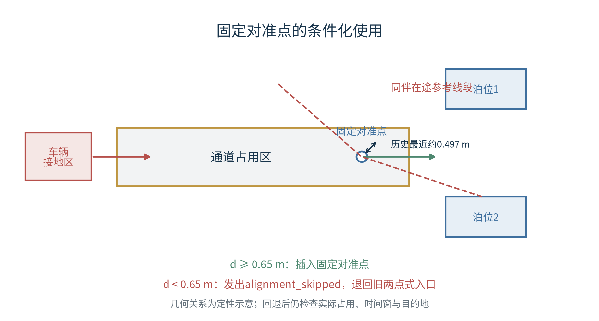

**表11 通道准入与释放检查**

| 检查对象 | 通过条件 | 不满足时的处理 |
|---|---|---|
| 名义时间窗 | 申请区间没有与既有预约冲突 | 延后、重订或选择绕行 |
| 实际占用 | 通道没有未清空的实体 | 在入口外等待，不提前记录进入 |
| 入口几何 | 对准点与同伴在途移动保持安全距离 | 跳过固定对准点，退回旧两点式入口 |
| 出口与目的地 | 出口方向和目的地区域可以接收 | 暂缓进入或调整目的地服务顺序 |

进入后，通道状态由reserved转为in_use。只有真实清空事件到达，才记录channel_cleared并重算有效释放时刻。名义窗的剩余部分随后可被后续合法预约使用。若对准超时或目的地一直占用，预约可以取消或重订，不能把等待时间隐藏成执行器已经通过。

入口对准的设计来自一次实跑。历史回合fs-hold-long-ind-01中，B2已经取得通道授权，却长期无法进入，持有通道约101.5 s。真值轨迹显示，车辆在约74 s内只移动0.24 m。这个现象把排查范围收窄到入口附近：如果问题主要发生在通道中段，就不会表现为车辆在入口长期小幅移动。结合入口动作检查，旧式“斜移加转向”在东口几何下难以完成进入。

在历史同卡对照中，增加东口对准点后，B2通道占用由约101.5 s降至23.6 s。对准点改变后的进入情况支持该场景继续采用入口调整，当时还有其他配置变化。

对准点随后暴露了一个几何冲突。队友换乘路径与固定对准区域相交，最近距离约0.497 m。在特定对抗场景中，还出现入口目标格被判为lethal cost的情况。简单保留固定对准点会把一个入口问题换成队友路径冲突，完全撤销又会回到原来的斜移转向问题。最终代码因此保留两条执行路径：几何检查通过时使用对准点，不通过时退回旧两点式入口。

**表12 入口设计案例的推理链**

| 阶段 | 观察或检查 | 对设计的影响 |
|---|---|---|
| 授权后仍无法进入 | 持有通道约101.5 s。约74 s仅移动0.24 m | 重点检查入口运动，而非继续延长名义时间窗 |
| 增加固定对准点 | 历史同卡对照中占用约23.6 s | 保留对准动作作为可行入口方案 |
| 发现队友路径冲突 | 对准点与换乘线段最近约0.497 m | 固定对准点不能无条件使用 |
| 最终条件化实现 | 0.65 m检查。失败时发出跳过事件并回退 | 同时保留改善动作与安全退路 |

这些数据来自该组 Gazebo 入口对照，说明对准条件为何需要单独检查。八实体 Webots 场景按本章的车体包络核对通行。

这项设计保留了问题形成过程里的两个经验：对准动作有助于入口收敛，固定点又可能成为别人的障碍。条件化使用比单纯增加一个路径点更符合实际协同关系。0.65 m 阈值的判定对象、历史距离簇和回退事件见附录 C，它只针对冻结几何成立，不构成任意场景下的安全距离证明。

## 3.3 报告时效和岗位确认

协同从可使用的信息开始。每条报告包含来源、内容、采样时刻、有效期和消息编号。接收方以报告实际到达时的仿真时间判断其是否仍在6秒有效期内。发送时刻仍在窗口内而送达时已经过期的报告，不进入服务决策。Gazebo 归档整场同时记录queued、delivered、failed和pending，避免把队列中的消息算作队友已经收到。

岗位状态用于把承诺、移动、服务和退出分开。PROPOSED表示服务提议已经生成，CONFIRMED表示双方确认同一承诺，MOVING表示服务者正在前往岗位，READY表示已经到达并等待激活条件，ACTIVE表示服务正在执行，RELEASED表示承诺已经退出。状态转换需要配套事件，不由画面中的距离远近推断。

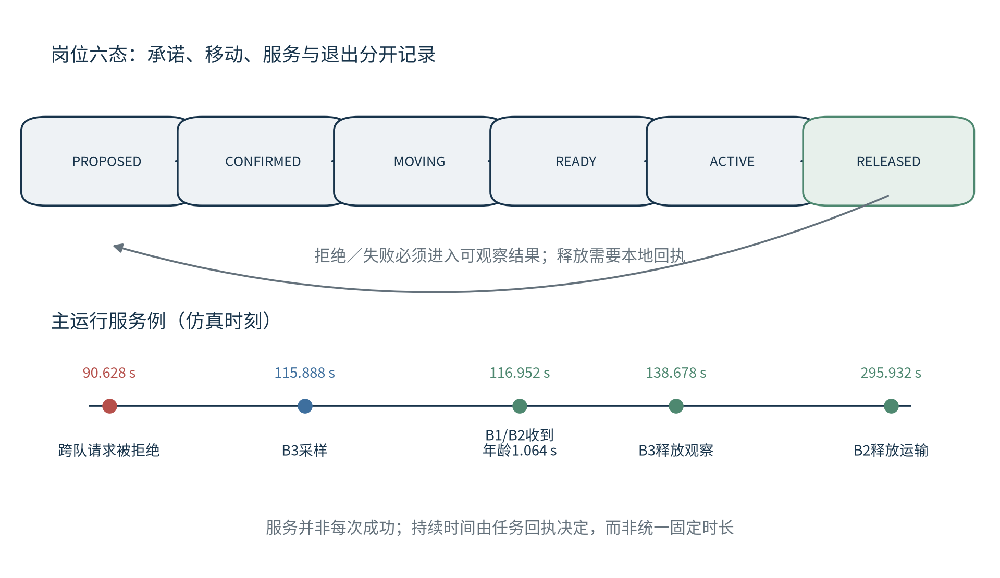

一次完整服务经历请求、提议、确认和激活四个阶段。请求者给出所需服务及理由，候选服务者计算自身代价并报价，双方对同一proposal_id确认后，服务才进入激活。激活还需要满足到位、报告有效等条件。完成后记录released，使车辆能够回到后续本职任务。

Gazebo 归档整场中的蓝方换乘服务可以说明这一区别。B3在115.888 s采样报告，B1和B2于116.952 s收到，报告年龄为1.064 s。服务边在接收且有效时激活，而不是在采样时刻提前生效。另有跨越蓝红队伍的服务请求在90.628 s被拒绝，原因是当前任务模式不提供跨队服务。这类拒绝也保留在记录中，防止把所有协商都写成必然成功。

Webots 的整场控制把报告规则放到 B2 的放行条件里。等待、拒收旧帧、重新采样和获得有效帧四步都有事件时间。报告刚采集时反映的是过去一个时刻的画面，其有效期应由接收方核对。补采完成后，还要检查通道空闲以及任务已释放。Gazebo 中的岗位确认解决的是分工承诺能否履行，Webots 中的新鲜帧确认解决的是 B2 本次是否可以开走。

## 3.4 候选方案在什么时候被排除

任务分配研究通常同时考虑任务收益、执行代价和资源约束[12]。Khamis等综述了多机器人任务分配的主要方法[13]，Chakraa等进一步讨论了优化目标与求解技术[14]。本设计没有对所有实体和任务做全排列，而是先根据任务图、状态和资源生成有限候选，再在候选集内比较。

Gazebo 与离散模型中的candidate_rows()把一次决策拆成四个维度，并做笛卡尔积：

**表13 有限候选的组成**

| 维度 | 可选值 | 决策含义 |
|---|---|---|
| 运输分工 | single / split | 一车独立完成，或两车分担运输与交接 |
| 观察支援 | fixed / air | 使用地面固定观察岗位，或使用空中观察 |
| 路线 | channel / bypass | 使用共享通道，或选择外侧绕行 |
| 信息方式 | refresh / self / carry / wait | 刷新报告、自身观察、携带信息或安全等待 |

四个维度产生 32 个待检查组合。每次决策会根据当前状态过滤。预测阶段会检查队友位置与可用承诺、报告新鲜度、空中巡检承诺、观察与通信路线，以及通道时隙。缺少所需能力或承诺、信息已经过期、路线与当前协议不相容的候选会被过滤。wait只在固定观察支援加单车运输时作为安全等待保留，在线重规划下也不把它伪装成与确定预测完全等价的普通路线。

我先检查当前平台能否提供候选所需的能力，再看任务是否有足够时间。比如用两车交接，需要第二辆车空闲、交接点可用、双方到达窗口相容。选择中央路线需要有效预约，选择绕行需要核对同一条任务期限。过滤后的方案按按期交付、新增工作量和交接空档比较，准备执行的方案还要等双方确认。

## 3.5 仿生分工与军蚁活桥

我在选择协同规则时参考了四类群体行为。自然群体靠局部观察、岗位响应和信息传递形成整体动作，这些思路可以转化为工程上的具体判断。下表同时交代每个参考在本项目用到了哪一步。

**表14 仿生现象与本设计的关系**

| 理论或现象 | 从中得到的设计思路 | 在本项目中的体现 |
| --- | --- | --- |
| Reynolds 的分离、对齐、聚合规则 [7] | 用局部信息维持群体间距与方向秩序 | 取局部间距的思路处理窄口，两车让行仍由通道占用判断 |
| 军蚁活桥的成本收益折中 [6] | 有个体停下为队伍服务时，它原有工作的时间也要计入 | 在离散任务算例中估算中继岗位的机会成本 |
| 社会性昆虫的响应阈值与分工 [8] | 根据任务刺激和原岗位负担决定是否响应 | 作为岗位候选和响应阈值的设计参考 |
| 少数知情个体引导群体运动 [9] | 专门观察的个体可把少量有时间意义的信息传给行动者 | B3 提供带时刻的观察，B2 据此等待或出发 |

军蚁活桥给了我最直接的启发。一辆车暂时做中继，可能使另一辆车早些交付，这时仍要问中继车原来的工作会不会被耽误。为此我做了一个离散任务算例。比较方案时先看按期任务数，再看总逾期量，其后才比较车辆活跃工作时间与任务完成时刻。这个优先顺序把“做完几件事”和“做这些事花了多少车时”分开了。

例如一张任务卡给 R1 的期限为 50 s，给提供帮助的车辆的期限为 37 s。帮助后，R1 从 42 s 提前到 34 s，提供帮助的车辆仍在 37 s 完成，但合计工作时间由 32 s 增至 34 s。当 R1 已能按期时，节省出来的时间是否值得调车，要看项目对车时的要求。当 R1 的期限压到 34 s 时，帮助能够改变按期任务数，所以两种计分规则均选择帮助。两种计分规则在 12 组条件下各运行一次，其中 2 组的岗位选择发生变化。这个结果说明岗位互助的价值取决于任务还有多少时间可用。

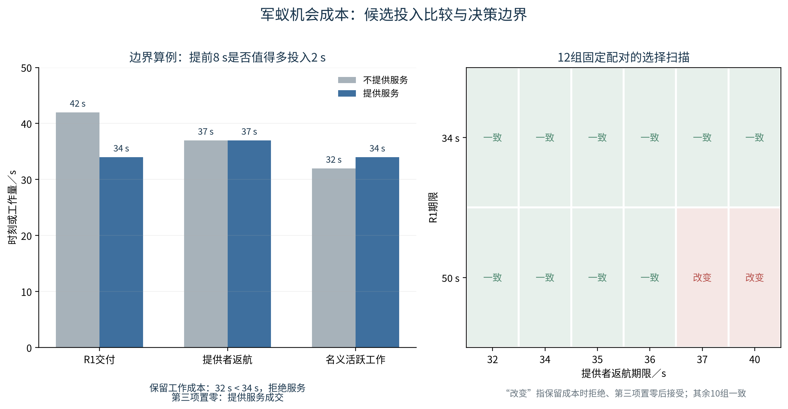

## 3.6 算一次提供支援与保留岗位的取舍

把军蚁活桥的启发落实到计算时，首先要弄清主任务与支援任务谁更紧。这里用一个效用向量 U = (按期任务数，−总逾期，−名义活跃工作时间，−完成时刻和)。比较时遇到第一项不同就定先后。R1 期限 50 s、提供者返航期限 37 s 时，不支援的向量是 (2, 0, −32, −79)，支援是 (2, 0, −34, −71)，时间在此统一为秒。两者都按期，先比较活跃工作时间，因此保留岗位。去掉活跃工作这一项后，选择完成时刻和更小的支援方案。

该算例在固定图模型经过12组、24次配对运行复核，只有第三项活跃工作成本被置零，其余预测、期限门、通信和实际验收保持不变。两处选择变化发生在R1期限50 s、提供者返航期限37 s和40 s，另外10组选择一致。

**表15 R1期限50 s、提供者返航37 s时的实际运行结果**

| 成本处理 | R1交付/s | 蓝方1批/s | 蓝方2批/s | 提供者返航/s | 报价结果 |
|---|---|---|---|---|---|
| 保留活跃工作成本 | 42 | 53 | 61 | 37 | 拒绝 |
| 第三项置零 | 34 | 43 | 53 | 37 | 接受并完成 |

保留成本时，不提供服务使R1较晚交付，蓝方后续两批也相应较晚。置零后成交，R1与蓝方交付都提前，而提供者返航仍为37 s。该结果把仿生启发、效用排序和实际选择连了起来，但仍是固定确定性图模型算例。该结果用于解释岗位规则。

当R1期限收紧到34 s时，两种成本处理都接受服务，实际R1交付34 s、蓝方两批43 s和53 s、提供者返航37 s。原因是独立方案的42 s会造成8 s逾期，第一优先级已经改变。机制因此具有明确的条件性：既不会因额外2 s工作一概拒绝，也不会因R1能提前就一概接受。

## 3.7 任务协调的接口与分工

Gazebo 归档整场把8个实体分别放入独立进程。每个进程维护本机任务、候选、消息副本和状态机，通过multiprocessing.Pipe与任务站、入口服务站及其他实体交换请求。该实现让消息路由、进程状态和跨进程调用次数可以直接记录，也比单进程共享对象更接近多机器人软件的组织方式。

fp124-ent-ind-01共记录17708次跨进程请求。任务站和入口服务站仍承担共享资源管理，因而系统具有中心化的资源仲裁点。真值位姿也由仿真环境统一提供。每实体独立进程证明了状态与通信可以按实体拆分，但不证明完全分布式、无中心或全局强一致。

这一实现还带来额外工程约束。请求必须带唯一编号，重复发送不能直接造成二次占用。进程退出时需要释放管道和子进程。回执中的仿真时刻要与接收方时间基准一致。当前版本具备消息去重、失败与重试记录，但真实无线信道、随机丢包和长时间网络分区尚未在在线整机中系统验证。

Webots 主场景采用统一调度和裁判记录，每个机器人通过控制接口执行自身动作。这样安排便于将同一任务状态与真实车体几何对在一起。分散运动控制能各自处理传感变化，统一的通道授权能避免两个入口同时将对方判断为空闲。Gazebo 的独立进程与 Webots 的统一裁判都体现出对共享资源负责的接口。

# 4 Webots 整场与专项实验

## 4.1 同一任务卡的试验设计

按照地面车辆课程中“建模、编程、仿真”的过程 [2,5]，我先设置场地、通道和各任务点，再做带差速轮、传感器和碰撞体的地面车。建模时实际车体的尺寸直接影响通道宽度、对准点和停车点。各实体运行自己的运动控制，裁判定期读场景位置、记录事件，连续运行 400 s，据任务卡检查结果。轨迹以约 0.5 s 的间隔保存供复核，通道占用按仿真步长判断。

我安排了三类比较。正常回合检查从启动到结束能否闭合。首份观察延迟回合保持场地和任务卡，只增加这一条观察的传递时间，检查等待和补采。侦察车起点变化回合保持规则和运输任务，检查调整两个侦察起点后是否仍能执行。正常设置还重新启动两次，主要用来观察重复跑完时有没有遗漏任务或通道重叠。

整场回合用固定分母核对完成数和按期数。缺失的任务留在分母里，超期任务有自己的完成时间。通道冲突按仿真中的同时占用检查。表中的零表示该窗口没有记录到车体包络重叠，接触或避障表现需看各自记录。两架无人机在整场采用航点运动学，单独的多旋翼模型承担控制验证。关闭回执把这一分工写进 `motion_backend=hybrid` 与 `kinematic_actors=["B3","R5"]`：六辆地面车由电机驱动，两架飞机留在运动学层，因为本后端没有旋翼动力学。整机的物理实跑因此指六台地面底盘及其传感、到位与通道几何，空中部分的反馈闭环由第 2.8 节的单机实验补充，两者不互相冒充。

## 4.2 正常回合与起点变动

三组试验均使用同样的实体、任务和通道判断方法。主回合按正常速度投递观察。延迟回合只改变 B3 首份发车观察的传递时间。第三组改变 R3、R4 的起点，查看侦察车辆的路线变化后全队是否仍能完成任务。另在同一正常设置下重新启动两次，均为 14 项按期、无通道占用重叠。

**表16 Webots 完整回合结果**

| 条件 | 完成任务 | 按期任务 | 通道进入 / 清空 | 通道占用重叠 |
| --- | ---: | ---: | ---: | ---: |
| 正常观察 | 14/14 | 14/14 | 5/5 | 0 |
| 首份观察延迟 | 14/14 | 14/14 | 5/5 | 0 |
| 两辆侦察车起点变化 | 14/14 | 14/14 | 5/5 | 0 |

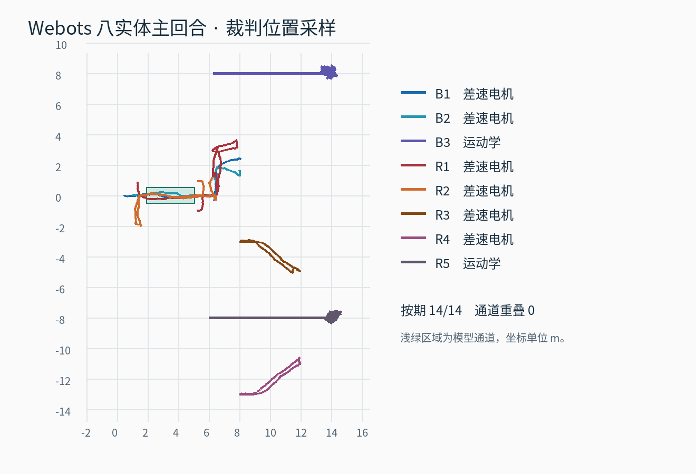

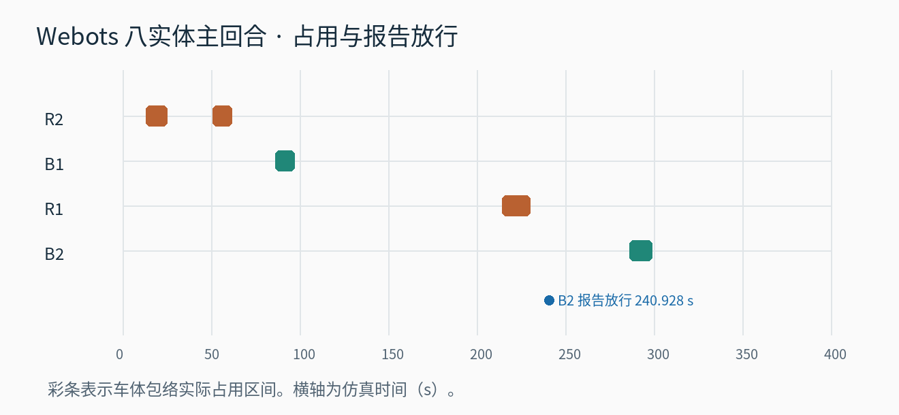

轨迹图显示地面车辆的运输和侦察路线，以及两架无人机的巡察路线。占用图记录的五段车辆占用区间均有结束事件，结束时车体包络已退出保护区域。R2 先从东端穿过通道去装货，再返回东端交付，另外三辆运输车各通过一次，通行数和交付批次分别统计。下表列出四次运输交付。四项运输中余量最小的 R1，正常回合还有约 10.6 s 余量，入口偏移或重复停车会直接消耗这段时间。

**表17 正常回合的四次运输交付（仿真时间）**

| 交付 | 完成时刻 / s | 任务期限 / s | 余量 / s |
| --- | ---: | ---: | ---: |
| 红方第二批 R2 | 80.1 | 100 | 19.9 |
| 蓝方第一批 B1 | 125.4 | 350 | 224.6 |
| 红方第一批 R1 | 239.4 | 250 | 10.6 |
| 蓝方第二批 B2 | 306.1 | 350 | 43.9 |

**表18 正常回合五次车体占用**

| 实体 | 进入 / s | 清空 / s | 持续 / s |
| --- | --- | --- | --- |
| R2 | 13.088 | 25.312 | 12.224 |
| R2 | 50.912 | 61.760 | 10.848 |
| B1 | 86.416 | 96.944 | 10.528 |
| R1 | 214.528 | 230.256 | 15.728 |
| B2 | 286.320 | 298.880 | 12.560 |

这五个区间按进入顺序排列。R2 为取货和返程两次使用通道，其他三台运输车各一次。两段之间的空档还包括装载、任务释放、其他车在入口外对准或等待观察。空档时长本身不能直接归为纯排队，分析某个任务为什么晚，需要顺着它自己的事件链检查。

## 4.3 延迟观察从接收到交付的传递

为了检验时间戳是否真的影响调度，我只把首份观察的传递设定从 1.0 s 增至 7.3 s。在正常回合，B2 约在 240.9 s 得到有效观察并发车。延迟回合里的首份观察约在 247.2 s 到达，已经超出 6 s 的有效期。系统重新请求一帧，在约 249.0 s 收到有效观察后放行。由此发车晚了约 8.1 s，第二批交付从约 306.1 s 变为 314.2 s，仍早于 350 s 的期限。

**表19 蓝方第二批运输的观察时效对照**

| 首份观察传递设定 / s | 首份为有效观察 | 有效观察放行 / s | 交付 / s |
| --- | --- | ---: | ---: |
| 1.0 | 是 | 240.9 | 306.1 |
| 7.3 | 否，重新采样 | 249.0 | 314.2 |

两组的运输路线相同，B2 从有效放行至交付的用时约为 65.2 s，因此这次交付差异主要来自起步前的等待。我用这组对照确认，飞机传来的时间信息参与了地面车辆的出发判断，过期观察使车等待，重新取帧又使车继续执行。它也展示了预先给定的任务路线怎样结合在线信息调整执行时刻。

## 4.4 拒收后等待与请求补采

正常与延迟的对照告诉我，时间戳确实影响发车。还有一个问题：既然过期不能放行，继续等待和主动补采有什么区别？为此保持首份观察延迟为 7.3 s，分别尝试“拒收后继续等”和“拒收后请求新帧”。两组在约 247.2 s 收到了同一次采样的过期观察，车辆都保持等待。

**表20 同一延迟下，过期之后两种做法的结果**

| 处理 | B2 的后续行动 | 按期任务 | 通道占用重叠 |
| --- | --- | ---: | ---: |
| 拒收后等待 | 没有新的放行，第二批在 400 s 窗口内未交付 | 13/14 | 0 |
| 拒收后补采 | 约 249.0 s 发车，约 314.2 s 交付 | 14/14 | 0 |

这组对照是我保留补采的依据。第一种做法守住了时效要求，第二种在相同的时效要求下还恢复了运输。补采是否能挽回任务仍取决于期限余量，这张任务卡给 B2 留的交付期限是 350 s。

## 4.5 单独切换通道放行规则

**表21 Webots 两车场景的放行对照**

| 放行条件 | B1 清空 / s | B2 放行 / s | B2 进入 / s | B2 清空 |
| --- | --- | --- | --- | --- |
| 清空且等到固定时间 | 7.888 | 32.000 | 34.784 | 60 s 时未清空 |
| 确认前车清空即可放行 | 7.888 | 7.888 | 10.320 | 17.584 s |

两辆车、运动控制、路线和运行窗口相同。两组都须确认前车的车体完整驶出，固定时间组还须等到 32 s。按实时清空放行在本对照中少等 24.112 s。固定时间组到窗口末端仍未清空，因此只比较可直接观察的放行与进场时刻。两组各一轮，说明机制如何工作。

## 4.6 单车实验怎样支持整场设计

**表22 单车物理轨迹与服务到位**

| 布局 | 全局搜索 | 实际轨迹 / m | 到位 / s | 记录违例 |
| --- | --- | --- | --- | --- |
| 窄入口 | astar | 6.522 | 17.568 | 0 |
| 窄入口 | dijkstra | 6.589 | 19.056 | 0 |
| 开阔 | astar | 6.509 | 19.920 | 0 |
| 开阔 | dijkstra | 6.509 | 19.920 | 0 |

栅格规划和实际轨迹同用米作单位，但测得的是不同对象。规划长度是离散格网最短路。执行前的可见性简化会删掉多余的中间点，车辆随后依照实际姿态和几何条件跟踪这些点。表中的实际长度由裁判轨迹计算。单车试验回答路线能否执行，整场试验再检查进入顺序、信息等待与任务期限。

# 5 Gazebo 归档与协同机制对照

## 5.1 完整回合能说明哪些事

Gazebo 八实体归档回合在启动后接入8个实体进程，6辆地面车均完成AMCL定位、地图到车体坐标关系建立、导航启动和动作就绪。回合正常到达任务窗口末端，未收到外部停止信号。

**表23 Gazebo 归档整场的主要指标**

| 指标 | 结果 | 记录位置 |
|---|---|---|
| 实体与进程 | 8个实体，每实体一个进程 | 运行摘要.json与result_launch/live_run.json |
| 跨进程请求 | 17708次 | 运行摘要.json |
| 墙钟时间 | 1054.873 s | 运行摘要.json与shutdown.json |
| 任务完成 | 14/14按期 | result/metrics.json |
| 约束违例 | 0条记录 | constraint_violations |
| 消息状态 | queued 1065，delivered 934，failed 101，pending 30 | mission.messages |
| 岗位状态 | PROPOSED、CONFIRMED、MOVING、READY、ACTIVE、RELEASED各2次 | role_state_counts |
| 通道持有记录 | 5次，均有持有起点、释放时刻和提前释放 | events.jsonl |

任务时间图给出14项任务的完成时刻和期限。红方巡察在3.480 s完成，期限10 s。R4返场在118.352 s完成，期限130 s。红方返场在163.966 s完成，期限180 s。红方1批交付在186.894 s完成，期限250 s。蓝方两批交付分别在243.432 s和295.878 s完成，期限均为350 s。

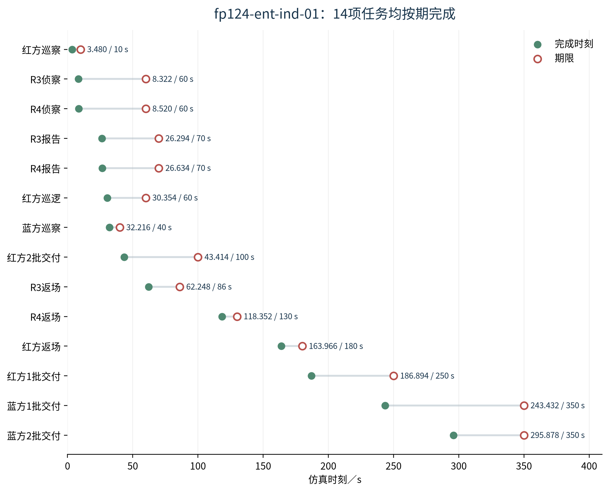

14/14说明这一回合的任务卡全部通过验收，但不代表每个协同请求都成功。记录中有跨队服务被拒绝、消息失败和结束时的待处理消息。delivered 934与queued 1065之差也不能简单解释为永久丢失，因为failed和pending分别描述了不同状态。报告不使用未经逐条消息追踪的“通信成功率”。

这一回合的主要作用是说明任务分配、独立实体进程、报告与通道预约确实共同运行过。收发消息的队列状态应按协议语义读。安排的消息可以还在排队，已经失败的消息也要按失败记录保存。交付通过任务卡验收，与每次局部请求都成交是两件事。

## 5.2 原生画面与一次完整执行事件

统计图可以说明任务何时完成，却不能单独展示场地、实体和实际运动。历史材料因此保留一张Gazebo原生俯瞰和一张phase46真值轨迹。场景图来自历史独立回合第二批交付事件触发后的原生截图，该回合14/14按期。截图滞后于事件，不能从中读取精确交付时刻。

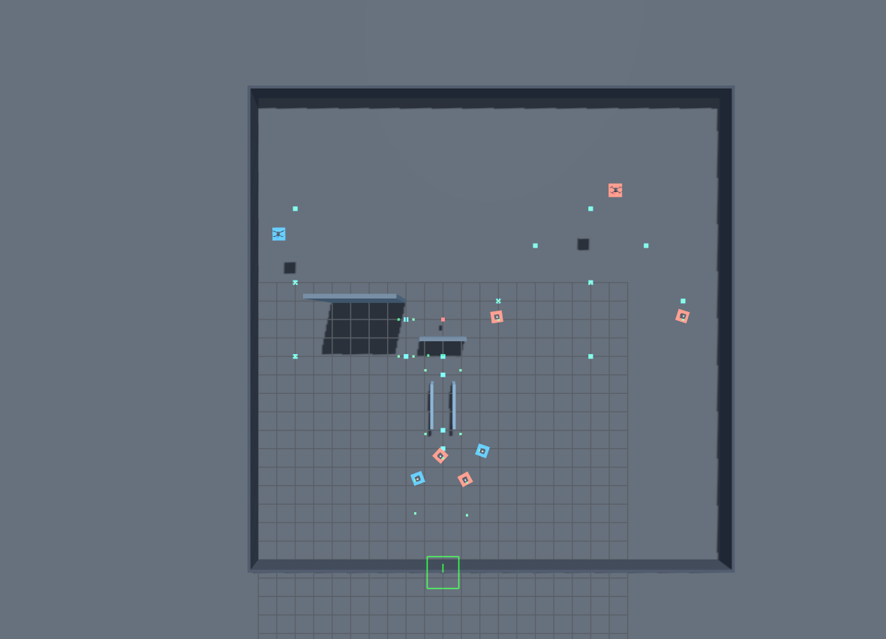

轨迹图来自phase46六辆地面车的真值轨迹。B1、B2、R1、R2在中央运输区活动，R3位于北侧，R4位于南侧。轨迹与任务指标承担不同作用：前者显示车辆实际走过哪里，后者判断任务是否按期、资源是否按规则占用。

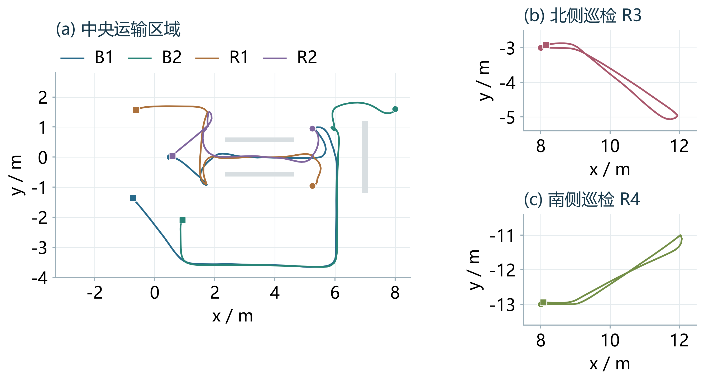

phase46还保留了一次可逐事件核对的B1通行过程。这段记录展示同一次通行从进场等待到卸载的全过程。

**表24 phase46中B1的通道通行与交付片段**

| 时刻/s | 原始事件 | 说明 |
|---|---|---|
| 9.092 | arrived W | 到达通道西侧，不等于已获授权 |
| 50.352 | channel_enter W→E | 通道持有起点，随后下发运动请求 |
| 89.092 | channel_cleared E / arrived E | 到达验收并释放资源，即释放时刻 |
| 181.280 | arrived D | 到达目的地，与跨口完成是不同事件 |
| 183.460 | delivery / unload_completed | 任务验收完成，晚于单纯导航到达 |

表中时刻取自随包 02_关键结果/phase46_完整回合/events.jsonl，按 t_ms/1000 换算。

## 5.3 通道持有起点、释放和任务交付

下面的时间图把channel_enter、channel_cleared和channel_release_recomputed三类事件放在同一时间轴上。channel_enter在通道资源被持有时记录，随后才下发运动请求，因此它对应持有起点而非车辆实际驶入的瞬间。channel_cleared在到达验收、释放资源时记录，对应释放时刻。深色段是两次记录之间的持有时长，浅色段是名义时间窗内因提前清空而释放的部分。

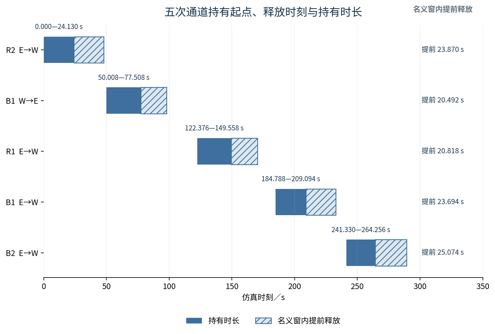

**表25 五次通道持有起点、释放时刻与持有时长**

| 实体与方向 | 持有起点/s | 释放时刻/s | 持有时长/s | 名义窗内提前释放/s |
|---|---|---|---|---|
| R2，E→W | 0.000 | 24.130 | 24.130 | 23.870 |
| B1，W→E | 50.008 | 77.508 | 27.500 | 20.492 |
| R1，E→W | 122.376 | 149.558 | 27.182 | 20.818 |
| B1，E→W | 184.788 | 209.094 | 24.306 | 23.694 |
| B2，E→W | 241.330 | 264.256 | 22.926 | 25.074 |

五次持有时长都没有延伸到名义窗终点，提前释放量约20.492—25.074 s。这里的收益不是把车辆运动速度提高，而是让通道已经不再占用时，后续预约不必继续等待到原计划终点。它直接对应第5章的释放规则，也能从原始事件逐条复算。

## 5.4 联合准入改变了多少下游等待

为了观察联合准入与释放相关机制的影响，报告选用phase123-wslgpu下的fs-mechoff-ind-01和fs-mechon-ind-01。两轮使用同一medium_independent场景、同一P3策略、同一truth反馈与同一执行层，差别集中在GONGYU_MECH设置：对照臂使用phase111配置，实验臂使用joint。

**表26 phase123机制关/开配对结果**

| 指标 | 机制关：fs-mechoff-ind-01 | 机制开：fs-mechon-ind-01 |
|---|---|---|
| 任务完成 | 14/14按期 | 14/14按期 |
| 记录违例 | 0 | 0 |
| 服务释放 | 3/3 | 3/3 |
| 红方1批交付/s | 187.784 | 183.448 |
| 蓝方1批交付/s | 245.572 | 239.198 |
| 蓝方2批交付/s | 298.556 | 295.480 |

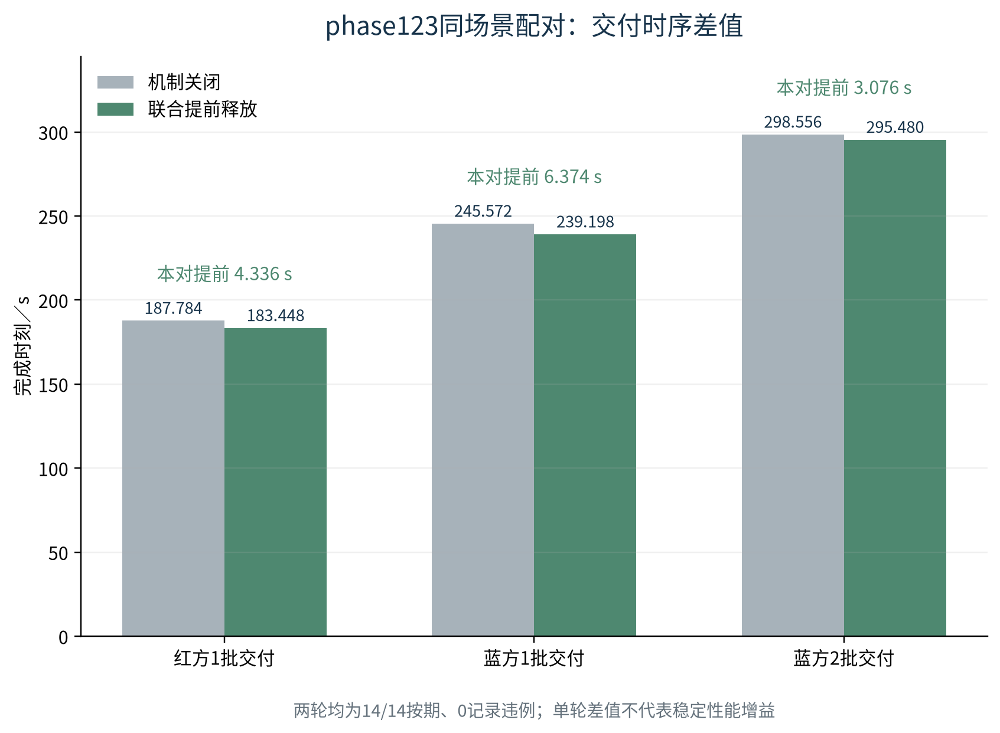

机制开启后，红方1批交付提前4.336 s，蓝方两批交付分别提前6.374 s和3.076 s。三项任务都提前，但样本只有一个配对，且joint包含多项判断，不能把差值归因于某一个单独条件。

释放量和交付提前量并不相等。机制开臂的channel_release_recomputed事件合计归还114.930 s名义余量，机制关臂没有这类重算事件。可是B2的通道持有起点只由243.466 s提前到236.854 s，蓝方2批交付又只提前3.076 s。

**表27 从名义释放到最终交付的分层核对**

| 层次 | 机制关 | 机制开 | 本对差值 |
|---|---|---|---|
| 重算释放的名义余量合计/s | 0 | 114.930 | +114.930 |
| B2通道持有起点/s | 243.466 | 236.854 | 提前6.612 |
| 蓝方2批交付时刻/s | 298.556 | 295.480 | 提前3.076 |

114.930 s是多次、多个占用窗口的剩余时间之和，不是某一辆后车可以完整独占的一段连续时间。通道资源变得可用后，后车仍要满足目的地到达区互斥。两臂事件流都出现physical_arrival_held，原因均为teammate holds the D arrival region。机制开臂中，B2在进入前仍有因B1持有D到达区而等待的记录。因此，局部释放先改变可预约时间，再影响实际进场，最后才可能转化为交付提前，中间还受目的地占用与后续运动约束。

这个例子说明“资源已经释放”和“后车实际用上资源”是两个判断。若只把释放秒数相加就宣称交付应提前同样多的时间，会漏掉下游瓶颈。当前配对仍不足以估计稳定收益，但它能够解释收益为什么在传递过程中被消耗。

## 5.5 中绕行与长绕行的对照范围

早期 Gazebo 分别在中绕行和长绕行场景比较独立和竞争两种任务组织方式。每一对使用本组同一场景、源码和选择规则，四轮均跑完 400 s。中绕行组的蓝方第二批交付由 294.766 s 变为 328.540 s，晚 33.774 s。长绕行组由 297.726 s 变为 296.066 s，早 1.660 s。两对均完成 14 项按期任务，记录违例为 0。

**表28 历史 Gazebo 两张场景卡内的比较**

| 场景 | 独立组织 B2交付 / s | 竞争组织 B2交付 / s | 同卡差值 / s |
| --- | --- | --- | --- |
| 中绕行 | 294.766 | 328.540 | +33.774 |
| 长绕行 | 297.726 | 296.066 | −1.660 |

通道资源时间与交付时间一起看，才能解释为何这两对出现不同结果。中绕行组 B2 的资源持有起点比独立组织晚约 27.29 s，长绕行组只晚约 0.02 s。一组有明显等待，另一组的起步资源条件几乎未变。这里保留两组，是因为场景条件会显著改变这项机制的效果。

## 5.6 噪声与地图外障碍的归档对照

Gazebo 归档里还记录了激光噪声和地图外柱体的扰动结果，用来理解单车控制中的传感差异。柱体放在标称路线附近，位置为场地坐标 (0.30, −1.00) m。不同条件下检查车辆实际轨迹到该位置的最小距离。未放柱时也沿用该位置作为计算参照。

**表29 Gazebo 归档中的噪声与柱体条件**

| 场景条件 | 扫描噪声估计中位数 / m | 轨迹至柱心最小距离 / m | 恢复记录 / 次 | 按期任务 |
| --- | --- | --- | --- | --- |
| 标称 | 0.0166 | 0.123 | 10 | 13/14 |
| 提高激光噪声 | 0.0397 | 0.856 | 1 | 14/14 |
| 宽柱 | 0.0164 | 0.871 | 10 | 13/14 |
| 窄柱 | 0.0183 | 0.845 | 2 | 14/14 |

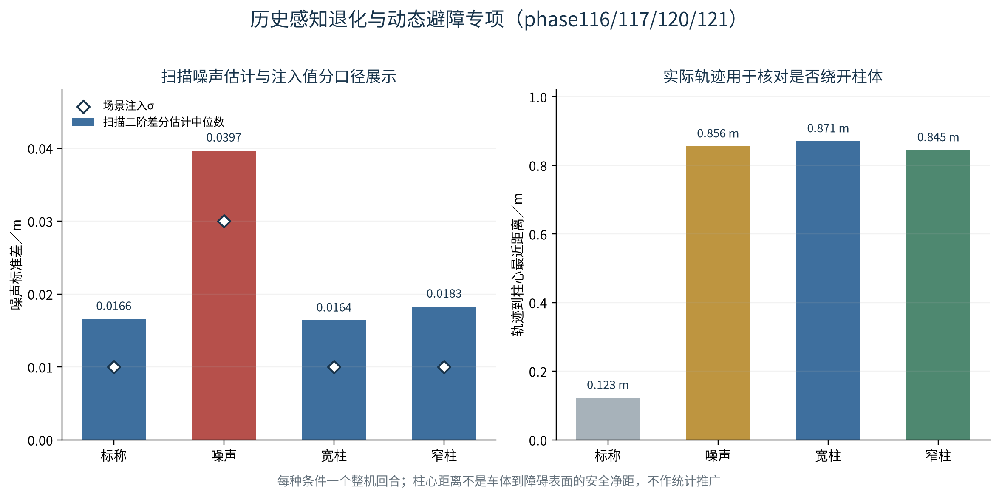

噪声设定由 0.01 m 增至 0.03 m 时，扫描估计中位数约增至 2.39 倍。加入两种柱体时，轨迹与柱心的最小距离均高于标称结果。该距离从车体参考点量起，用来辨认走行变化。每个条件有一个归档整场，参数配置也有差异，恢复次数和总任务结果只按记录描述。数值来自原始归档的扩充专项与复算记录。Webots 单车低箱测试独立回答是否触发保护停车。

# 6 离散模型的补充验证

## 6.1 报价、请求和总消息分别计数

整场只记录本回合发生的消息。这里再比较两种报价触发方式。历史图模型为此做过一组协议对照：广告式协议由地面中继车持续报价，按需询问则先由请求方发出需求，再由中继车决定是否应答。两组使用相同的三个场景，各跑1回合，意愿计算不变，只改变报价由谁触发。这组结果来自可单独运行的图模型扩展。

**表30 广告式协议与按需询问的图模型对照**

| 指标 | 广告式协议 | 按需询问 | 读法 |
|---|---:|---:|---|
| 运行构成 | 3场景×1回合 | 3场景×1回合 | 样本很小，只作机制对照 |
| 回执定义的按期率 | 1.0 | 1.0 | 本组对照中未下降 |
| 平均每回合报价/条 | 13.67 | 2.67 | 平均少11条报价 |
| 平均每回合中继请求/条 | 14.00 | 14.67 | 请求并未同步减少 |
| 覆盖失败/次 | 1 | 1 | 报价减少不等于覆盖已经完备 |
| 记录违例 | 0 | 0 | 两组均未记录约束违例 |

最直观的结果是平均报价从13.67条降至2.67条，而回执定义的按期率保持1.0。它说明持续广告中存在可以省略的报价：请求方尚未形成需求时，中继车反复报告“我能服务”并不会直接推动任务。按需询问把通信触发条件改为实际需求，信息更接近当前决策，因而用更少的报价完成了相同场景。

但“平均少11条报价”不能进一步写成“全网消息一定少11条”。逐场景回执中，三个场景的报价节省量分别为4、26和3条，按期率变化均为0。总排队消息变化却分别为-4、-26和+82条。受损链路场景里，报价虽然减少，重试、请求和其他协议消息仍可能增加。报价数、请求数和全网排队消息数是三个口径，不能把其中一项下降直接当成通信开销按同一比例下降。

两组仍各有一次覆盖失败，也说明按需询问不是把服务问题彻底解决了。它减少的是无需求时的广告，不会自动增加可用服务者，也不会让过期报告重新有效。若当前区域没有能按时到达的中继车，改变通信触发方式仍然无法完成服务。这一负结果与主运行中跨队请求被拒绝的记录相呼应：协议组织与任务可行性必须分别检查。

在按需询问之上，旧稿还实现了可关闭的响应阈值层。刺激量定义为请求方期限已经用去的比例，随relay_offer_request一起发出。中继车只在刺激不低于自身阈值时报价。服务成功后阈值下调0.15，拒绝对上调0.10，并限制在0.05—0.95之间。设计意图是让愿意服务的中继车逐渐更积极，让持续拒绝的中继车减少无效应答，但实际结果暴露了明显的筛选风险。

固定阈值扫描取五档组合、三个场景，共15回合。阈值为(0.05,0.05)、(0.30,0.70)、(0.50,0.50)和(0.70,0.70)时，平均报价均为2.67条，按期率均为1.0。阈值提高到(0.90,0.90)后，平均报价降为0，6次拒绝，按期率降至0.8788。提供者平均返航时刻由94.8 s提前到83.3 s，却只能说明中继车更早回到本职任务，不能据此判定全队效果更好，因为请求方失去了原本可以获得的支援。

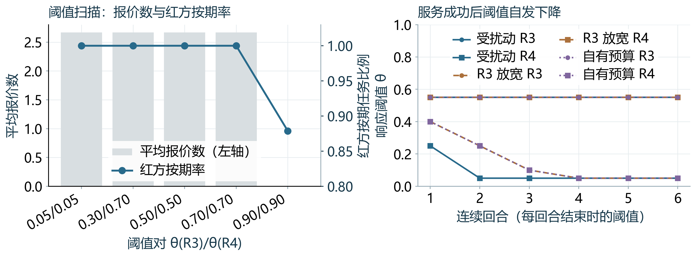

曲线之所以呈台阶而不是缓慢变化，可以从实际刺激值看出。到达决策环节的观测值只有0.7167、0.7317、0.7633和0.765，集中在约0.72—0.77的窄带内。阈值不超过0.70时，这些请求都会被应答。阈值升到0.90时，又全部被拒绝。因此，0.05到0.70之间的结果几乎没有变化，并不是阈值机制普遍稳定，而是扫描点之间没有新的决策刺激穿过阈值。

这组实验最终没有支持“阈值越高越能节省通信”的简单结论。按需询问减少的是冗余广告，阈值过滤减少的却可能是真正需要回答的请求，两者不是同一件事。对于当前课程系统，保留按需询问的组织思路更有价值。阈值层只适合作为扩展分析，且候选池仅有两台中继车、每档只有三个场景，不能据此给出通用阈值推荐，更不能把图模型报价数写成真实无线电带宽占用。

## 6.2 新增实体和增加资源争用

规模实验要区分两个问题：实体数量增加本身是否改变任务结果，以及新增实体是否争用原有共享资源。如果只增加实体名而不增加资源竞争，任务不变并不能证明系统具有良好扩展性。反之，如果争用加剧，也不能不经检查就把退化归因于单体决策器。本节因此设置了“新增单元停在整备节点”和“新增单元共同争用同一东西向通道”两种条件，N从6增至10，均为图模型结果。

**表31 两种规模扩展方式的任务结果**

| 实体数N | 整备节点：蓝方按期 | 整备节点：红方按期 | 争用通道：蓝方按期 | 争用通道：红方按期 | 争用条件槽位市场事件/条 |
|---:|---:|---:|---:|---:|---:|
| 6 | 3/3 | 5/5 | 3/3 | 5/5 | 9 |
| 7 | 3/3 | 5/5 | 3/3 | 4/5 | 0 |
| 8 | 3/3 | 5/5 | 2/3 | 4/5 | 0 |
| 9 | 3/3 | 5/5 | 1/3 | 4/5 | 0 |
| 10 | 3/3 | 5/5 | 1/3 | 4/5 | 0 |

新增单元停在整备节点时，蓝红按期数始终不变，所有条件的记录违例均为 0，消息与事件处理量随规模增加。M2整备条件的排队消息由N=6时的138条增至N=10时的174条，事件由492条增至568条，分别增加36条和76条。也就是说，“结果不变”只说明新增单元没有进入关键资源路径，并不说明运行记录和通信处理没有增长。

让新增单元争用同一通道后，结果明显不同。红方从N=7起由5/5降为4/5，蓝方从N=8起由3/3降为2/3，N=9和10进一步降为1/3。槽位市场事件则由N=6的9条变为后续条件的0条。退化不是蓝红同步发生的，红方先下降、蓝方后下降，说明不能只按N拟合一条统一曲线。通道容量为1，新增实体又依赖同一套预约与协商过程，任务结果首先受资源及其协议约束，而不是简单的“车多了，每辆车就变笨了”。

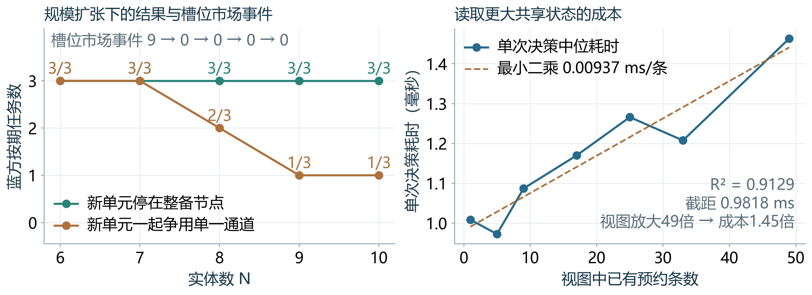

争用条件的排队消息为138、117、154、187和198条，N=7反而低于N=6。这个非单调点不应被抹平：消息数量同时受服务请求、失败、重试和合约状态影响，不能把它当成实体数的固定线性函数。与此相对，整备条件每增加一个单元，消息和事件呈稳定增加，因为新增单元只带来状态维护而没有改变任务选择。两种曲线放在一起，才把“规模带来的记录开销”和“争用带来的任务退化”分开。

决策成本另有独立微基准。实验向一份真实视图填充1、5、9、17、25、33和49条合成预约，每个规模重复60次，候选数始终为32。单次决策耗时中位数由1条预约时的1.0085 ms变为49条时的1.4631 ms，视图扩大49倍，成本约为1.45倍。最小二乘拟合斜率为0.00937 ms/条、截距0.9818 ms、R²=0.9129。

## 6.3 入口等待与通信时延敏感性

从两队任务的时间安排可以看到，延迟的影响取决于尚有多少时间余量。我保留原图模型里单卡单参数的两组扫描。第一组只把入口间隔从 0 逐档增加到 10 s，第二组只把消息时延从 0.2 s 逐档增加到 4 s。这里同一张卡上的蓝方分母为 3、红方为 5，和整场 Webots 的 14 项任务定义不同。

**表32 通道入口间隔强度扫描**

| 参数/ms | 蓝方按期 | 红方按期 | 合约决策/次 | 失败消息/条 | 待处理/条 | 泊位保持/次 |
|---|---|---|---|---|---|---|
| 0 | 3/3 | 5/5 | 2 | 38 | 0 | 0 |
| 2000 | 3/3 | 5/5 | 2 | 39 | 0 | 0 |
| 4000 | 3/3 | 4/5 | 1 | 19 | 7 | 0 |
| 6000 | 3/3 | 4/5 | 1 | 13 | 7 | 0 |
| 8000 | 3/3 | 4/5 | 1 | 12 | 7 | 0 |
| 10000 | 2/3 | 4/5 | 0 | 21 | 12 | 0 |

**表33 消息时延强度扫描**

| 参数/ms | 蓝方按期 | 红方按期 | 合约决策/次 | 失败消息/条 | 待处理/条 | 泊位保持/次 |
|---|---|---|---|---|---|---|
| 200 | 3/3 | 4/5 | 2 | 13 | 8 | 1 |
| 400 | 3/3 | 4/5 | 2 | 13 | 8 | 1 |
| 1000 | 3/3 | 5/5 | 2 | 39 | 0 | 0 |
| 2000 | 3/3 | 4/5 | 0 | 16 | 6 | 0 |
| 3000 | 1/3 | 3/5 | 0 | 13 | 52 | 0 |
| 4000 | 1/3 | 2/5 | 0 | 14 | 53 | 0 |

两项扫描都可能减少按期任务。入口等待先压缩红方余量，延迟较大时才观察到蓝方档位也变化。通信时延中红方的逐档结果有回升，涉及请求、承诺和执行次序一起变化。单因素试验说明改变哪项设定产生了变化，不能从一组档位拟合通用规律。

# 7 设计复盘与结论

## 7.1 从现象找到需要修改的层

整机调试时，“车辆没有到达”只是表面现象。若一开始就修改速度或膨胀半径，可能暂时改变画面，却把真正的问题留在原处。本设计按定位、全局路径、局部控制、资源入口和任务验收五层排查，每一层都使用不同的记录，避免用一个Nav2结果解释全部故障。

第一层先检查位姿和坐标关系。AMCL需要提供可用的map—odom修正，车辆才能在同一张地图上理解目标点、代价地图和传感器扫描。如果这一层不稳定，全局路线即使在地图上正确，也可能在车体坐标下落到错误方向。此时继续调整DWB评价项没有意义，因为控制器接收到的输入本身已经不可靠。定位结果为后续规划提供共同参考，任务完成仍由验收条件判断。

第二层检查全局路径是否存在，以及它为何选择当前路线。静态障碍形成的不可进入栅格、obstacle和peer层提供的实时占据、inflation层增加的贴障代价要分别查看。如果路径贴着障碍，应先区分是实际间隙不足，还是高代价区域促使规划器选择另一条累计代价更低的路线。直接缩小膨胀半径可能让路径重新出现，却也会减少运动间隙。在窄通道里，这种处理不能代替几何测量。

第三层检查局部控制是否能在全局路线附近找到可执行轨迹。B1的DWB在10档线速度和15档角速度中采样，前向预测1.7 s，控制频率10 Hz。这些参数共同决定短时间内能看到多少候选运动。车辆原地摆动时，需要看评价项是否把姿态牵引与路径推进放在冲突位置，入口历史调试因此将PathAlign和GoalAlign归零。车辆几乎不动时，则还要检查障碍评分是否否决了大多数轨迹、加减速限制是否使候选无法执行，以及局部目标是否落在不合适的位置。上述情况都可能表现为“控制器没有输出理想速度”，但修改对象并不相同。

第四层检查资源状态和入口动作。Gazebo 入口案例最能说明分层的重要性：B2已经获得授权，所以继续延长预约并不能解决74 s只移动0.24 m的问题。真值轨迹把问题定位到入口运动后，对准点才有试验价值。后来对准点与队友换乘路径冲突，故障又从单纯运动学问题变成协同几何问题，最终解决办法是Gazebo 中的 0.65 m 检查和两点式回退，而不是继续调快车轮。这个过程也说明，授权、导航目标发布和真实跨口必须分别记录，否则无法知道车辆究竟卡在哪一层。

第五层检查任务验收。车辆到达目标邻域后，仍可能因低速保持不足、驻留未完成或服务对象被占用而没有交付。phase46片段中，B1在50.352 s开始持有通道资源、89.092 s记录清空、183.460 s记录交付完成。通道进入、离开与任务交付本来就不应合并为一个“到达时间”。如果只读取导航动作成功，可能把通道通行之后的服务过程从系统分析中删掉。

## 7.2 从失败回合到正式方案的修改链

方案不是一次写成的。第 2.1 节的姿态探针、第 3.1 节的包络判空、第 4.4 节的主动补采，都对应一次具体的失败。把这些回合按「现象—定位—修改—复验」排起来，比只报最终成绩更能说明设计依据；逐回合数值与诊断细节见附录 C。

最早的物理诊断分支里，两次八实体尝试分别只完成 11 项和 13 项任务，第二次出现五次通道占用重叠。真值轨迹把问题定位到口部：占用窗口 2.05—4.95 m 与走廊墙 1.8—5.4 m 之间留有余量，航点又落在窗口边界内侧，车停在口部时按瞬时中心位置会被反复判为占用或已清空。这不是控制律不稳，而是判据分辨率跟不上执行误差。正式主版本因此改用整个车体的包络判空和串行放行，把对准与等待放到通道外，并给驻留取消门限加迟滞、给「下了指令却不走」加机动监督与倒车脱困；六车电机、两机运动学的混合配置在 `evidence/course_final/normal` 中给出 14/14 按期、5 进 5 清、0 重叠。

信息层也有同样的一次往返。只拒收过期帧而不请求新观察时，第二批运输在 400 s 窗口内没有交付，按期数为 13/14；加入主动补采后，同一延迟条件下恢复 14/14，交付由 306.1 s 变为 314.2 s。通道层的两车对照则显示，按车体实际清空放行比等到固定 32 s 少等 24.112 s。三处修改分别落在执行器、信息与资源三层，彼此不能互相替代。

这些调整给我的主要认识是，单车动作、共享资源和任务时间需要放在一起检查。单车控制解决车怎么走，通道互斥解决车怎么让，任务窗口决定哪些等待可以接受；判据本身也要按执行器能达到的精度来定，不能按理想点位来定。早期回合的差异帮助我找到设计问题，第 4 章的正式结果则由同条件复跑确认。

## 7.3 性能、任务效能和使用效用

**表34 本次设计检验到的三个层次**

| 评价层次 | 此次设计中的问题 | 本次依据 |
| --- | --- | --- |
| 技术性能 | 地面车能否沿路线行驶、停稳、把通道完整让出？ | 传感反馈、轨迹、运输驻留记录和五次清空 |
| 任务效能 | 单车行动能否合成按时完成的队伍任务？ | 三组仿真全部 14/14 按期，过期对照显示补采恢复缺失任务 |
| 使用效用 | 在任务更多、现场条件更杂时，排序与观察流程是否仍好用？ | 本次覆盖同一场地及一组起点变化，可继续检验 |

本设计的贡献可以从三个具体问题判断。差速车执行说明定位和航向如何转成实际车轮运动。按实际清空和带时效的观察说明一台车的动作怎样受其他平台状态影响。带期限的岗位算例说明仿生启发如何转成可计算的分工条件。整场、单体和规则配对各自有原始记录。

受限于场地，两队的竞争集中在同一处通行资源。多旋翼动力学和低障碍检测已经用独立场景检验。低障碍组缺少绕行完成的证据，单机飞行还需在八实体场景中与地面运输一起运行。延迟之后是否来得及补采，需看具体任务剩余时间。后续若扩大系统，先固定现有的包络判空与任务验收，再比较固定顺序和动态排序，才能知道改善来自哪里。

## 7.4 增强设想和实际验证范围

四项增强分别涉及传感覆盖、单车搜索、空中执行和队伍任务分配。要判断验证做到哪一步，需要看受控条件和实际行为。

**表35 四项增强的对应验证**

| 增强方向 | 报告内的结果 | 目前的验证范围 |
| --- | --- | --- |
| 全周感知 | 第 2.5 节，主雷达在前后左右均检出目标，低位补充停车证据 | 静态方向检查与低箱行驶对照。后向低位与近距仍有漏检 |
| 同条件规划器对照 | 第 2.4、4.6 节，同图、同栅格、同车辆比较 Dijkstra 与 A* | 开阔和窄入口各一组闭环。每种布局的同图搜索计时各 31 次 |
| UAV 动力学闭环 | 第 2.7、2.8 节，四个单机回合均通过五个飞行环节，含遮挡和短时定位停更 | 单机螺旋桨模型。八实体使用运动学飞行和仿真相机 |
| 实质性跨车改派 | 第 3.4 节给出候选与协商，第 4.3、4.4 节验证补采后原车执行 | 尚无整场中未完任务由另一台车接管并交付的记录 |

如果继续验证跨车改派，需要记录原车释放任务、接手车确认、更新通道及目的地预约，以及接手车完成任务的回执。这样的结果才能同时核查任务归属和按期完成。现有对照中的 B2 在等待有效帧后仍由本车交付。

# 参考文献

[1] 王涛. 无人系统导论·第一讲 无人系统概述[Z]. 中山大学智能工程学院课程讲义.

[2] 王涛. 无人系统导论·第二讲 军用无人地面车辆系统[Z]. 中山大学智能工程学院课程讲义.

[3] 王涛. 无人系统导论·第三讲 无人机系统概论[Z]. 中山大学智能工程学院课程讲义.

[4] 王涛. 无人系统导论·第六讲 无人水面艇技术[Z]. 中山大学智能工程学院课程讲义.

[5] Cyberbotics Ltd. Webots R2025a user guide[EB/OL]. https://cyberbotics.com/doc/guide/.

[6] Reid C R, Lutz M J, Powell S, et al. Army ants dynamically adjust living bridges in response to a cost-benefit trade-off[J]. Proceedings of the National Academy of Sciences, 2015, 112(49): 15113–15118. DOI: 10.1073/pnas.1512241112.

[7] Reynolds C W. Flocks, herds, and schools: A distributed behavioral model[C]. SIGGRAPH, 1987: 25–34. DOI: 10.1145/37401.37406.

[8] Bonabeau E, Theraulaz G, Deneubourg J L. Fixed response thresholds and the regulation of division of labor in insect societies[J]. Bulletin of Mathematical Biology, 1998, 60: 753–807. DOI: 10.1006/bulm.1998.0041.

[9] Couzin I D, Krause J, Franks N R, Levin S A. Effective leadership and decision-making in animal groups on the move[J]. Nature, 2005, 433: 513–516. DOI: 10.1038/nature03236.

[10] Open Navigation LLC. Nav2 documentation[EB/OL]. https://docs.nav2.org/.

[11] Fox D, Burgard W, Thrun S. The dynamic window approach to collision avoidance[J]. IEEE Robotics & Automation Magazine, 1997, 4(1): 23–33. DOI: 10.1109/100.580977.

[12] Gerkey B P, Matarić M J. A formal analysis and taxonomy of task allocation in multi-robot systems[J]. The International Journal of Robotics Research, 2004, 23(9): 939-954. DOI:10.1177/0278364904045564.

[13] Khamis A, Hussein A, Elmogy A. Multi-robot task allocation: A review of the state-of-the-art[C]//Cooperative Robots and Sensor Networks 2015. Cham: Springer, 2015: 31-51. DOI:10.1007/978-3-319-18299-5_2.

[14] Chakraa H, Guérin F, Leclercq E, et al. Optimization techniques for Multi-Robot Task Allocation problems: Review on the state-of-the-art[J]. Robotics and Autonomous Systems, 2023, 168: 104492. DOI:10.1016/j.robot.2023.104492.

# 附录A　任务明细与证据入口

**表A.1 正常回合逐项完成记录**

| 任务 | 执行者 | 完成时刻 / s | 期限 / s |
| --- | --- | ---: | ---: |
| 蓝方空中巡察 | B3 | 2.016 | 40 |
| 红方空中巡察 | R5 | 2.016 | 10 |
| R3 侦察 | R3 | 6.080 | 60 |
| R4 侦察 | R4 | 6.080 | 60 |
| R4 报告 | R4 | 18.832 | 70 |
| R3 报告 | R3 | 18.944 | 70 |
| 红方空中巡逻 | R5 | 19.680 | 60 |
| 红方无人机返场 | R5 | 37.328 | 180 |
| R4 返场 | R4 | 41.584 | 130 |
| R3 返场 | R3 | 42.336 | 86 |
| 红方第二批交付 | R2 | 80.096 | 100 |
| 蓝方第一批交付 | B1 | 125.392 | 350 |
| 红方第一批交付 | R1 | 239.360 | 250 |
| 蓝方第二批交付 | B2 | 306.112 | 350 |

教师可以先看第 4 章，再打开 `docs/demo/course_final_replay.mp4`。视频用本次 Webots 正常回合的裁判真值与事件还原，画面带仿真时间标记，适合查看完整动作顺序。Gazebo 归档另附原生画面与完整历史演示，路径见表 A.2。

**表A.2 关键结果的核对路径**

| 报告结果 | 仓库内记录 | 核对方法 |
| --- | --- | --- |
| 正常、延迟、起点变化三组整机 | `evidence/course_final/{normal,delay,holdout}/result/metrics.json` 与同级 `shutdown.json` | 对照 `task_completed` 的 14 项、`channel_enters/releases`、`violations` 与仿真窗口 |
| 正常条件两次重启 | `evidence/course_final/specialty_results.json` 的 `normal_restarts` | 逐轮核对按期数、进入/清空与 B2 完成时刻 |
| 拒收与补采对照 | 同文件 `observation_refresh`；`evidence/webots/d-report-expired/` | 按时间戳回到收帧、拒收、补采与发车事件 |
| 两车放行对照 | 同文件 `two_vehicles`；`evidence/webots/e-mech-release/` | 同场景查两台车的进入、清空和放行时刻 |
| 单车、多旋翼与规划计时 | 同文件 `b1`、`uav`、`planner_timing`；`evidence/webots/b-*`、`c-*`、`p-*` | 用输出汇总、真值轨迹或原始传感记录核验 |
| Gazebo 归档整场 | `evidence/fp124-ent-ind-01/result/` 与 `result_launch/` | 查独立进程回执、联合准入与两张配对场景卡 |
| 机会成本、规模与通信专项 | `source/scenarios/`、`source/gongyu/`、`docs/course_alignment/` | 用固定图模型复算效用向量与逐档条件 |
| 逐回合清单与复现 | `docs/evidence_index.md`、`docs/reproduce.md`、`docs/demo/` | 33 个回合的摘要、运行入口与同源回放 |

## A.1 复现实验时从哪一步开始

从仓库根目录的 `docs/reproduce.md` 进入：安装 Webots R2025a 与 Python 3，按说明用 `webots/tools/run_webots.sh <scene> <run-id>` 启动，`GONGYU_PHYS=1` 切真实电机，`GONGYU_AERIAL=B3,R5` 指定留在运动学层的两架飞机。每次运行使用新的输出目录，以保留该回合的参数、事件与关闭回执。完整窗口结束后，先核对八个实体与十四项任务，再检查通道进入与清空；要核查某一项，从表 A.1 的完成时刻回到 `events.jsonl` 中对应实体、事件类型与时间戳。

仓库的 `webots/` 保存控制器与世界，`scenes/` 保存冻结场景，`evidence/` 保存每个回合的摘要与回执，`source/` 保存图模型和 Gazebo 侧代码。`docs/evidence_index.md` 由各回合的 `summary.json` 自动生成，33 个回合可逐个定位；`docs/demo/` 提供整机回放与自包含演示页，交稿回合与历史归档回合分别按各自回执读取，不混用。规划耗时用多次搜索的中位数，实际到位用真值记录，传感停障用接触日志和门限事件。大体积原始输出留在运行机上，仓库只提交可复核的摘要、指标与事件。

## A.2 正常条件复跑的逐轮核对

**表A.3 同条件复跑的任务与通道记录**

| 回合 | 按期任务 | 进入与清空 | 重叠 | B2 完成 / s |
| --- | --- | --- | --- | --- |
| 正常主回合 | 14/14 | 5/5 | 0 | 306.112 |
| 第二次启动 | 14/14 | 5/5 | 0 | 290.336 |
| 第三次启动 | 14/14 | 5/5 | 0 | 306.112 |

相同设置下三轮均达到通道互斥和按期条件。第二次启动的 B2 完成得更早，说明按期结果一致时，具体动作时序仍可发生变化。仿真窗口均为 400 s；三轮的逐项指标保存在 `evidence/course_final/specialty_results.json` 的 `normal_restarts`，与主版本 `normal` 同配置。

# 附录B　辅助试验的条件与复算

## B.1 报价与覆盖的逐场景比较

本表把少发报价记为“广告式减去按需询问”，正号表示按需询问少发。排队消息变化为“按需询问减去广告式”，正号表示按需询问增加。三个场景的按期率变化均为0，但排队消息在受损链路场景中增加82条，说明报价和总消息必须分开阅读。

**表B.1 按需询问相对广告式协议的逐场景差值**

| 场景 | 少发报价/条 | 排队消息变化/条 | 按期率变化 |
|---|---|---|---|
| own_budget | 4 | -4 | 0.0 |
| r3_looser | 26 | -26 | 0.0 |
| impaired_link | 3 | 82 | 0.0 |

## B.2 实体数与资源争用的条件表

M1_passive和M2_passive的新增实体停在整备节点。M2_contested的新增实体共同争用东西向单容量通道。槽位市场事件是事件记录数，不是仍在执行的合约数。三种条件在所有规模下均未记录约束违例。

**表B.2 M1整备节点规模记录**

| N | 蓝方按期 | 红方按期 | 排队消息/条 | 事件/条 | 槽位市场事件/条 | 违例/条 |
|---|---|---|---|---|---|---|
| 6 | 3/3 | 3/3 | 44 | 216 | 0 | 0 |
| 7 | 3/3 | 3/3 | 49 | 226 | 0 | 0 |
| 8 | 3/3 | 3/3 | 54 | 236 | 0 | 0 |
| 9 | 3/3 | 3/3 | 59 | 246 | 0 | 0 |
| 10 | 3/3 | 3/3 | 64 | 256 | 0 | 0 |

**表B.3 M2整备节点规模记录**

| N | 蓝方按期 | 红方按期 | 排队消息/条 | 事件/条 | 槽位市场事件/条 | 违例/条 |
|---|---|---|---|---|---|---|
| 6 | 3/3 | 5/5 | 138 | 492 | 9 | 0 |
| 7 | 3/3 | 5/5 | 147 | 511 | 9 | 0 |
| 8 | 3/3 | 5/5 | 156 | 530 | 9 | 0 |
| 9 | 3/3 | 5/5 | 165 | 549 | 9 | 0 |
| 10 | 3/3 | 5/5 | 174 | 568 | 9 | 0 |

**表B.4 M2共同争用通道规模记录**

| N | 蓝方按期 | 红方按期 | 排队消息/条 | 事件/条 | 槽位市场事件/条 | 违例/条 |
|---|---|---|---|---|---|---|
| 6 | 3/3 | 5/5 | 138 | 492 | 9 | 0 |
| 7 | 3/3 | 4/5 | 117 | 407 | 0 | 0 |
| 8 | 2/3 | 4/5 | 154 | 493 | 0 | 0 |
| 9 | 1/3 | 4/5 | 187 | 569 | 0 | 0 |
| 10 | 1/3 | 4/5 | 198 | 580 | 0 | 0 |

## B.3 五次提前释放怎样合计

机制开臂共有5条channel_release_recomputed记录。released_early_ms等于nominal_end_ms减effective_end_ms，表中统一换算为s。五项之和为114.930 s，是多个名义窗口剩余量之和，不是一段可由B2连续使用的时间。

**表B.5 机制开臂五次通道释放重算**

| 实体 | slot_id | 名义结束/s | 有效结束/s | 提前释放/s | 资源持有时长/s |
|---|---|---|---|---|---|
| R2 | R2_0 | 48.000 | 25.970 | 22.030 | 25.940 |
| B1 | B1_50000 | 98.000 | 76.778 | 21.222 | 26.756 |
| R1 | R1_122304 | 170.304 | 147.278 | 23.026 | 24.974 |
| B1 | B1_181344 | 229.344 | 204.264 | 25.080 | 22.920 |
| B2 | B2_236854 | 284.854 | 261.282 | 23.572 | 24.428 |

复算算式为22.030+21.222+23.026+25.080+23.572=114.930 s。B2通道持有起点则由机制关臂的243.466 s提前到机制开臂的236.854 s，差值6.612 s。蓝方2批交付由298.556 s提前到295.480 s，差值3.076 s。三个差值分别对应名义资源、通道持有起点和任务交付，不能互相替代。

## B.4 图模型中的机会成本复算

设两项受保护任务的完成时刻为c1、c2，期限为d1、d2，名义活跃工作为w，则原实现的字典序效用可写为U=(n_on_time, -late, -w, -(c1+c2))。其中n_on_time是按期任务数，late是逾期量。原实现以ms计，因此报告中32 s活跃工作对应效用项-32000。

**表B.6 两组期限条件下的候选效用与原口径选择**

| 期限条件 | 候选 | R1交付/s | 返航/s | 活跃工作/s | 原效用向量 | 原口径 |
|---|---|---|---|---|---|---|
| R1=50 s，返航=37 s | 不提供服务 | 42 | 37 | 32 | (2, 0, -32000, -79000) | 选中 |
| R1=50 s，返航=37 s | 提供服务 | 34 | 37 | 34 | (2, 0, -34000, -71000) | 未选中 |
| R1=34 s，返航=37 s | 不提供服务 | 42 | 37 | 32 | (1, -8000, -32000, -79000) | 未选中 |
| R1=34 s，返航=37 s | 提供服务 | 34 | 37 | 34 | (2, 0, -34000, -71000) | 选中 |

R1期限50 s时，两候选前两项相同，原口径先比较活跃工作，因此不服务获胜。第三项消融置零后，两候选前三项相同，服务的第四项-71000优于不服务的-79000，选择随之反转。R1期限34 s时，不服务只有1项按期且逾期8000 ms，服务有2项按期且逾期为0，第一、二项已经决定结果，两种成本口径均接受服务。

# 附录C　判定性调试记录

正文只保留影响选型的诊断与结论，这里按可复核的顺序保存支撑数值。C.1—C.3 属于执行器层与规则层的诊断分支，不参与第 4 章的正式整机结论；正式主版本的回合与口径见 1.4 节。

## C.1 姿态符号与轮轴映射

两处符号错误曾互相掩护：左右轮接反使转弯方向相反，随后把惯性单元读数取负又使环路成为正反馈。判定方法是让单车以 ±0.8 rad/s 纯自转各跑一回合，裁判由 `getOrientation()` 的旋转矩阵取 atan2(R10, R00) 作真值航向，控制器同时上报惯性单元与四个编码器的原始值。

**表C.1 纯自转对照的判定性测量**

| 指令角速度 | 裁判真值 | 惯性单元读数 | 位置漂移 | 结论 |
| --- | --- | --- | --- | --- |
| +0.8 rad/s | +0.558 rad/s | +0.535 rad/s | 0.001 m | 两者同号，惯性单元为逆时针正 |
| −0.8 rad/s | 对称取负 | 对称取负 | 同量级 | 去掉 `theta = -imu`，按 y 坐标重排轮轴 |

修正后同一单车路线的通道占用由约 23.0 s 降到 7.1 s。回合为 `evidence/webots/p-att-spin-plus`、`p-att-spin-minus`；单车完整路线闭合见 `p-motor-b1-route`（D→W→E→L→O，1/1 按期、0 违例）。

## C.2 入口对准的几何检查与回退

这一组 Gazebo 配置中的 `ENTRY_APRON_M=0.65` 是入口 apron 几何检查阈值。`apron_clear()` 取固定对准点与每名同伴当前在途移动的起点—终点参考线段之间的最短距离；只要有一名同伴的距离小于 0.65 m，就判定当前对准动作不安全。源码注释记录的历史距离簇为 0.497 m，其余不小于 0.906 m，阈值用于区分这两类情况。

检查通过时，固定对准点被插入入口路径；不通过时，系统发出 `physical_entry_alignment_skipped`，退回旧两点式入口。该阈值比较的是点到队友在途线段的几何距离，回退仍要接受实际占用、目的地和导航执行检查。它只针对冻结几何和历史距离簇，不构成任意场景下的安全距离证明。

## C.3 口部几何与占用判据的错位

两次八实体电机诊断回合 `p-motor-full-01`、`p-motor-full-02` 分别完成 11 项与 13 项任务（分母同为 14 项），后者记录 5 次通道占用重叠。根因不在控制律：占用判据窗口为 2.05 m ≤ x ≤ 4.95 m，走廊墙却在 x ∈ [1.8, 5.4] m，航点 W(2, 0) 与 E(5, 0) 正好落在窗口边界内侧；实体车在口部驻留时，车体跨在边界上，姿态稍有偏差就被时而在窗内、时而在窗外。

三条可消掉该现象的修法是：把口部余量加到 0.45 m；把 W/E 航点移出窗口或增设 staging 点；把瞬时占用判据改成带迟滞的施密特触发。三者都会改变已归档运动学回合的判据口径，因此登记为边界，没有在该诊断分支实施。正式主版本另行采用车体包络判空与串行放行（`shutdown.json` 的 `corridor_protocol=footprint_serial_dispatch`），并在口部之外完成对准，从而在混合后端下给出 14/14、5 进 5 清、0 重叠。完整诊断记录见 `docs/webots/PHYSICAL_LAYER.md`。

## C.4 调试回合的修改链

**表C.2 现象、定位、修改与复验**

| 层次 | 现象 | 定位依据 | 修改 | 复验结果 |
| --- | --- | --- | --- | --- |
| 执行器 | 原地打转、航向误差饱和 | ±0.8 rad/s 真值与惯性单元同号 | 去掉航向负号、重排轮轴 | 单车通道占用 23.0 s → 7.1 s |
| 资源 | 口部反复占用、5 次重叠 | 占用窗口与航点边界错位 | 车体包络判空、对准外移、驻留迟滞与脱困 | `course_final/normal`：14/14、5/5、0 |
| 信息 | 过期帧被拒收后 13/14 | 400 s 窗口内无新帧 | 加入主动补采 | 14/14，交付 306.1 → 314.2 s |
| 规则 | 后车等到固定 32 s 才放行 | 两车同场景放行时刻对照 | 按前车实际清空放行 | 少等 24.112 s 且无重叠 |

表 C.2 只汇总同平台内的配对结果；跨平台只比较行为是否复现，不并列秒数。
