# 摘要

本次课程设计用 ROS 2、Nav2 和 Gazebo 搭建了一座 25 m × 25 m 的空地协同靶场。6 辆地面车和 2 架无人机分别承担巡察、侦察和运输任务，红蓝双方需要协调狭窄通道的使用。我在任务安排中考虑报告有效期和临时支援的代价，在通行环节检查入口、通道占用与目的地是否可用。主版本 phase124 的中绕行独立回合中，14 项任务全部按期完成，记录中有 5 次通道持有与释放、0 条约束违例。较早的整机对照显示，中绕行场景下切换到对抗目标后蓝方第二批交付推迟 33.774 s，长绕行场景下则提前 1.660 s。这两组结果用于分析通道争用和交付时序的关系。主版本采用仿真真值辅助反馈，尚未完成同版本的独立与对抗整机对照。

**关键词：** ROS 2；异构多无人系统；任务分配；机会成本；共享通道；Gazebo仿真

# 1 问题定义与总体思路

## 1.1 靶场任务与设计问题

题目二要求设计多个能够自主行动和协作的无人靶标。我把场景设在两个作业区之间，用中央建筑和一条窄通道限制地面车辆的通行。红方承担巡察、侦察、报告、返场和分批交付，蓝方承担巡察和两批运输。这样，双方都有自己的任务，也会在同一处争用通行资源。

第一个问题是信息是否仍然有效。侦察车看到的物资位置只是某一时刻的观测，网络又有延迟。如果报告送达后直接成为永久事实，队友可能依据过期位置行动。第二个问题是帮助是否值得。运输车可以临时承担观察或支撑岗位，但服务会占用时间和通行资源，也可能让原任务错过期限。第三个问题是共享资源怎样退出。车辆进入通道后可以预约一段时间，但若只等固定时间结束，早已清空的通道仍被占用；若只凭车辆发出离开命令就释放，又可能让下一辆车与尚未完全离开的车辆争道。

我用报告的有效期判断信息还能否使用，用岗位状态记录支援是否已经确认和完成，并把通道准入与清空作为单独的状态处理。这些约束会随车辆运动和任务进度变化，也是后续调度需要反复检查的条件。

## 1.2 设计取舍：有限状态、局部信息与可回放证据

本系统没有采用一次性全局规划。任务图提供长期依赖，车辆状态和资源状态提供当前约束，有限候选生成器再给出少量可比较方案。这样做的原因是题目中的实体数有限，而状态变化频繁；相比追求一个难以解释的全局最优解，明确每个候选为何可行、为何被拒绝更适合课程设计，也便于定位失败。

协同决策同样没有建立“所有车辆始终知道全局状态”的假设。报告通过带延迟的消息进入队友的本地状态，服务通过提议和确认建立承诺，车辆根据自身剩余任务与期限计算机会成本。任务站和入口服务站仍保存共享任务与资源信息，因此系统属于分层协同，而非完全去中心化。

证据也按这一思路组织。每次运行保留场景、事件、指标和进程记录；主结果只读取同一冻结版本的同一回合，机制差值只读取同场景配对，图模型只回答图模型能回答的问题。这样处理会放弃一些看起来更强的汇总数字，却能避免把不同实验拼成不存在的系统结论。

## 1.3 系统组成

系统分为任务、协同、执行和仿真四层。任务层维护14项任务及期限；协同层处理报告、岗位、入口预约和对抗事件；执行层完成地面导航、空中位置控制、入口对准与到位验收；仿真层提供场地、传感器、执行器和统一真值回执。

地面和空中执行链使用不同的控制接口，但任务层只接收统一的到位与完成事件。报告、岗位和通道不是相互独立的附加功能：报告可改变任务图，岗位会改变车辆可用性，通道预约又会改变执行时间。第2章给出系统结构图，并同时标出证据入口，防止后文用界面截图代替任务与资源记录。

## 1.4 主版本与阅读口径

**表1 主版本配置与证据分层**

| 项目 | 本文采用口径 |
|---|---|
| 主版本 | phase124-wslgpu |
| 主回合 | fp124-ent-ind-01 |
| 场景与策略 | medium_independent；P3；feedback_mode=truth |
| 机制与拓扑 | GONGYU_MECH=joint；GONGYU_TOPOLOGY=entities |
| 软件环境 | WSL2；ROS 2 Jazzy；Nav2；Gazebo Sim 8.15 |
| 主证据 | 8实体进程；14/14按期；0记录违例；17 708次跨进程请求 |
| 机制配对 | phase123同版本、同场景的fs-mechoff-ind-01与fs-mechon-ind-01 |
| 历史专项 | 入口设计案例、感知退化4回合、军蚁机会成本、对抗参数剖面、通信与规模扩展、phase46完整Demo |

表1是全文证据的边界。第6章先把主回合讲清，再讨论机制配对和历史专项。任何一项数字都应能回到对应运行编号；不能把phase46的画面、phase123的差值和phase124的任务统计写成同一次实验。

# 2 对抗靶场总体设计

## 2.1 场地、路线与任务分工

课上讲无人系统总体设计时，先从任务需求出发，再确定各平台的功能和接口[1]。这里我先给各实体分配巡察、侦察或运输任务，再按航路、到位和服务条件明确各自的职责。场地由两个作业区、一条中央通道和若干绕行路线组成。主回合中 B1 从西侧 D 点出发，R1 和 R2 分别从东口 E 的两个泊位出发，其余实体的起点见表 2。地面车能否进入通道还要看姿态、入口占用和出口泊位。

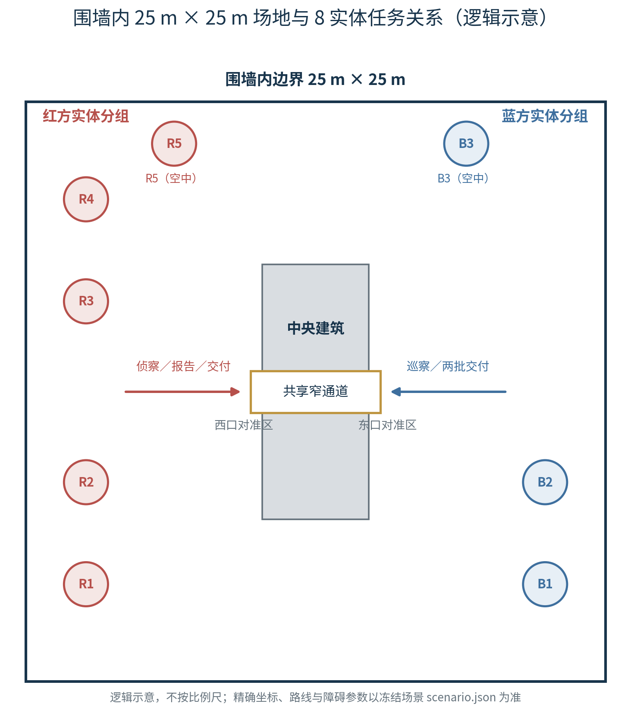

地面车有两类路线。中央路线经过D、W、L、E等节点，距离短，但经过中央通道时，E—W段需要预约。外侧路线经过N0或S0、PN或PS等节点，可以避开通道占用，代价是更长的运动时间。空中车不受地面窄口的通过方向限制，可以直接读取自身任务图中的PN、PS路线，但仍需接受任务期限、到位与报告有效性约束。

系统使用8个实体，满足题目对3—10个智能靶标的数量要求。实体编号延续源码和日志中的命名，便于把报告中的任务与原始记录逐项对应。

**表2 实体、起始节点与主回合验收任务**

| 实体 | 起始节点 | 主回合验收任务 | 期限 |
|---|---|---|---|
| B1 | D | 第一批蓝方交付 | 350 s |
| B2 | O | 第二批蓝方交付，过程中承担换乘运输服务 | 350 s |
| B3 | F | 蓝方空中巡察，另承担观察支援 | 40 s |
| R1 | E | 第一批红方交付 | 250 s |
| R2 | E | 第二批红方交付 | 100 s |
| R3 | N0 | 侦察、报告、返场 | 60、70、86 s |
| R4 | S0 | 侦察、报告、返场 | 60、70、130 s |
| R5 | F_R | 红方空中巡察报告、巡逻报告、返场 | 10、60、180 s |

起始节点按冻结任务卡填写，与表后结果事件逐项对应。换乘运输服务和观察支援是实体在完成任务过程中承担的过程性工作，不单独计为验收任务。这样八行合计正好对应主回合的14项验收任务；任何一个执行器到位事件都不能直接替代整项任务的完成。

## 2.2 功能结构与信息流

系统划分为感知、任务管理、决策、运动执行和通信五个功能部分。图2保留了它们之间的主要关系，省略与主版本无关的扩展模块。

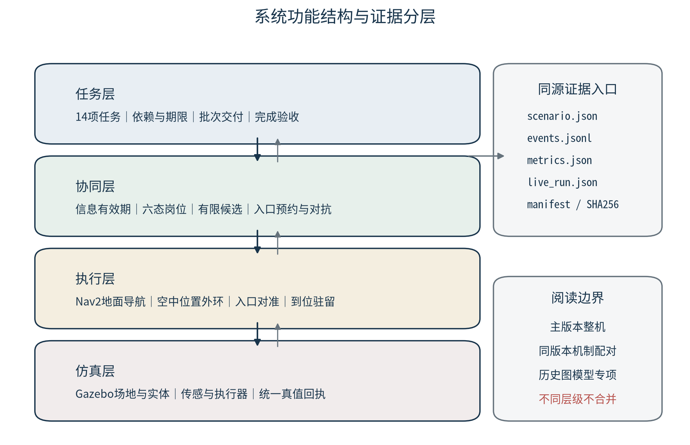

感知部分提供本机位姿、速度、任务相关几何信息和报告。主版本中，这些信息的一部分来自Gazebo真值，另一部分来自AMCL和任务管理器。报告带有采样时刻与接收时刻，后续决策只使用仍在有效期内的副本。

任务管理器保存任务卡、候选节点、期限、前置条件和完成状态。它不直接输出车轮速度，而是向决策层提供可行动作及其约束。决策层负责候选比较、岗位协商、通道预约和对抗排序。运动执行层接收目标点、路线、时间窗与服务动作，分别调用地面Nav2或空中位置控制。通信部分传递报告、预约、提议、确认、释放和回执，并保留消息编号用于去重。

这种划分的实际好处是排查问题时可以定位层级。车辆没有到达，可能是Nav2未收敛，也可能是入口没有授权；服务没有生效，可能是提议未确认，也可能是报告已经过期。若所有状态都写成一个“任务成功”标志，这些差异会被掩盖。

任务与运动分层的思路来自课上讲的多无人艇协同任务规划[2]。在这个空地场景里，上层根据期限和通道状态安排岗位、路线与时隙，下层负责把车或无人机送到指定位置。车辆到位、清空通道以后，执行层再把结果交回任务层，用于检查交付条件或释放资源。

## 2.3 共享资源与状态接口

系统把容易造成冲突的对象显式建模为资源，而不是依赖车辆之间的偶然避让。

**表3 共享资源及其状态**

| 资源 | 关键状态 | 合法转移 | 主要记录 |
|---|---|---|---|
| 中央通道 | free、reserved、in_use | 申请、授权、进入、清空、释放 | slot_id、方向、起止时刻、revision |
| 入口与泊位 | free、occupied、aligning | 到位、对准、占用、清空 | 实体、姿态、占用区间 |
| 交付目的地 | free、loading、unloading | 装载、服务、卸载、离开 | 任务、服务回执、目的地状态 |
| 信息报告 | pending、delivered、expired、failed | 创建、送达、使用、过期 | 采样时刻、接收时刻、消息编号 |
| 岗位与服务 | free至active、released | 请求、提议、确认、激活、释放 | proposal_id、provider、consumer |

通道预约记录包含名义起止时刻。名义窗用于预约时的冲突检查，实际清空事件用于提前释放未使用部分。泊位和目的地单独记录，避免车辆虽然持有通道时间窗，却在出口处与另一项服务发生冲突。

报告和岗位也有生命周期。报告到期后不再参与有效服务边的判断；岗位在服务完成、请求者不再需要或继续占用已不合理时释放。释放不是日志末尾的补充动作，而是任务管理器必须处理的状态，否则后续候选会一直把已经空闲的实体视为不可用。

## 2.4 时间与完成口径

主回合的策略调度间隔为100 ms，连续运动与Nav2回调按各自的仿真时间推进。冻结场景的step_ms为100，运行器按该值触发策略调度；两者通过仿真时间戳交换状态，不能用调度间隔解释实际控制器输出。历史轨迹中另有按0.5 s采样的记录，那是该批历史的采样设置，不适用于主回合。

报告把下列四个概念分开记录。

（1）**预测。** 决策器根据路线、速度参数、等待和服务动作估计某任务何时完成。预测用于比较候选，可能因执行误差和冲突而改变。

（2）**执行器完成。** Nav2到达、空中位置环稳定或某个物理动作结束。它只说明局部执行状态，不一定满足整项任务。

（3）**任务验收。** 车辆位于目标区间、速度低于阈值并持续驻留，且需要的服务事件已经满足。验收后才更新任务管理器中的完成状态。

（4）**独立真值审计。** 场景记录器检查位置、占用、期限和约束违例。审计用于复核任务管理器，不能把执行器自报成功直接当作独立证明。

这套口径增加了一些日志字段，却避免了最常见的误判：路径点到达被写成装载完成，计划时间被写成实际时间，或者一条任务完成消息被当作全队回合成功。

# 3 单体自主运动与任务验收

## 3.1 AMCL定位与坐标关系

课上讲地面无人车路径规划时，区分了利用已知地图选路线的全局规划和根据局部观测调整运动的局部规划[3]。本设计用 AMCL 提供定位，NavFn 在地图上选路，DWB 根据附近障碍和底盘约束给出速度命令。任务层通过 Nav2 的导航动作接口传入目标点[4]。通道授权和任务验收由靶场的任务层判断。

AMCL不把一次初始位姿当作永久真值。车辆运动后，粒子先按运动模型预测，再由激光观测与地图的匹配程度更新权重，最后重采样，使粒子逐渐集中到更符合观测的位姿附近。map到odom的修正再交给规划和控制节点使用。主配置使用500—2000个粒子、60束激光，平移或旋转达到0.1后触发更新。粒子数影响计算量和分布表达能力，观测更新则决定车辆运动后能否及时纠正先验。

这一层与任务验收分开。AMCL收敛表示导航获得了可用位姿，并不表示侦察、装载或交付已经完成；任务管理器仍需检查目标区域、驻留和服务回执。

## 3.2 全局规划与膨胀层的选型理由

全局规划器选用NavFn的Dijkstra模式，配置为`use_astar: false`、`tolerance: 0.0`。场地已经结构化，主要连通关系由中央通道和少量绕行路线构成，首先需要一条稳定、可复查的搜索基线。Dijkstra不依赖启发项，在统一代价地图上按累计代价扩展节点，调整膨胀层或入口几何时，排查问题不必同时处理启发权重变化。Smac Hybrid-A*把车辆运动学约束编入节点扩展，更适合需要直接生成可执行曲率路径的场景；它对应的是另一种实现复杂度与运动可行性的取舍，而不是绝对性能高低。

全局代价地图依次为static、obstacle、peer和inflation层。膨胀半径0.55 m、代价缩放3.0，障碍标记距离2.5 m、清障光线3.0 m；局部代价地图使用3 m×3 m滚动窗口。膨胀层在障碍附近随距离衰减提高通行代价，促使路径保留间隙，但并不把整个膨胀范围都改成禁止通行区域。真正不可进入的栅格与“可通过但代价较高”的栅格必须区分，否则窄通道调试时容易把路径贴墙、无路可走和控制器不愿进入混为同一个问题。

这也解释了为什么不能只按通道净宽判断可行性。静态建筑、动态障碍、队友占位和膨胀代价共同改变全局路线；即使全局路线存在，局部控制器仍可能因姿态、速度采样或入口目标布置而无法收敛。

## 3.3 DWB评价项与差速运动学

DWB在允许速度范围内采样，按航向、目标距离、障碍间隙和速度等评分项选择命令[5]。Fox等人提出的动态窗口方法说明了这种“短时预测—候选评分—执行反馈”的基本思想[6]。冻结B1配置中，PathAlign与GoalAlign权重均为0，PathDist为32、GoalDist为24、RotateToGoal为32、BaseObstacle为0.02。

将PathAlign和GoalAlign归零，与窄通道入口的摆头现象有关。路径对齐和目标对齐会牵引车辆姿态持续追随局部路径或目标方向；通道内本来就需要小幅修正时，这两项可能放大左右摆动。保留路径距离和目标距离评价，可以继续比较轨迹偏离与推进程度，把旋转更多交给接近目标后的控制过程。这个参数组合针对冻结入口几何调试，不能直接推广为所有导航场景的推荐值。

差速执行还需要把车体命令换成左右轮速度。设车体线速度为v、角速度为ω、轮距为L，则：

v_left = v - ωL/2，v_right = v + ωL/2

轮距越大，同一角速度对应的左右轮速差越大；轮速、角速度和加减速限制因而必须配套设置。若只限制车体v而不检查ω和轮速，车辆可能在窄口转向时超出执行器能力，或出现任务层已经下达目标、车轮却无法按预期转动的情况。

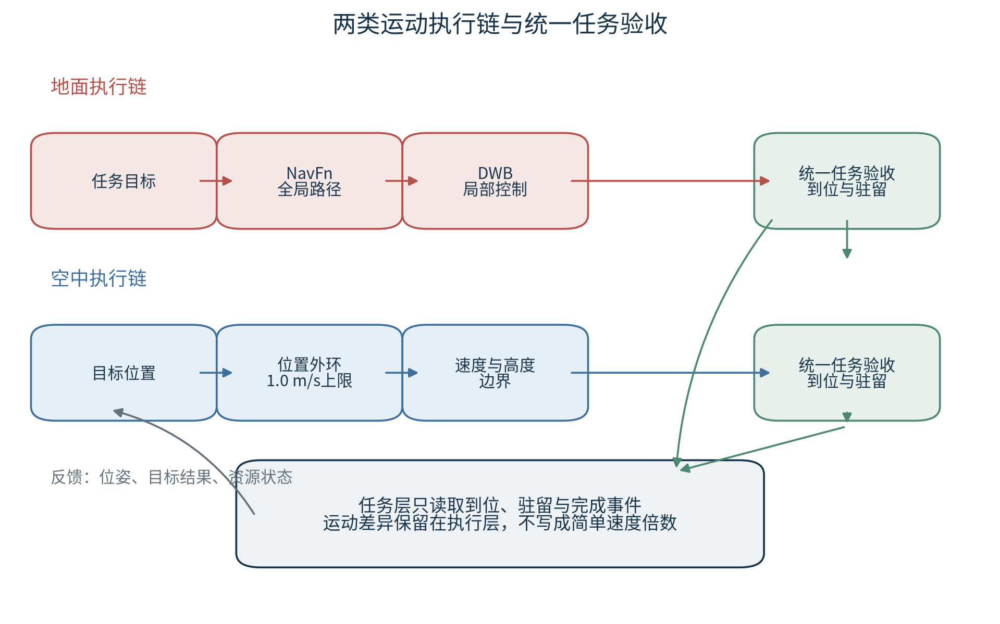

表4列出B1主配置的直接读取值。这里只声明已逐项核对B1，不把同一张表扩展为“所有地面车均已逐车核验”。地图分辨率采用0.05 m，地面命令线速度上限0.26 m/s；场景中的`ground_speed=0.5 m/s`用于任务图估计，不直接控制Nav2。

**表4 地面与空中运动的主要参数**

| 参数 | 取值 | 作用层级与说明 |
|---|---|---|
| 地图分辨率 | 0.05 m | 全局与局部代价地图栅格尺度 |
| max_vel_x / max_speed_xy | 0.26 m/s | 地面平移命令上限 |
| max_vel_theta | 1.0 rad/s | 地面角速度命令上限 |
| vx_samples / vtheta_samples | 10 / 15 | DWB平移与角速度采样档数 |
| sim_time | 1.7 s | 局部轨迹前向预测时长 |
| 控制频率 | 10 Hz | DWB控制循环频率 |
| acc_lim_x / acc_lim_theta | 2.5 / 3.2 | 线、角加速度限制 |
| 规划tolerance / 控制xy_goal_tolerance | 0.0 / 0.08 m | 分属全局规划与控制目标容差 |
| 空中位置环 | kp=2.0，积分限幅0.30，输出限幅3.0 | 误差限幅±5 m，使用自身仿真位姿 |

场景中的抽象速度、导航命令上限和真值完成时间属于三个口径。空中1.0 m/s与地面0.5 m/s可以比较任务参数设置，却不能写成“空中实际速度是地面实际速度的两倍”。真值回合中的地面运动还受转向、障碍、入口等待和稳定判据影响。

## 3.4 空中车执行链与感知边界

两架多旋翼使用自身仿真位姿作为反馈，位置外环根据目标误差生成控制量，再作用于带惯性、重力与风扰的多旋翼模型。该链路可以演示起飞、巡航、悬停和任务服务，但不包含机载相机、激光雷达、状态估计或真实飞控内环。

位置外环的误差先限幅，再分别进入比例和积分项。限幅用于防止大误差下积分累积和过强命令，稳定驻留判据则防止车辆高速掠过目标点时提前验收。空中实体在当前课程目标中主要提供观察和报告；若研究目标改为自主感知或精确飞行控制，需要重新接入传感器与估计器，并重新测定报告时延和位置误差。

## 3.5 到位、驻留与服务验收

执行器把“接近目标”与“任务完成”分开。车辆进入目标半径只是第一个条件，还需满足横向误差、低速稳定和驻留时间。对需要装载、卸载、侦察或报告的任务，必须有相应服务事件。

**表5 到位与驻留判据**

| 判据 | 地面运输车 | 空中观察机 | 依据 |
|---|---|---|---|
| 水平到位容差 | 0.10 m | 0.10 m | 冻结场景 `physical_berth_tolerance_m` |
| 到位速度上限 | 0.10 m/s | 0.10 m/s | 源码到位判定 `speed<=0.1` |
| 到位高度容差 | — | 0.20 m | 地面只查水平距离 |
| 移动到位保持 | 约 1 s | 约 1 s | 原始事件 `dwell_ms` 1000—1008 |
| 服务时长 | 2 s | 2 s | 场景 `service_ms=2000`，事件 `dwell_ms=2000` |
| 服务记录 | 装载/卸载/交付 | 观察/报告 | 按任务要求 |

驻留期间如果车辆离开目标区、速度重新升高或服务对象被占用，计时与任务状态需要重新评估。完成时刻可能因此晚于导航到达时刻，这也解释了记录中为什么同时出现到位、物理完成确认和交付等不同事件。

## 3.6 地面感知退化与动态避障的历史证据

主版本以真值反馈完成任务验收，不能据此证明机载感知退化下仍然有效。为单独检查地面导航对激光噪声和未写入静态地图障碍物的响应，历史专项保留phase116、117、120、121四个整机回合。它们不是phase124新增结果，每种条件也只有一个回合，价值在于把受控扰动和实际轨迹对应起来。

噪声实验把场景注入的激光噪声标准差由0.01 m提高到0.03 m。扫描二阶差分估计得到的中位数分别为0.0166 m和0.0397 m，比值为2.39。注入值与扫描估计值采用不同口径，正文不把它们写成同一个数，也不要求二者数值相等。

障碍实验在场地中放置不写入静态地图的柱体，中心为(0.30, -1.00)，宽柱半宽0.35 m、窄柱半宽0.25 m。实验设计有两个前置判断：障碍需要切入车辆本来会经过的路线，否则“成功绕开”可能只是车辆从未接近；障碍也不能直接堵住任务目标，否则任务失败无法区分是避障问题还是目标被人为封死。检查时使用实际轨迹到柱心的最近距离，而不是只看一条重规划线。

**表6 历史受控感知与避障结果**

| 条件 | 回合与版本 | 扫描σ中位数/m | 轨迹到柱心最近距离/m | 恢复行为/次 | 任务结果 |
|---|---|---|---|---|---|
| 标称 | fs-g11-new-ind-01，phase116 | 0.0166 | 0.123 | 10 | 13/14按期，0违例 |
| 噪声 | fs-deg-noise-ind-01，phase117 | 0.0397 | 0.856 | 1 | 14/14按期，0违例 |
| 宽柱 | fs-deg-occl4-ind-01，phase120 | 0.0164 | 0.871 | 10 | 13/14按期，0违例 |
| 窄柱 | fs-deg-occl5-ind-01，phase121 | 0.0183 | 0.845 | 2 | 14/14按期，0违例 |

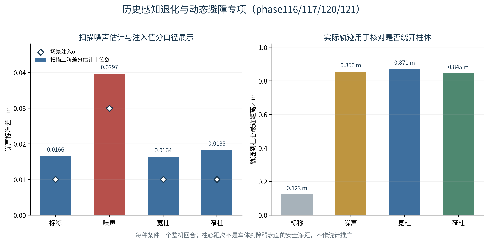

标称回合的轨迹到柱心最近距离为0.123 m，说明原路线确实经过柱体附近；加入宽柱或窄柱后，最近距离分别变为0.871 m和0.845 m，车辆实际运动已经绕开柱心区域。噪声回合的0.856 m则说明在噪声与场景条件共同变化时，轨迹也发生了明显偏移。四个回合均跑满窗口且没有记录违例，但任务完成数和恢复次数并不随扰动单调变化。现有样本只能支持“车辆在这些历史受控条件下通过传感反馈改变了实际轨迹”，不能拟合噪声越大交付越晚的曲线，更不能替代phase124的机载感知验证。

## 3.7 承诺与释放的取舍

多车协同中，较早承诺可以保留资源，过晚承诺则可能错过时间窗。系统采用分层承诺：任务层先锁定目标与执行期限，通道层再按预计进入时刻预约，执行层在获得授权后进入。若预测误差导致原窗口不再合适，任务管理器可以重订；若车辆已经清空通道，剩余名义窗立即释放。

完全不做承诺，车辆会不断被更短任务抢占；承诺一直保持到名义结束，又会让已经空闲的通道无法被后续任务使用。主版本采用“预约时保留、清空后释放”的折中。服务岗位也按任务依赖释放：服务完成或请求者不再需要时可以退出，正在执行的服务则不能被另一项承诺直接覆盖。

## 3.8 从“车不动”反推故障层级

整机调试时，“车辆没有到达”只是表面现象。若一开始就修改速度或膨胀半径，可能暂时改变画面，却把真正的问题留在原处。本设计按定位、全局路径、局部控制、资源入口和任务验收五层排查，每一层都使用不同的记录，避免用一个Nav2结果解释全部故障。

第一层先检查位姿和坐标关系。AMCL需要提供可用的map—odom修正，车辆才能在同一张地图上理解目标点、代价地图和传感器扫描。如果这一层不稳定，全局路线即使在地图上正确，也可能在车体坐标下落到错误方向。此时继续调整DWB评价项没有意义，因为控制器接收到的输入本身已经不可靠。定位可用也不等于任务完成，只说明后续规划有了共同参考。

第二层检查全局路径是否存在，以及它为何选择当前路线。静态障碍形成的不可进入栅格、obstacle和peer层提供的实时占据、inflation层增加的贴障代价要分别查看。如果路径贴着障碍，应先区分是实际间隙不足，还是高代价区域促使规划器选择另一条累计代价更低的路线。直接缩小膨胀半径可能让路径重新出现，却也会减少运动间隙；在窄通道里，这种处理不能代替几何测量。

第三层检查局部控制是否能在全局路线附近找到可执行轨迹。B1的DWB在10档线速度和15档角速度中采样，前向预测1.7 s，控制频率10 Hz；这些参数共同决定短时间内能看到多少候选运动。车辆原地摆动时，需要看评价项是否把姿态牵引与路径推进放在冲突位置，入口历史调试因此将PathAlign和GoalAlign归零。车辆几乎不动时，则还要检查障碍评分是否否决了大多数轨迹、加减速限制是否使候选无法执行，以及局部目标是否落在不合适的位置。上述情况都可能表现为“控制器没有输出理想速度”，但修改对象并不相同。

第四层检查资源状态和入口动作。历史入口案例最能说明分层的重要性：B2已经获得授权，所以继续延长预约并不能解决74 s只移动0.24 m的问题；真值轨迹把问题定位到入口运动后，对准点才有试验价值。后来对准点与队友换乘路径冲突，故障又从单纯运动学问题变成协同几何问题，最终解决办法是0.65 m检查和两点式回退，而不是继续调快车轮。这个过程也说明，授权、导航目标发布和真实跨口必须分别记录，否则无法知道车辆究竟卡在哪一层。

第五层检查任务验收。车辆到达目标邻域后，仍可能因低速保持不足、驻留未完成或服务对象被占用而没有交付。phase46片段中，B1在50.352 s进入通道、89.092 s清空通道、183.460 s记录交付完成；通道进入、离开与任务交付本来就不应合并为一个“到达时间”。如果只读取导航动作成功，可能把通道通行之后的服务过程从系统分析中删掉。

感知专项也按同样方法处理。障碍物没有写入静态地图时，全局规划层最初并不知道它存在；只有传感器进入obstacle层后，局部规划或恢复行为才有机会改变运动。因此，实验不能只看是否生成了一条绕障规划线，还要看实际轨迹是否离开柱心区域，以及任务目标是否被人为堵死。标称、宽柱和窄柱条件的最近距离差异提供了后一项检查，恢复行为次数则只作为过程记录，不被当作“避障能力越强，恢复次数越少”的单调指标。

这套顺序的价值在于控制修改范围。定位有问题时修定位，入口冲突时修几何，目的地占用时检查服务与泊位，验收未完成时检查驻留和回执。每一次只改变与证据对应的层级，才能判断后续变化来自哪项修改。对本课程设计而言，排障过程本身也是自主导航设计的一部分，而不是报告之外无法复现的经验。

# 4 多体协同机制

## 4.1 时效信息与六态岗位

协同从可使用的信息开始。每条报告包含来源、内容、采样时刻、有效期和消息编号。接收方以报告实际到达时的仿真时间判断其是否仍在6秒有效期内；发送时刻仍在窗口内而送达时已经过期的报告，不进入服务决策。主运行同时记录queued、delivered、failed和pending，避免把队列中的消息算作队友已经收到。

岗位状态用于把承诺、移动、服务和退出分开。`PROPOSED`表示服务提议已经生成，`CONFIRMED`表示双方确认同一承诺，`MOVING`表示服务者正在前往岗位，`READY`表示已经到达并等待激活条件，`ACTIVE`表示服务正在执行，`RELEASED`表示承诺已经退出。状态转换需要配套事件，不由画面中的距离远近推断。

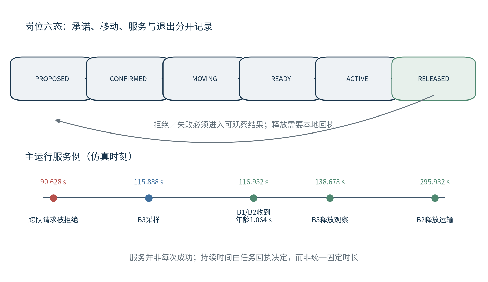

一次完整服务经历请求、提议、确认和激活四个阶段。请求者给出所需服务及理由，候选服务者计算自身代价并报价，双方对同一proposal_id确认后，服务才进入激活。激活还需要满足到位、报告有效等条件。完成后记录released，使车辆能够回到后续本职任务。

主运行中的蓝方换乘服务可以说明这一区别。B3在115.888 s采样报告，B1和B2于116.952 s收到，报告年龄为1.064 s；服务边在接收且有效时激活，而不是在采样时刻提前生效。另有跨越蓝红队伍的服务请求在90.628 s被拒绝，原因是当前任务模式不提供跨队服务。这类拒绝也保留在记录中，防止把所有协商都写成必然成功。

## 4.2 32个有限候选怎样形成

任务分配研究通常同时考虑任务收益、执行代价和资源约束[7]。Khamis等综述了多机器人任务分配的主要方法[8]，Chakraa等进一步讨论了优化目标与求解技术[9]。本设计没有对所有实体和任务做全排列，而是先根据任务图、状态和资源生成有限候选，再在候选集内比较。

最终`candidate_rows()`把一次决策拆成四个维度，并做笛卡尔积：

**表7 有限候选的组成**

| 维度 | 可选值 | 决策含义 |
|---|---|---|
| 运输分工 | single / split | 一车独立完成，或两车分担运输与交接 |
| 观察支援 | fixed / air | 使用地面固定观察岗位，或使用空中观察 |
| 路线 | channel / bypass | 使用共享通道，或选择外侧绕行 |
| 信息方式 | refresh / self / carry / wait | 刷新报告、自身观察、携带信息或安全等待 |

四个维度形成2×2×2×4=32个预定义候选。32只是生成起点，不等于每个状态都有32个可执行方案。预测阶段会检查队友位置与可用承诺、报告新鲜度、空中巡检承诺、观察与通信路线，以及通道时隙。缺少所需能力或承诺、信息已经过期、路线与当前协议不相容的候选会被过滤；`wait`只在固定观察支援加单车运输时作为安全等待保留，在线重规划下也不把它伪装成与确定预测完全等价的普通路线。

课上讲多无人机任务分配时，把时间窗、同步和优先级列为影响分配的约束[10]。这里先检查任务期限和资源可用性，再按按期交付数、新增移动工作量、交接空档的顺序比较候选。岗位还要经过双方确认并到位才激活。这样即使一辆车离队友很近，临时支援也得先满足双方的任务和时序要求。

P1使用较直接的独立选择；P2执行严格的一维分块改善，增强P2允许等值移动并增加固定起点；P3允许联合调整岗位、支援和路线。去中心化图任务分配研究同样强调局部信息与图结构对决策的影响[11]，不过本系统仍保留任务站与入口服务站，不能据此宣称已经实现去中心化分配。

下面用一次边界决策把“生成—过滤—比较—确认”走完。算例采用机会成本专项中R1期限50 s、提供者返航期限37 s的固定图模型状态。这里不补写一份没有原始记录的32行明细，而是先说明32个预定义组合怎样被缩减，再使用专项中实际保留下来的“提供服务”和“不提供服务”两个候选进行计算。

第一步是生成。`candidate_rows()`先组合运输分工、观察支援、路线和信息方式，形成32行。此时每行只是一种组织方案，尚未证明它在当前时刻可执行。比如，`split`只是说明可以考虑两车交接，并不代表第二辆运输车已经空闲；`channel`只是选择中央路线，并不代表对应时隙已经获得授权。

第二步是过滤。平台能力先排除不具备执行条件的组合：空中观察需要可用空中单元，分担运输需要可用的第二辆地面车。既有承诺再排除会覆盖已确认服务的方案，避免一个新报价把正在执行的任务静默挤掉。信息方式还要检查报告是否在有效期内，以及刷新、携带或自身观察能否在协议允许的时间内完成。选择中央通道的组合则必须有可满足的时间窗。`wait`可以保留在缺少新鲜队友状态时的安全候选中，但不能给尚未发生的服务编造一个确定到达时刻，更不能与条件齐备、可以立即交付的方案按同一种预测口径混排。

经过这些检查，剩下的才是合法候选。由此也能理解为什么“32个预定义候选”与“32个当前合法候选”不是一回事：前者控制搜索规模，后者由当前状态决定。过滤本身不是失败日志里的附属说明，而是任务分配的一部分；如果直接把不可执行组合送入评分，后面的效用计算再精确也没有意义。

第三步是按统一口径比较。两个候选都预计提供者37 s返航，双方两项本职任务也都按期。不提供服务时，R1预计42 s交付，名义活跃工作为32 s；提供服务时，R1预计34 s交付，名义活跃工作为34 s。按第4.3节的效用向量，两者分别为：

不服务：U = (2, 0, -32000, -79000)

服务：U = (2, 0, -34000, -71000)

时间项在实现中以ms计，因此42 s与37 s之和写成79000 ms，34 s与37 s之和写成71000 ms。保留活跃工作成本时，前两项完全相同，第三项中-32000大于-34000，于是选择不服务。专项消融只把第三项置零，此时前三项相同，才轮到第四项比较；-71000大于-79000，服务候选获胜。这解释了消融为什么改变选择：不是简单的“删掉一个惩罚所以服务变便宜”，而是活跃工作成本不再提前决定胜负后，更短的合计完成时刻成为决胜依据。

第四步才是确认。评分最高的方案还要生成服务提议，由双方对同一proposal_id确认，随后进入移动、到位、激活和释放。若确认前报告过期、承诺条件改变或协议已无法按时完成，候选不能被当成已成交服务继续执行。这样一来，效用表中的一行才会变成可检查的事件链；反之，事件链也能反查当时究竟选择了哪个候选。

这个实例还限定了P2、P3的作用范围。它们是在同一套候选生成、过滤和评价规则下改变搜索方式，而不是各自发明一套任务语义。P2做一维分块改善，计算量较小，但可能停在局部结构；P3允许联合调整岗位、支援和路线，可以处理“只改一个维度没有改善、联合改两个维度才可行”的情况。相同评价预算下比较的是搜索覆盖范围，不是把P3的预测结果直接当成实际交付保证。

## 4.3 军蚁活桥启发的机会成本

Reid等人对军蚁活桥的研究显示，活桥位置与群体通路效率有关，形成结构还会占用原本可参与觅食的个体，因此需要在通路收益与个体投入之间权衡[12]。本设计借用的是这一成本—收益关系：服务者临时支撑队友，可以改善请求者的通路，但自身投入的本职活动时间也会增加。车辆协商并不是对军蚁行为的完整仿真。

对提供者与受保护的自身返航任务，图模型使用效用向量：

U = (按期任务数，-逾期量，-名义活跃工作时间，-两项完成时刻之和)

比较按字典序进行，前一项相同才比较后一项。第三项是提供服务所付出的活跃工作投入，不是“逾期惩罚”；即使两项本职任务都能按期，它也不会自动变成零。最后一项用于在前三项仍相同的时候区分整体时序。

最能说明问题的是R1期限50 s、提供者返航期限37 s这一组。两种方案下，双方本职任务都预计按期，提供者返航也均为37 s。

**表8 机会成本边界算例的候选比较**

| 候选 | R1交付/s | 提供者返航/s | 双方按期任务数 | 名义活跃工作/s | 保留工作成本时的选择 |
|---|---|---|---|---|---|
| 不提供服务 | 42 | 37 | 2 | 32 | 接受该候选 |
| 提供服务 | 34 | 37 | 2 | 34 | 拒绝该候选 |

真正需要决策的是：为了让R1提前8 s交付，是否值得多投入2 s活跃工作。保留第三项时，两个候选的按期数和逾期量相同，不提供服务以32 s对34 s占优，因此服务被拒绝。专项消融只把第三项活跃工作成本置零，其余预测、期限门、通信和实际验收不变，此时提供服务转而成交。

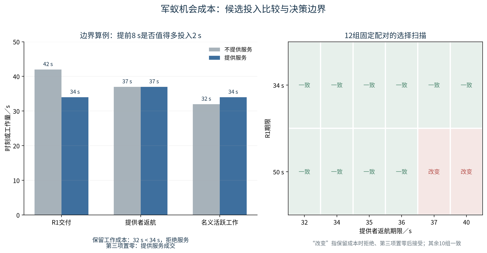

若把R1期限收紧到34 s，不提供服务对应42 s、逾期8 s，提供服务对应34 s、恰好按期。此时第一优先级“按期任务数”已经不同，两种成本口径都转向协作。这个对照说明机会成本并不是一概少帮忙：本职任务都可行时，它比较额外投入；更高优先级的期限受到威胁时，仍可以选择服务。

## 4.4 每实体独立进程的实现特点

主版本把8个实体分别放入独立进程。每个进程维护本机任务、候选、消息副本和状态机，通过multiprocessing.Pipe与任务站、入口服务站及其他实体交换请求。该实现让消息路由、进程状态和跨进程调用次数可以直接记录，也比单进程共享对象更接近多机器人软件的组织方式。

fp124-ent-ind-01共记录17708次跨进程请求。任务站和入口服务站仍承担共享资源管理，因而系统具有中心化的资源仲裁点；真值位姿也由仿真环境统一提供。每实体独立进程证明了状态与通信可以按实体拆分，但不证明完全分布式、无中心或全局强一致。

这一实现还带来额外工程约束。请求必须带唯一编号，重复发送不能直接造成二次占用；进程退出时需要释放管道和子进程；回执中的仿真时刻要与接收方时间基准一致。当前版本具备消息去重、失败与重试记录，但真实无线信道、随机丢包和长时间网络分区尚未在在线整机中系统验证。

## 4.5 协同失效时应保留什么

协同机制是否可信，往往取决于失败后留下的信息。系统保留被拒绝的提议、过期报告、未被接受的换乘和未执行服务。它们不参与成功次数统计，却能解释为什么某个候选没有被选中。

例如，服务者距离请求者很近但新增活跃工作不划算时，报价可能失去竞争力；报告在途中过期时，服务边不会激活；入口尚未获得授权时，车辆即使已经接近通道也不能记录为正在占用。上述情况都不应通过修改日志口径变成“协同成功”。后续实验因此同时查看任务完成数、消息状态和拒绝原因。

# 5 共享通道与受约束对抗

## 5.1 时间预约之外的几何约束

中央通道的时间窗回答“什么时候可以用”，却不能回答“现在是否进得去”。入口附近的泊位、换乘路径和对准动作可能相互交叉。若车辆只凭预约时刻驶入，即使时间上没有重叠，也可能在入口姿态或出口泊位上发生冲突。

东口设置两个泊位和一个对准点。图7显示，换乘路径会穿过对准区，入口动作不能只按通道中心线生成。联合准入需要同时满足四类条件。

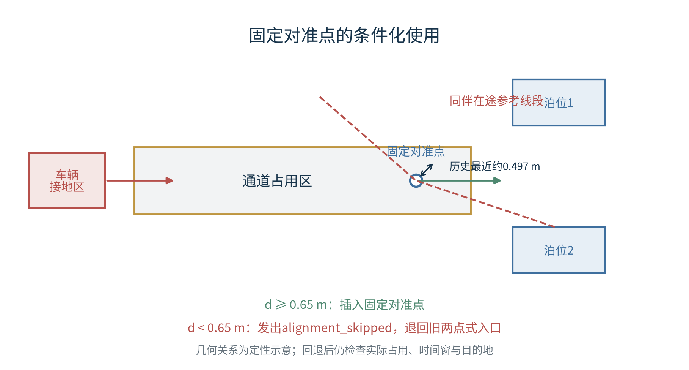

**表9 通道准入与释放检查**

| 检查对象 | 通过条件 | 不满足时的处理 |
|---|---|---|
| 名义时间窗 | 申请区间没有与既有预约冲突 | 延后、重订或选择绕行 |
| 实际占用 | 通道没有未清空的实体 | 在入口外等待，不提前记录进入 |
| 入口几何 | 对准点与同伴在途移动保持安全距离 | 跳过固定对准点，退回旧两点式入口 |
| 出口与目的地 | 出口方向和目的地区域可以接收 | 暂缓进入或调整目的地服务顺序 |

进入后，通道状态由reserved转为in_use。只有真实清空事件到达，才记录channel_cleared并重算有效释放时刻。名义窗的剩余部分随后可被后续合法预约使用。若对准超时或目的地一直占用，预约可以取消或重订，不能把等待时间隐藏成执行器已经通过。

## 5.2 入口对准是怎样形成的：一个历史设计案例

最终方案不是一次写出的。历史回合`fs-hold-long-ind-01`中，B2已经取得通道授权，却长期无法进入，持有通道约101.5 s。真值轨迹显示，车辆在约74 s内只移动0.24 m。这个现象把排查范围收窄到入口附近：如果问题主要发生在通道中段，就不会表现为车辆在入口长期小幅移动。结合入口动作检查，旧式“斜移加转向”在东口几何下难以完成进入。

在历史同卡对照中，增加东口对准点后，B2通道占用由约101.5 s降至23.6 s。这个结果支持对准点能够改善该回合的入口运动，但不能据此排除其他同期因素，也不能把历史差值当成phase124收益。

对准点随后暴露了副作用。队友换乘路径与固定对准区域相交，最近距离约0.497 m；在特定对抗场景中，还出现入口目标格被判为lethal cost的情况。简单保留固定对准点会把一个入口问题换成队友路径冲突，完全撤销又会回到原来的斜移转向问题。最终代码因此保留两条执行路径：几何检查通过时使用对准点，不通过时退回旧两点式入口。

**表10 入口设计案例的推理链**

| 阶段 | 观察或检查 | 对设计的影响 |
|---|---|---|
| 授权后仍无法进入 | 持有通道约101.5 s；约74 s仅移动0.24 m | 重点检查入口运动，而非继续延长名义时间窗 |
| 增加固定对准点 | 历史同卡对照中占用约23.6 s | 保留对准动作作为可行入口方案 |
| 发现队友路径冲突 | 对准点与换乘线段最近约0.497 m | 固定对准点不能无条件使用 |
| 最终条件化实现 | 0.65 m检查；失败时发出跳过事件并回退 | 同时保留改善动作与安全退路 |

上述数字均属于历史回合，用于解释设计来源。当前主版本是否实际使用对准点，要由对应事件另行判断，不能用历史占用时间代替phase124结果。

## 5.3 0.65 m阈值的实际含义与回退方式

最终实现中的`ENTRY_APRON_M=0.65`是入口 apron 几何检查阈值。`apron_clear()`取固定对准点与每名同伴当前在途移动的起点—终点参考线段之间的最短距离；只要有一名同伴的距离小于0.65 m，就判定当前对准动作不安全。源码注释记录的历史距离簇为0.497 m，其余不小于0.906 m，阈值用于区分这两类情况。

检查通过时，固定对准点被插入入口路径；不通过时，系统发出`physical_entry_alignment_skipped`，退回旧两点式入口。这里没有新增等待状态，也不是直接进入被占用区域，更没有所谓“候选路线长度差小于0.65 m就视为等价”的规则。回退仍要接受实际占用、目的地和导航执行检查。

这项设计保留了问题形成过程里的两个经验：对准动作有助于入口收敛，固定点又可能成为别人的障碍。条件化使用比单纯增加一个路径点更符合实际协同关系，但它只针对冻结几何和历史距离簇，不构成任意场景下的安全距离证明。

## 5.4 同一可行集上的对抗排序

对抗层不改变对方任务，也不删除其合法动作。蓝红双方先根据同一场景规则生成各自可行的候选，再由本队策略改变本队候选的排序。对方仍然可以交付、返场、申请通道、合法取消重约或绕行，对抗效果来自资源使用时序的变化。

红方只依据声明区域内的有限公开观察估计资源压力，不读取对方私有任务状态。候选评分还需要考虑蓝方可能取消原预约并重新安排，不能把一次占用当成对方只能被动等待。若候选会让本队关键任务违约，或需要无效占用、穿墙、跳过入口授权，则不能仅因对方预计延误较大而被选中。

跨队服务也受任务模式约束。主运行中一次跨队服务请求被拒绝，说明协同与对抗的边界由任务规则控制，不能因为两车距离较近就临时把对方变成本队服务者。

### 5.4.1 用16 m绕行边界还原一次对抗选择

以第6.8节的绕行16 m、释放120 s条件为例，红方动作不是把蓝方2批交付从305 s强行改成324 s，而是在合法候选中占用一个资源时隙。蓝方随后仍可根据自身任务重新比较等待通道、取消重约和外侧绕行。最终独立侧蓝方2批为305.000 s，对抗侧为324.000 s，差值19.000 s；两侧都完成14/14任务，红方1批也都按期，记录违例为0。因此，这次“有效对抗”的准确含义是蓝方在变化后的可行集上得到较晚交付，而不是蓝方发生违约或红方绕过了授权规则。

红方能够使用的输入也需要限制。公开观察只提供声明区域内的有限状态、资源占用和可见预约信息，不能直接读取蓝方私有任务卡后挑选一个“必然最痛”的时刻。资源压力估计的作用，是判断哪个通道窗口可能与对方后续路线形成重叠；如果对方早已完成相关任务，或者采用空中路线，这个压力估计再高也没有实际作用。

15 m与16 m之间的一米差异，体现的是候选排序的离散变化，而不是车辆物理运动突然改变。15 m时，独立侧和对抗侧蓝方2批都为262.5 s，外侧路线仍能作为低成本替代，红方占用通道后蓝方可以沿用同一类绕行结果。16 m时，独立侧已经为305 s，对抗侧为324 s，说明路线和时隙选择都跨过了另一个分支。若只把延迟理解成“绕行每增加一米就多等一段时间”，既解释不了15 m处的零差值，也解释不了16—41 m的19 s平台。

平台同样来自候选结构。16、20、24、28、34和41 m条件下，两侧最终采用的关键路线与时隙结果相同，所以差值保持19 s。绕行变长会提高备选路线成本，但在这些条件里没有进一步改变被选分支，延迟便不会持续增加。只有把候选选择和最终时隙一起核对，才能区分“参数没有继续作用”和“作用进入平台”。

释放时刻扫描则是另一种边界。固定绕行16 m时，对抗侧在各条件下保持324 s，独立侧从120 s时的305 s逐步接近324 s，150 s时两侧一致。红方名义动作仍然存在，但蓝方合法取消、重约或选择其他路线后，原来的资源重叠不再形成额外延迟。150 s处的零结果不是对抗机制失效代码，而是该动作在这张任务卡上已经不在作用域内。

由此，红方排序至少要保留三类反问：本队关键任务是否仍可按合法预约完成，对方是否存在成本可接受的替代路线，对方是否能在动作生效前完成或重订。只追求对方预计延迟而忽略第一项，会把对抗变成自损；忽略第二、三项，则会得到大量看似积极、实际无效的资源占用。受约束对抗的设计重点正是把这些反问放进候选生成和过滤，而不是在结果出来后挑一个正差值。

## 5.5 降级判据与无效干扰排除

绕行和等待都必须落到可计算的候选上。系统排除几类“看起来干扰很强、实际上没有作用”的情况。

（1）对方使用空中路线，地面通道占用不会影响其路径。

（2）对方在通道作用发生前已经完成相关任务，后续延误不可能反向改变已完成事件。

（3）对方绕行的增加时间小于其期限余量，任务仍按期完成，此时可以记录时序变化，但不能记为使其违约。

（4）候选要求本队违反预约、目的地或入口约束，该候选直接不可行。

这些规则使对抗结果更接近可验证的系统行为，而不是在结果图上寻找一个看似有利的时间差。

## 5.6 对抗作用域

对抗能否产生影响，取决于两个条件是否同时出现：替代路线与原路线存在足够成本差，且对方任务与通道使用窗口存在时间重叠。只有一个条件通常不够。

绕行较短时，外侧路线仍是低成本替代，对方可以避开通道等待；绕行成本跨过某个边界后，等待通道才会成为相关选择。释放时刻则改变预约能否形成有效重叠。即使对抗动作相同，合法时隙关系变化也可能让延迟逐渐缩短直至归零。

因此，报告不把对抗算法描述成普遍提高胜率的方法。第6章恢复两条参数剖面，分别固定释放时刻和绕行长度，再结合候选成本与时隙解释曲线。该结论还需要在主版本整机上做同版本、同场景、同执行层的独立/对抗配对，才能进一步估计物理执行中的稳定影响。

# 6 仿真结果与讨论

## 6.1 证据配置与阅读方式

本章先给运行编号，再给结果。表11列出报告实际使用的证据，不把不同版本的数字拼成一次“最终系统运行”。

**表11 实验与证据矩阵**

| 证据 | 版本与执行层 | 用途 | 结论边界 |
|---|---|---|---|
| fp124-ent-ind-01 | phase124，实体进程整机，WSL2 | 主版本8实体、14任务、通道与服务 | 单轮、truth反馈、冻结场景 |
| fs-mechoff-ind-01 | phase123，单进程整机，同场景 | 联合机制关闭的对照 | 与下一轮配对描述，不作统计推广 |
| fs-mechon-ind-01 | phase123，单进程整机，同场景 | 联合机制开启的对照 | 同上 |
| phase46完整Demo | a9c84e6，历史整机 | 原生场景、实际轨迹与完整任务过程 | 不冒充phase124录屏 |
| 历史入口案例 | fs-hold-long-ind-01及同卡对照 | 解释对准点和0.65 m检查的形成 | 历史占用量不作为主版本结果 |
| 感知退化4回合 | phase116、117、120、121 | 噪声与未建模障碍下的实际轨迹 | 每条件一个回合，不作统计推广 |
| 机会成本12条件 | 历史固定图模型，24次运行 | 检查活跃工作成本是否改变边界决策 | 不等于整机收益提升 |
| 对抗扫描 | phase106/106b图模型 | 检查参数剖面与失效条件 | 101条记录与91个去重条件分列 |
| 通信与规模扩展 | threshold_receipt、scaling_receipt | 按需询问、响应阈值、规模争用、强度扫描与决策成本 | 默认关闭的图模型，新增单元不承担完整任务 |
| 独立最小算例复核 | 本次重构时的图模型运行 | 检查核心程序可运行、文件可生成 | 6/6按期，不是Gazebo整机结果 |

主结果只回答冻结配置下发生了什么。对于机制效果，优先使用同版本配对；对于只有历史整机或图模型支持的现象，正文明确降低结论强度。

## 6.2 phase124整机主结果

主运行在启动后接入8个实体进程，6辆地面车均完成AMCL定位、地图到车体坐标关系建立、导航启动和动作就绪。回合正常到达任务窗口末端，未收到外部停止信号。

**表12 fp124-ent-ind-01主要结果**

| 指标 | 结果 | 记录位置 |
|---|---|---|
| 实体与进程 | 8个实体，每实体一个进程 | 运行摘要.json与result_launch/live_run.json |
| 跨进程请求 | 17708次 | 运行摘要.json |
| 墙钟时间 | 1054.873 s | 运行摘要.json与shutdown.json |
| 任务完成 | 14/14按期 | result/metrics.json |
| 约束违例 | 0条记录 | constraint_violations |
| 消息状态 | queued 1065，delivered 934，failed 101，pending 30 | mission.messages |
| 岗位状态 | PROPOSED、CONFIRMED、MOVING、READY、ACTIVE、RELEASED各2次 | role_state_counts |
| 通道持有记录 | 5次，均有持有起点、释放时刻和提前释放 | events.jsonl |

图8给出14项任务的完成时刻和期限。红方巡察在3.480 s完成，期限10 s；R4返场在118.352 s完成，期限130 s；红方返场在163.966 s完成，期限180 s；红方1批交付在186.894 s完成，期限250 s；蓝方两批交付分别在243.432 s和295.878 s完成，期限均为350 s。

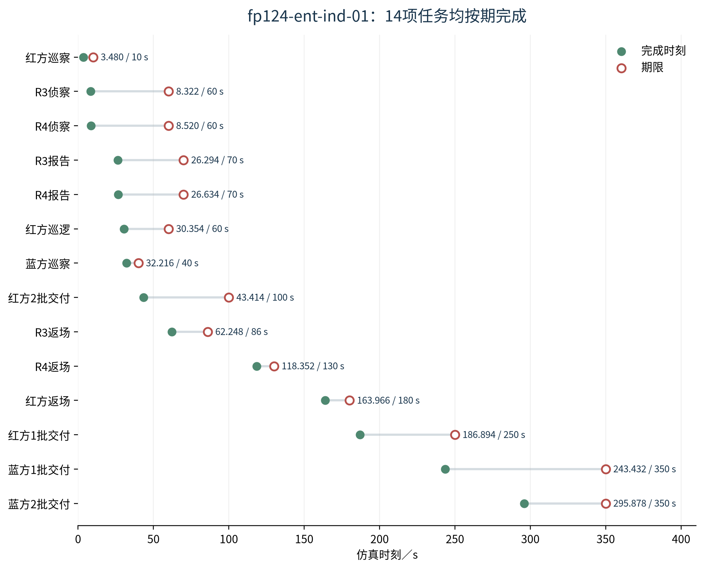

14/14说明这一回合的任务卡全部通过验收，但不代表每个协同请求都成功。记录中有跨队服务被拒绝、消息失败和结束时的待处理消息。delivered 934与queued 1065之差也不能简单解释为永久丢失，因为failed和pending分别描述了不同状态。报告不使用未经逐条消息追踪的“通信成功率”。

## 6.3 通道持有起点、释放时刻与持有时长

图9把channel_enter、channel_cleared和channel_release_recomputed三类事件放在同一时间轴上。channel_enter在通道资源被持有时记录，随后才下发运动请求，因此它对应持有起点而非车辆实际驶入的瞬间；channel_cleared在到达验收、释放资源时记录，对应释放时刻。深色段是两次记录之间的持有时长，浅色段是名义时间窗内因提前清空而释放的部分。

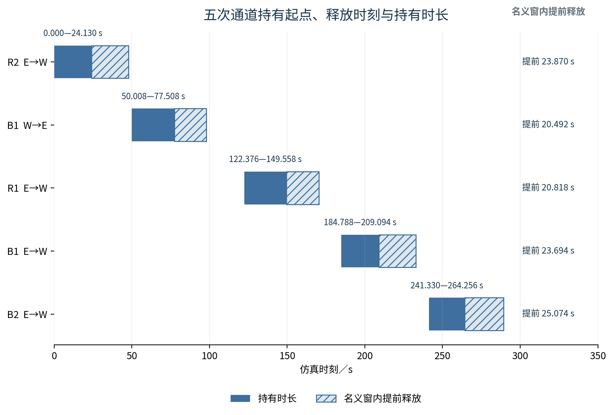

**表13 五次通道持有起点、释放时刻与持有时长**

| 实体与方向 | 持有起点/s | 释放时刻/s | 持有时长/s | 名义窗内提前释放/s |
|---|---|---|---|---|
| R2，E→W | 0.000 | 24.130 | 24.130 | 23.870 |
| B1，W→E | 50.008 | 77.508 | 27.500 | 20.492 |
| R1，E→W | 122.376 | 149.558 | 27.182 | 20.818 |
| B1，E→W | 184.788 | 209.094 | 24.306 | 23.694 |
| B2，E→W | 241.330 | 264.256 | 22.926 | 25.074 |

五次持有时长都没有延伸到名义窗终点，提前释放量约20.492—25.074 s。这里的收益不是把车辆运动速度提高，而是让通道已经不再占用时，后续预约不必继续等待到原计划终点。它直接对应第5章的释放规则，也能从原始事件逐条复算。

主运行中的入口对准有一次physical_entry_alignment_skipped记录。该事件表示0.65 m几何检查未通过时省略固定对准点并回退，不应理解为跳过入口授权或目的地检查。

## 6.4 服务状态与有效报告

蓝方服务从88.522 s的请求开始，一次跨队请求在90.628 s被拒绝。随后，B1分别向B2提出transport岗位、向B3提出observe岗位。B2在91.674 s确认，B3在99.996 s确认；两者在102.014 s进入MOVING，分别于108.934 s和112.856 s进入READY。

B3在115.948 s进入ACTIVE，115.888 s采样的报告于116.952 s送达B1与B2，报告年龄1.064 s，随后服务边激活。B2在119.066 s进入运输服务ACTIVE，B3在138.678 s释放观察岗位，B2在295.932 s带本地服务回执释放运输岗位。上述记录覆盖了状态机的完整生命周期，而不是只有开始没有结束。

该例还说明，服务持续时间可以相差很大。观察岗位在报告交付后即可释放，运输岗位需要伴随请求者完成后续交付。若统一采用固定服务时长，B2可能被过早释放，或B3被无意义地长期占用。

## 6.5 原生场景、实际轨迹与历史完整Demo

统计图可以说明任务何时完成，却不能单独展示场地、实体和实际运动。历史材料因此保留一张Gazebo原生俯瞰和一张phase46真值轨迹。图10来自历史独立回合第二批交付事件触发后的原生截图，该回合14/14按期；截图滞后于事件，不能从中读取精确交付时刻。

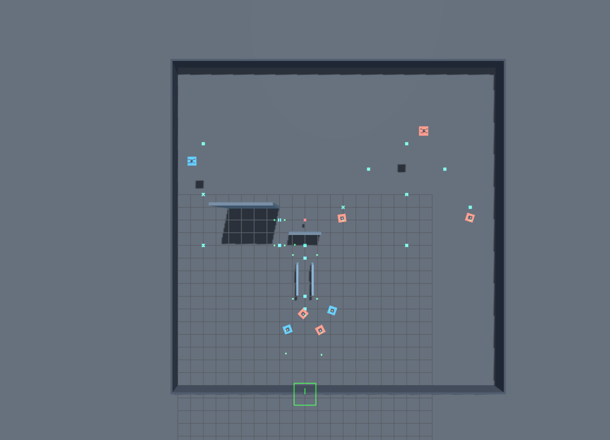

图11是phase46六辆地面车的真值轨迹。B1、B2、R1、R2在中央运输区活动，R3位于北侧，R4位于南侧。轨迹与任务指标承担不同作用：前者显示车辆实际走过哪里，后者判断任务是否按期、资源是否按规则占用。

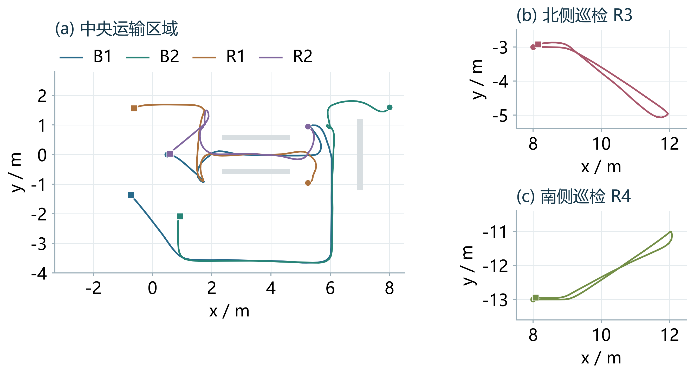

phase46还保留了一次可逐事件核对的B1通行过程。该回合与主版本不是同一源码，因此只用来说明执行链和验收口径。

**表14 phase46中B1的通道通行与交付片段**

| 时刻/s | 原始事件 | 说明 |
|---|---|---|
| 9.092 | `arrived` W | 到达通道西侧，不等于已获授权 |
| 50.352 | `channel_enter` W→E | 通道持有起点，随后下发运动请求 |
| 89.092 | `channel_cleared` E / `arrived` E | 到达验收并释放资源，即释放时刻 |
| 181.280 | `arrived` D | 到达目的地，与跨口完成是不同事件 |
| 183.460 | `delivery` / `unload_completed` | 任务验收完成，晚于单纯导航到达 |

表中时刻取自随包 `02_关键结果/phase46_完整回合/events.jsonl`，按 `t_ms/1000` 换算。

历史附件中的观看副本为2倍速，约215.4 s；对应原始媒体时长约430.8 s。当前交付没有phase124同源完整录屏，因此采用“历史Demo展示真实场景与运动，主版本回执证明当前冻结配置结果”的双证据写法。两者都真实存在，但不能相互替代。

## 6.6 phase123机制配对与下游约束

为了观察联合准入与释放相关机制的影响，报告选用phase123-wslgpu下的fs-mechoff-ind-01和fs-mechon-ind-01。两轮使用同一medium_independent场景、同一P3策略、同一truth反馈与同一执行层，差别集中在GONGYU_MECH设置：对照臂使用phase111配置，实验臂使用joint。

**表15 phase123机制关/开配对结果**

| 指标 | 机制关：fs-mechoff-ind-01 | 机制开：fs-mechon-ind-01 |
|---|---|---|
| 任务完成 | 14/14按期 | 14/14按期 |
| 记录违例 | 0 | 0 |
| 服务释放 | 3/3 | 3/3 |
| 红方1批交付/s | 187.784 | 183.448 |
| 蓝方1批交付/s | 245.572 | 239.198 |
| 蓝方2批交付/s | 298.556 | 295.480 |

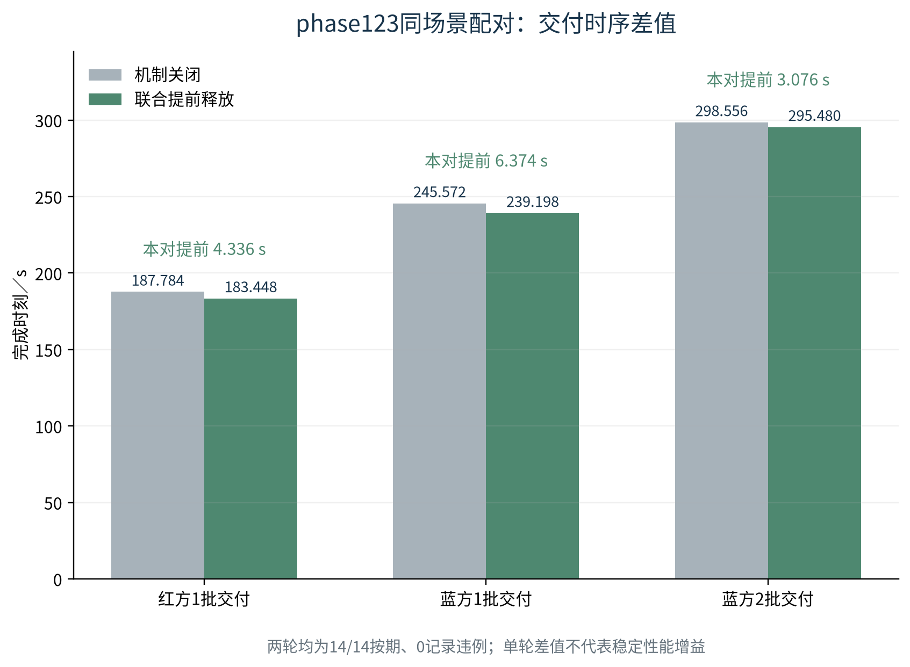

机制开启后，红方1批交付提前4.336 s，蓝方两批交付分别提前6.374 s和3.076 s。三项任务都提前，但样本只有一个配对，且joint包含多项判断，不能把差值归因于某一个单独条件。

释放量和交付提前量并不相等。机制开臂的channel_release_recomputed事件合计归还114.930 s名义余量，机制关臂没有这类重算事件；可是B2的通道持有起点只由243.466 s提前到236.854 s，蓝方2批交付又只提前3.076 s。

**表16 从名义释放到最终交付的分层核对**

| 层次 | 机制关 | 机制开 | 本对差值 |
|---|---|---|---|
| 重算释放的名义余量合计/s | 0 | 114.930 | +114.930 |
| B2通道持有起点/s | 243.466 | 236.854 | 提前6.612 |
| 蓝方2批交付时刻/s | 298.556 | 295.480 | 提前3.076 |

114.930 s是多次、多个占用窗口的剩余时间之和，不是某一辆后车可以完整独占的一段连续时间。通道资源变得可用后，后车仍要满足目的地到达区互斥。两臂事件流都出现`physical_arrival_held`，原因均为`teammate holds the D arrival region`；机制开臂中，B2在进入前仍有因B1持有D到达区而等待的记录。因此，局部释放先改变可预约时间，再影响实际进场，最后才可能转化为交付提前，中间还受目的地占用与后续运动约束。

这个例子说明“资源已经释放”和“后车实际用上资源”是两个判断。若只把释放秒数相加就宣称交付应提前同样多的时间，会漏掉下游瓶颈。当前配对仍不足以估计稳定收益，但它能够解释收益为什么在传递过程中被消耗。

**历史整机对抗配对：正负两个方向**

上面比较的是同一版源码里机制开与关的差别。更早一轮还在旧源码上做过整机对抗配对，回答的是另一个问题：把目标从独立型切到对抗型，会不会把蓝方交付推后。这一组属于历史整机对照，源码与当前冻结版本不同；phase124 主结果仍在中绕行独立模式，两者不合并成同一轮实验。

旧架构在同一场景下两次独立运行的蓝方第二批交付时刻为 296.956 s 和 298.586 s，极差为 1.630 s。本节把 10 s 作为判断明显延迟的门槛。phase111 的四份完整回执来自两张场景卡。中绕行和长绕行各做一次独立运行、一次对抗运行，每组沿用本组的场景、源码和 P3 策略，两臂均跑满 400 s。表 17 的 C、D 对应中绕行配对，长绕行是另一次留出对照。

**表17 历史中绕行整机记录**

| 格 | 架构 | 目标 | 蓝2交付/s | R1本职/s | 按期 | 违例 |
|---|---|---|---|---|---|---|
| A | 旧版归档·原架构截断 | 独立型 | 297.844 | 187.266 | 14/14 | 0 |
| B | 旧版归档·原架构截断 | 对抗型 | 277.326 | 305.614（超期） | 13/14 | 0 |
| C | 优化架构·闭合 | 独立型 | 294.766 | 184.454 | 14/14 | 0 |
| D | 优化架构·闭合 | 对抗型 | 328.540 | 213.494 | 14/14 | 0 |

C、D 两轮均有 14 项任务按期完成，记录违例为 0。对抗侧蓝方第二批交付推迟 33.774 s，红方第一批交付用时 213.494 s，仍在 250 s 期限内。A、B 是旧架构下因墙钟时限提前结束的记录，仅供回顾早期试验。

中绕行场景切到对抗目标后，R1 的通道持有起点由 122.088 s 变为 150.008 s，B2 由 222.740 s 变为 250.028 s。两车分别晚 27.920 s 和 27.288 s 持有资源，蓝方第二批交付由 294.766 s 推迟到 328.540 s。长绕行组的变化小得多，R1 的持有起点由 122.332 s 变为 122.388 s，B2 仅后移 0.018 s，蓝方第二批交付由 297.726 s 提前到 296.066 s。两组均为 14/14 按期、0 条记录违例。中绕行的交付延迟在长绕行留出场景中没有复现。

以 D 轮为例，R1 从 150.008 s 持有通道，到 177.374 s 释放，共持有 27.366 s。B2 的资源持有起点为 250.028 s，释放时刻为 297.414 s，卸载交付在 328.540 s 完成。其中持有起点取自 channel_enter 事件，表示通道开始为该车占用的时刻。两组指标、事件和复算结果见附件 04_历史整机配对证据。

## 6.7 机会成本算例的实际结果

第4章的边界算例在固定图模型中经过12组、24次配对运行复核，只有第三项活跃工作成本被置零，其余预测、期限门、通信和实际验收保持不变。两处选择变化发生在R1期限50 s、提供者返航期限37 s和40 s，另外10组选择一致。

**表18 R1期限50 s、提供者返航37 s时的实际运行结果**

| 成本处理 | R1交付/s | 蓝方1批/s | 蓝方2批/s | 提供者返航/s | 报价结果 |
|---|---|---|---|---|---|
| 保留活跃工作成本 | 42 | 53 | 61 | 37 | 拒绝 |
| 第三项置零 | 34 | 43 | 53 | 37 | 接受并完成 |

保留成本时，不提供服务使R1较晚交付，蓝方后续两批也相应较晚；置零后成交，R1与蓝方交付都提前，而提供者返航仍为37 s。该结果把仿生启发、效用排序和实际选择连了起来，但仍是固定确定性图模型算例，不能直接写成phase124整机性能增益。

当R1期限收紧到34 s时，两种成本处理都接受服务，实际R1交付34 s、蓝方两批43 s和53 s、提供者返航37 s。原因是独立方案的42 s会造成8 s逾期，第一优先级已经改变。机制因此具有明确的条件性：既不会因额外2 s工作一概拒绝，也不会因R1能提前就一概接受。

## 6.8 对抗参数剖面与形成原因

对抗扫描使用phase106的56条记录和phase106b的45条细化记录，合计101条、202次独立/对抗运行。按原始记录计，24条正延迟、77条零延迟、0条负延迟。以`(绕行长度, 释放时刻)`为条件键去重，细化记录覆盖同键旧记录，得到91个条件，其中21个正延迟、70个零延迟、0个负延迟；10个重复键的结果方向与数值一致。两种口径分别保留，避免把101条扫描记录写成91次独立实验。

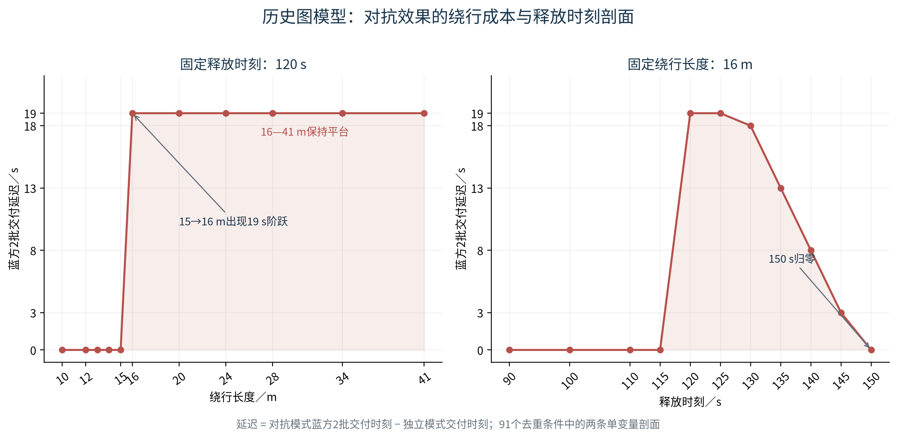

固定释放120 s时，绕行10—15 m均未产生延迟，16 m起出现19 s延迟，继续增至41 m仍为19 s。15 m条件下，两侧蓝方2批交付均为262.5 s；16 m时，独立模式为305 s，对抗模式为324 s。这条边界不只反映对抗模式多等了多久，独立模式在15 m与16 m之间也换了路线或时序选择。15 m绕行仍能作为低成本替代，16 m后等待通道成为相关选择。16—41 m的平台来自该图模型中相同的被选路线与时隙结果，不能解释成“绕行过长后对方不再依赖通道”。

固定绕行16 m时，释放90、100、110、115 s均为零延迟，120和125 s均为19 s，130—145 s依次为18、13、8、3 s，150 s归零。对抗侧在这些条件下保持324 s，而独立侧由120 s时的305 s逐步变为150 s时的324 s。释放时刻后移改变了可形成的有效重叠和合法时隙，独立方案逐渐接近对抗方案的完成时刻，最终两侧一致。

峰值条件为绕行16 m、释放120 s。表19把两侧的任务结果一起列出，避免只读19 s差值而忽略红方自身时序也发生变化。

**表19 最大差值条件的双侧任务核对**

| 指标 | 独立模式 | 对抗模式 | 核对结论 |
|---|---:|---:|---|
| 蓝方2批交付/s | 305.000 | 324.000 | 差值+19.000 s |
| 红方1批交付/s | 196.000 | 224.000 | 两侧均按期 |
| 任务完成 | 14/14按期 | 14/14按期 | 延迟未转化为本例违约 |
| 记录违例/条 | 0 | 0 | 对抗动作仍受原约束检查 |

蓝方延迟不必然转化为违约，红方1批在对照两侧也都按期。19 s是这张任务卡和时隙条件下的结果，不是某个通用通道时隙。所有剖面仍只属于历史图模型，不是phase124整机胜率。当前主版本尚缺同版本、同场景、同实体进程执行层的独立/对抗整机配对。

## 6.9 按需询问与响应阈值：通信开销不是单一指标

前面的主运行统计的是消息队列状态，还没有回答“这些消息是否都有必要”。历史图模型为此做过一组协议对照：广告式协议由地面中继车持续报价，按需询问则先由请求方发出需求，再由中继车决定是否应答。两组使用相同的三个场景，各跑1回合，意愿计算不变，只改变报价由谁触发。该层默认关闭，以下结果不属于phase124整机通信性能。

**表20 广告式协议与按需询问的图模型对照**

| 指标 | 广告式协议 | 按需询问 | 读法 |
|---|---:|---:|---|
| 运行构成 | 3场景×1回合 | 3场景×1回合 | 样本很小，只作机制对照 |
| 回执定义的按期率 | 1.0 | 1.0 | 本组对照中未下降 |
| 平均每回合报价/条 | 13.67 | 2.67 | 平均少11条报价 |
| 平均每回合中继请求/条 | 14.00 | 14.67 | 请求并未同步减少 |
| 覆盖失败/次 | 1 | 1 | 报价减少不等于覆盖已经完备 |
| 记录违例 | 0 | 0 | 两组均未记录约束违例 |

最直观的结果是平均报价从13.67条降至2.67条，而回执定义的按期率保持1.0。它说明持续广告中存在可以省略的报价：请求方尚未形成需求时，中继车反复报告“我能服务”并不会直接推动任务。按需询问把通信触发条件改为实际需求，信息更接近当前决策，因而用更少的报价完成了相同场景。

但“平均少11条报价”不能进一步写成“全网消息一定少11条”。逐场景回执中，三个场景的报价节省量分别为4、26和3条，按期率变化均为0；总排队消息变化却分别为-4、-26和+82条。受损链路场景里，报价虽然减少，重试、请求和其他协议消息仍可能增加。报价数、请求数和全网排队消息数是三个口径，不能把其中一项下降直接当成通信开销按同一比例下降。

两组仍各有一次覆盖失败，也说明按需询问不是把服务问题彻底解决了。它减少的是无需求时的广告，不会自动增加可用服务者，也不会让过期报告重新有效。若当前区域没有能按时到达的中继车，改变通信触发方式仍然无法完成服务。这一负结果与主运行中跨队请求被拒绝的记录相呼应：协议组织与任务可行性必须分别检查。

在按需询问之上，旧稿还实现了可关闭的响应阈值层。刺激量定义为请求方期限已经用去的比例，随`relay_offer_request`一起发出；中继车只在刺激不低于自身阈值时报价。服务成功后阈值下调0.15，拒绝对上调0.10，并限制在0.05—0.95之间。设计意图是让愿意服务的中继车逐渐更积极，让持续拒绝的中继车减少无效应答，但实际结果暴露了明显的筛选风险。

固定阈值扫描取五档组合、三个场景，共15回合。阈值为(0.05,0.05)、(0.30,0.70)、(0.50,0.50)和(0.70,0.70)时，平均报价均为2.67条，按期率均为1.0；阈值提高到(0.90,0.90)后，平均报价降为0，6次拒绝，按期率降至0.8788。提供者平均返航时刻由94.8 s提前到83.3 s，却只能说明中继车更早回到本职任务，不能据此判定全队效果更好，因为请求方失去了原本可以获得的支援。

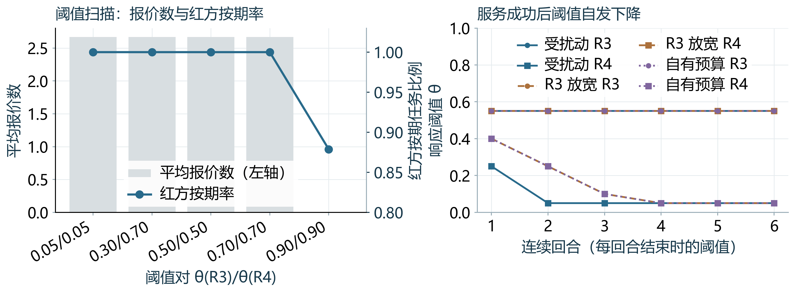

曲线之所以呈台阶而不是缓慢变化，可以从实际刺激值看出。到达决策环节的观测值只有0.7167、0.7317、0.7633和0.765，集中在约0.72—0.77的窄带内。阈值不超过0.70时，这些请求都会被应答；阈值升到0.90时，又全部被拒绝。因此，0.05到0.70之间的结果几乎没有变化，并不是阈值机制普遍稳定，而是扫描点之间没有新的决策刺激穿过阈值。

这组实验最终没有支持“阈值越高越能节省通信”的简单结论。按需询问减少的是冗余广告，阈值过滤减少的却可能是真正需要回答的请求，两者不是同一件事。对于当前课程系统，保留按需询问的组织思路更有价值；阈值层只适合作为扩展分析，且候选池仅有两台中继车、每档只有三个场景，不能据此给出通用阈值推荐，更不能把图模型报价数写成真实无线电带宽占用。

## 6.10 实体规模、共享状态与单参数强度扫描

规模实验要区分两个问题：实体数量增加本身是否改变任务结果，以及新增实体是否争用原有共享资源。如果只增加实体名而不增加资源竞争，任务不变并不能证明系统具有良好扩展性；反之，如果争用加剧，也不能不经检查就把退化归因于单体决策器。历史回执因此设置了“新增单元停在整备节点”和“新增单元共同争用同一东西向通道”两种条件，N从6增至10，均为图模型结果。

**表21 两种规模扩展方式的任务结果**

| 实体数N | 整备节点：蓝方按期 | 整备节点：红方按期 | 争用通道：蓝方按期 | 争用通道：红方按期 | 争用条件槽位市场事件/条 |
|---:|---:|---:|---:|---:|---:|
| 6 | 3/3 | 5/5 | 3/3 | 5/5 | 9 |
| 7 | 3/3 | 5/5 | 3/3 | 4/5 | 0 |
| 8 | 3/3 | 5/5 | 2/3 | 4/5 | 0 |
| 9 | 3/3 | 5/5 | 1/3 | 4/5 | 0 |
| 10 | 3/3 | 5/5 | 1/3 | 4/5 | 0 |

新增单元停在整备节点时，蓝红按期数始终不变，所有条件的记录违例均为0，但系统并非没有增加工作。M2整备条件的排队消息由N=6时的138条增至N=10时的174条，事件由492条增至568条，分别增加36条和76条。也就是说，“结果不变”只说明新增单元没有进入关键资源路径，并不说明运行记录和通信处理没有增长。

让新增单元争用同一通道后，结果明显不同。红方从N=7起由5/5降为4/5，蓝方从N=8起由3/3降为2/3，N=9和10进一步降为1/3；槽位市场事件则由N=6的9条变为后续条件的0条。退化不是蓝红同步发生的，红方先下降、蓝方后下降，说明不能只按N拟合一条统一曲线。通道容量为1，新增实体又依赖同一套预约与协商过程，任务结果首先受资源及其协议约束，而不是简单的“车多了，每辆车就变笨了”。

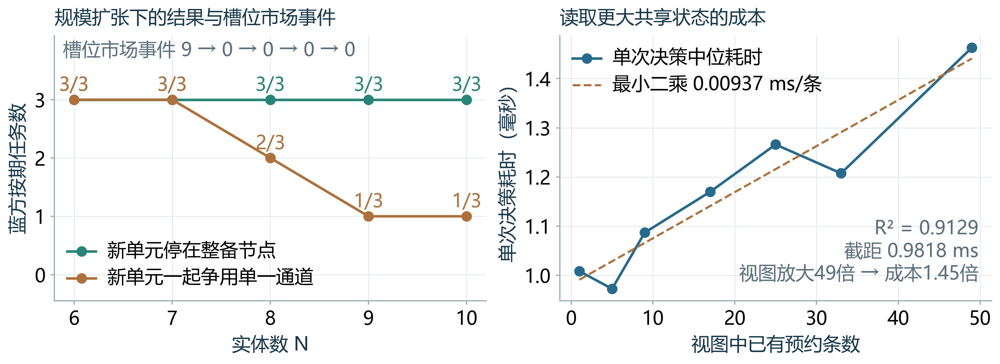

争用条件的排队消息为138、117、154、187和198条，N=7反而低于N=6。这个非单调点不应被抹平：消息数量同时受服务请求、失败、重试和合约状态影响，不能把它当成实体数的固定线性函数。与此相对，整备条件每增加一个单元，消息和事件呈稳定增加，因为新增单元只带来状态维护而没有改变任务选择。两种曲线放在一起，才把“规模带来的记录开销”和“争用带来的任务退化”分开。

决策成本另有独立微基准。实验向一份真实视图填充1、5、9、17、25、33和49条合成预约，每个规模重复60次，候选数始终为32。单次决策耗时中位数由1条预约时的1.0085 ms变为49条时的1.4631 ms，视图扩大49倍，成本约为1.45倍。最小二乘拟合斜率为0.00937 ms/条、截距0.9818 ms、R²=0.9129。

这个拟合描述的是读取更大共享状态的成本趋势，不是完整任务耗时，也不是每增加一辆真实任务车就固定增加多少毫秒。原始中位数在5条预约时为0.9727 ms，低于1条时的1.0085 ms；33条时也低于25条，因而不存在逐点严格单调。有限候选把候选数量稳定在32，确实限制了组合搜索的增长，但预约读取、过滤和状态整理仍随共享视图增大而产生开销。图15右图的线性趋势应与这些波动一起阅读。

除实体规模外，旧稿还做了单卡单参数强度扫描。每次只改变已发布M2卡的一项参数，不把多个扰动叠加后再归因。表22保留三组结果，其中红方预约时刻对蓝方没有作用，是与“强度越大越有效”相反的必要负结果。

**表22 单参数强度扫描的结果与边界**

| 参数及范围 | 蓝方按期变化 | 红方按期变化 | 可以得出的判断 |
|---|---|---|---|
| 通道入口间隔0→10000 ms | 3/3→2/3，单调不增 | 5/5→4/5，单调不增 | 该旋钮能改变任务结果，但变化不是线性 |
| 消息时延200→4000 ms | 3/3→1/3，单调不增 | 4/5→2/5，非单调 | 双方不能共用一条单调强度曲线 |
| 红方预约时刻16000→44000 ms | 3/3保持不变 | 4/5与5/5之间变化，末端4/5 | 对蓝方在这张卡上无效 |

入口间隔的六档蓝方结果为3/3、3/3、3/3、3/3、3/3、2/3，红方为5/5、5/5、4/5、4/5、4/5、4/5；消息时延的六档蓝方为3/3、3/3、3/3、3/3、1/3、1/3，红方为4/5、4/5、5/5、4/5、3/5、2/5。红方预约时刻五档中，蓝方始终3/3，红方则为4/5、4/5、5/5、5/5、4/5。三组扫描的记录违例均为0，说明“任务未按期”与“违反硬约束”仍需分开。

因此，强度可调只对实际改变关键资源或信息时序的旋钮成立。红方预约时刻虽然名义上改变了对抗动作，却没有落入蓝方关键任务的重叠区间，结果自然为零。这与第6.8节的两条参数剖面一致：对抗作用域由路线成本与时隙共同决定，而不是由参数名称决定。

规模实验还有明确边界。新增单元只承担整备状态或泊位、通道争用，并未各自运行一套完整任务；N小于6还需要先参数化脚本策略层。因此，结果不能推广成“10个完整任务实体仍保持同样行为”。微基准中的合成预约也不是一次完整任务回合。本文据此把瓶颈定位到这张卡上的单容量通道、相关协商和共享状态读取，而不声称已经完成任意规模、任意地图的可扩展性证明。

## 6.11 结果的适用边界与未闭合项

**表23 当前限制及后续验证需求**

| 限制 | 对结论的影响 | 后续需要的验证 |
|---|---|---|
| 真值反馈与符号几何 | 不能证明机载感知下同样有效 | 接入相机、激光、估计误差与延迟 |
| 感知专项每条件仅一回 | 不能估计退化与任务结果的定量关系 | 同条件重复、多噪声等级与多障碍位置 |
| 单一冻结场景 | 14/14不能直接推广到其他地图和期限 | 跨场景、多期限、多随机种子配对 |
| 单轮主运行 | 不能估计均值、方差和置信区间 | 同版本重复运行并保留失败回合 |
| 导航参数逐项核对范围为B1 | 不能把B1表当作全车统一配置证明 | 逐车读取并比较冻结参数文件 |
| 实体进程但保留服务站 | 不等于完全分布式或去中心化 | 网络分区、消息延迟与服务站故障实验 |
| 历史图模型对抗证据 | 不能替代主版本整机对抗 | phase124独立/对抗同层配对 |
| 通信与规模扩展样本 | 3场景对照、每条件单回合及合成视图微基准不能给出统计推广 | 增加完整任务实体、真实通信链路和同条件重复运行 |
| 主版本无同源录屏 | 画面证据与主回执分离 | 录屏、场景、源码与运行编号同包冻结 |
| 尚未真机验证 | 控制器参数与通信模型可能变化 | 真机导航、定位、无线通信和安全测试 |

这些限制会改变后续实验的设计。例如，接入机载感知后，6秒报告有效期需要重新测量；更换车辆尺寸后，入口对准点和泊位规则需要重新生成；扩大场景后，32个预定义候选的过滤规则和计算时间也要重新评估。直接沿用现有阈值并不能保证同样的结果。

## 6.12 讨论

通道提前空出来以后，下一辆车仍可能因为目的地有人而等在入口。phase123 的开关对照中，机制打开后累计释放了 114.930 s 的名义余量，B2 的交付却只提早了 3.076 s。回看事件可以看到，两个回合的 B2 都等过 D 到达区。这次比较让我把注意力从通道本身转到了通道、出口和交付区之间的衔接。

通信和规模专项也出现了类似的情况。按需询问减少了报价，但各场景的消息总量变化不同。新增实体都停在整备点时，原有任务仍能按期完成；让这些实体共同争用通道后，按期数就下降了。后续扩大靶场时，应先明确新增实体要参与哪些任务、使用哪些共享资源，再比较系统负载。

# 7 结论与展望

这次课程设计完成了一个包含 8 个实体和 14 项任务的空地协同靶场。主版本的中绕行独立回合中，14 项任务全部按期完成，记录违例为 0。地面导航、空中巡察、岗位服务和通道预约接入了同一套任务流程。仿真回执中可以分别查到导航到位、卸载交付和资源释放的时刻。

设计过程中我对课程里任务规划与运动控制的分工有了更具体的理解。以东口为例，几辆车即使都能规划出路线，入口姿态、队友的换乘路径和交付区占用仍可能让它们互相等待。最终方案保留了对准点，并在队友路径与对准区过近时回退到两点式入口。处理这类问题时，先从轨迹和状态事件找出车辆停在哪一步，比反复调整规划器参数更有针对性。

当前结果来自仿真。主版本仍需在相同场景下完成独立与对抗整机配对，并用重复试验判断差值能否复现。空中位置控制目前使用仿真位姿反馈，接入机载感知后还需要重新测定报告时延和位置误差。

# 参考文献

[1] 王涛. 无人系统导论·第一讲 无人系统概述[Z]. 中山大学智能工程学院课程讲义.

[2] 王涛. 无人系统导论·第六讲 无人水面艇技术[Z]. 中山大学智能工程学院课程讲义.

[3] 王涛. 无人系统导论·第二讲 军用无人地面车辆系统[Z]. 中山大学智能工程学院课程讲义.

[4] Open Navigation LLC. Nav2 documentation[EB/OL]. [2026-11-08]. https://docs.nav2.org/.

[5] Macenski S, Martin F, White R, et al. Configuring Nav2[EB/OL]. (2026-03-12)[2026-11-08]. https://docs.nav2.org/configuration/index.html.

[6] Fox D, Burgard W, Thrun S. The dynamic window approach to collision avoidance[J]. IEEE Robotics & Automation Magazine, 1997, 4(1): 23-33. DOI:10.1109/100.580977.

[7] Gerkey B P, Matarić M J. A formal analysis and taxonomy of task allocation in multi-robot systems[J]. The International Journal of Robotics Research, 2004, 23(9): 939-954. DOI:10.1177/0278364904045564.

[8] Khamis A, Hussein A, Elmogy A. Multi-robot task allocation: A review of the state-of-the-art[C]//Cooperative Robots and Sensor Networks 2015. Cham: Springer, 2015: 31-51. DOI:10.1007/978-3-319-18299-5_2.

[9] Chakraa H, Guérin F, Leclercq E, et al. Optimization techniques for Multi-Robot Task Allocation problems: Review on the state-of-the-art[J]. Robotics and Autonomous Systems, 2023, 168: 104492. DOI:10.1016/j.robot.2023.104492.

[10] 王涛. 无人系统导论·第三讲 无人机系统概论[Z]. 中山大学智能工程学院课程讲义.

[11] Peng J, Viswanath H, Bera A. Graph-Based Decentralized Task Allocation for Multi-Robot Target Localization[J]. IEEE Robotics and Automation Letters, 2024, 9(11): 10676-10683. DOI:10.1109/LRA.2024.3475013.

[12] Reid C R, Lutz M J, Powell S, et al. Army ants dynamically adjust living bridges in response to a cost-benefit trade-off[J]. Proceedings of the National Academy of Sciences, 2015, 112(49): 15113-15118. DOI:10.1073/pnas.1512241112.

# 附录A 主版本与证据索引

**表A.1 交付证据及其用途**

| 材料 | 标识或文件 | 用途 | 备注 |
|---|---|---|---|
| 冻结源码 | phase124-wslgpu.tar.gz | 主版本源码与配置 | 按manifest校验，不使用其他源码快照替代；冻结场景见归档内scenario.json |
| 主运行证据 | fp124-ent-ind-01.evidence.tar.gz | 14任务、通道、服务和通信记录 | 含events、metrics及启动记录；场景见冻结源码归档 |
| 机制配对摘要 | fs-mechoff-ind-01、fs-mechon-ind-01 | phase123同场景机制对照 | 只描述本对时序差值 |
| 历史完整Demo | phase46视频、原生截图与真值轨迹 | 观看真实Gazebo场景和实际运动 | a9c84e6，不是phase124录屏 |
| 图模型专项 | opportunity_cost_study、phase106/106b扫描 | 复算机会成本与对抗参数剖面 | 固定图模型，不是整机结果 |
| 通信与规模回执 | threshold_receipt.json、scaling_receipt.json | 复核报价、阈值、规模争用、强度扫描和决策成本 | 默认关闭扩展层，原始JSON随同源文件保存 |
| 感知专项 | expansion_recomputed.json的sensor.conditions（clean/noise/occluded_wide/occluded_narrow四组） | 核对四种历史条件的噪声与轨迹 | 每条件一个回合；原始输入另附SHA256 |
| 扩充复算 | expansion_recomputed.json及对应原始记录 | 复核32/34 s、101到91、114.930 s等口径 | 随包JSON含输入SHA256，按该入口核对；历史计算脚本另附 |
| 复现说明 | 阅读与复现说明.txt、请先阅读.txt | 环境、启动、结果查看与版本边界 | 随精简附件提供 |

主版本manifest SHA256为f87ed81dc059f19efdfcfa7524a106d917dbcd985617c7d63b4625cc5d4dfa66。冻结场景在源码归档中的路径为scenes/scene_medium_independent/scenario.json。若源码、场景或启动开关发生变化，应另设运行编号，不应继续沿用fp124-ent-ind-01的结果。

扩充专项的核对入口是随包的expansion_recomputed.json及表A.1列出的对应原始记录，输入路径与SHA256都写在该JSON内。同目录的recompute_expansion.py是依赖旧工作区绝对路径与包外感知输入的历史计算脚本，不作为读者在本包内的可运行入口；历史整机两组差值（+33.774 s、−1.660 s）的可运行入口是`04_历史整机配对证据/recompute_four_cell.py --check`，它直接读取随包四份metrics.json，已逐字节复算通过。

# 附录B 复现步骤与结果检查

（1）解压冻结源码与场景，保持目录结构不变。核对发布清单、场景文件和补丁记录，确认使用phase124-wslgpu，而非旧版当前源码目录。

（2）按随包复现说明准备Ubuntu 24.04、ROS 2 Jazzy、Nav2与Gazebo Sim 8.15环境。主运行使用本机WSL2和Mesa d3d12渲染；没有该图形环境时，不能把软件渲染或其他平台的结果直接写成同平台复现。

（3）在主配置中设置medium_independent、P3、feedback_mode=truth、GONGYU_MECH=joint和GONGYU_TOPOLOGY=entities。需要复现配对时，另按phase123说明切换机制开关，并保留独立运行编号。

（4）按附件《阅读与复现说明.txt》启动冻结脚本。报告中不另造简写命令；启动前应核对脚本实际参数，避免用旧版README中的场景名或输出路径覆盖本次证据。

（5）回合结束后检查events.jsonl、metrics.json、scenario.json、manifest和live_run.json。任务验收读取mission.tasks，通道行为读取channel_enter、channel_cleared与channel_release_recomputed，服务过程读取role_state、contract_state和service_report_received。

（6）只有所有必需输出存在且环境回执一致时，才比较14/14、期限、消息和释放数据。缺文件、提前停止、场景不一致或源码哈希不一致的运行，应与正式结果分开保存。

核心源码的独立辅助复核共收集285项测试，其中283项通过、2项因Linux进程组与信号条件跳过。该复核针对提取到的源码快照，只证明测试环境下的软件行为，不替代phase124的WSL2整机回执。

# 附录C 主运行任务明细

**表C.1 fp124-ent-ind-01任务完成时刻**

| 任务 | 完成时刻/s | 期限/s | 期限余量/s | 结果 |
|---|---|---|---|---|
| 红方巡察 | 3.480 | 10 | 6.520 | 按期 |
| R3侦察 | 8.322 | 60 | 51.678 | 按期 |
| R4侦察 | 8.520 | 60 | 51.480 | 按期 |
| R3报告 | 26.294 | 70 | 43.706 | 按期 |
| R4报告 | 26.634 | 70 | 43.366 | 按期 |
| 红方巡逻 | 30.354 | 60 | 29.646 | 按期 |
| 蓝方巡察 | 32.216 | 40 | 7.784 | 按期 |
| 红方2批交付 | 43.414 | 100 | 56.586 | 按期 |
| R3返场 | 62.248 | 86 | 23.752 | 按期 |
| R4返场 | 118.352 | 130 | 11.648 | 按期 |
| 红方返场 | 163.966 | 180 | 16.034 | 按期 |
| 红方1批交付 | 186.894 | 250 | 63.106 | 按期 |
| 蓝方1批交付 | 243.432 | 350 | 106.568 | 按期 |
| 蓝方2批交付 | 295.878 | 350 | 54.122 | 按期 |

表C.1中的期限余量由期限减去完成时刻得到，仅用于描述本回合。它不包含额外的安全保证，也不意味着把期限统一缩短同样数值后仍能全部完成。

# 附录D 指标口径与常见误读

（1）0.05 m是Nav2代价地图分辨率，不能写成2.05 m。0.26 m/s是地面命令上限，场景ground_speed=0.5 m/s是任务参数，两者服务于不同层级。

（2）空中1.0 m/s与地面0.5 m/s不能用来断言实际速度为两倍。实际完成时间还受Nav2限速、转向、入口等待、驻留和服务影响。

（3）“每实体一个进程”描述软件拓扑。系统仍使用任务站、入口服务站和统一仿真真值，不具备完全去中心化或全局强一致保证。

（4）“0记录违例”表示本次constraint_violations为空，不等于证明所有可能冲突都不存在。消息pending、failed与服务被拒绝应按各自含义解释。

（5）phase46、phase123和phase124各自保留版本边界。历史Demo、历史受控整机、图模型消融和主版本整机共同支撑报告的不同部分，但不能合并成一轮从未共同运行过的实验。

（6）0.65 m是固定对准点到同伴在途参考线段的距离阈值，不是候选路线长度差阈值。检查不通过时退回旧两点式入口，不等于跳过时间预约、实际占用或目的地检查。

（7）机会成本算例的第三项是名义活跃工作时间。双方本职均按期时该项仍参与排序；把它写成逾期代价或“按期即为零”都会改变原算法含义。

（8）对抗统计保留双口径：101条扫描记录对应202次运行；按条件键去重后为91个条件。感知专项的0.01/0.03 m是场景注入标准差，0.0166/0.0397 m是扫描二阶差分估计中位数，两组数值不能互相替代。

（9）按需询问的13.67/2.67条是平均每回合中继报价，不是全网消息总数，也不是真实无线电带宽。平均少11条报价不能推导为每个场景都少11条排队消息；0.90阈值下的报价归零同样不能解释成通信效率无限提高。

（10）规模实验中的新增单元只承担整备状态或共享泊位、通道争用，不是新增完整任务实体。49倍共享视图与1.45倍决策成本来自合成预约填充真实视图的微基准，不能写成“49辆车只增加1.45倍任务时间”。

# 附录E 通信与规模专项条件明细

本附录把第6.9—6.10节的条件级结果展开，表格由threshold_receipt.json和scaling_receipt.json直接生成。所有结果均为历史图模型或共享视图微基准，不涉及ROS 2或Gazebo整机运行；其用途是复核正文中的条件判断，不是增加一组与主版本混用的性能数字。

## E.1 按需询问的逐场景变化

表E.1中的少发报价为“广告式减去按需询问”，正号表示按需询问少发；排队消息变化为“按需询问减去广告式”，正号表示按需询问增加。三个场景的按期率变化均为0，但排队消息在受损链路场景中增加82条，说明报价和总消息必须分开阅读。

**表E.1 按需询问相对广告式协议的逐场景差值**

| 场景 | 少发报价/条 | 排队消息变化/条 | 按期率变化 |
|---|---|---|---|
| own_budget | 4 | -4 | 0.0 |
| r3_looser | 26 | -26 | 0.0 |
| impaired_link | 3 | 82 | 0.0 |

## E.2 固定响应阈值的完整组合

每档阈值组合在三个场景各运行一次。answers是实际应答数，declines是拒绝数；提供者返航时刻只描述中继车自身任务，不能替代全队任务评价。

**表E.2 五档固定阈值组合的条件结果**

| R3/R4阈值 | 回合数 | 平均报价/条 | 应答/次 | 拒绝/次 | 红方按期率 | 提供者返航/s |
|---|---|---|---|---|---|---|
| 0.05/0.05 | 3 | 2.67 | 8 | 0 | 1.0000 | 94.8 |
| 0.30/0.70 | 3 | 2.67 | 8 | 0 | 1.0000 | 94.8 |
| 0.50/0.50 | 3 | 2.67 | 8 | 0 | 1.0000 | 94.8 |
| 0.70/0.70 | 3 | 2.67 | 8 | 0 | 1.0000 | 94.8 |
| 0.90/0.90 | 3 | 0.00 | 0 | 6 | 0.8788 | 83.3 |

## E.3 实体规模的条件级记录

M1_passive和M2_passive的新增实体停在整备节点；M2_contested的新增实体共同争用东西向单容量通道。槽位市场事件是事件记录数，不是仍在执行的合约数。三种条件在所有规模下均未记录约束违例。

**表E.3 M1整备节点规模记录**

| N | 蓝方按期 | 红方按期 | 排队消息/条 | 事件/条 | 槽位市场事件/条 | 违例/条 |
|---|---|---|---|---|---|---|
| 6 | 3/3 | 3/3 | 44 | 216 | 0 | 0 |
| 7 | 3/3 | 3/3 | 49 | 226 | 0 | 0 |
| 8 | 3/3 | 3/3 | 54 | 236 | 0 | 0 |
| 9 | 3/3 | 3/3 | 59 | 246 | 0 | 0 |
| 10 | 3/3 | 3/3 | 64 | 256 | 0 | 0 |

**表E.4 M2整备节点规模记录**

| N | 蓝方按期 | 红方按期 | 排队消息/条 | 事件/条 | 槽位市场事件/条 | 违例/条 |
|---|---|---|---|---|---|---|
| 6 | 3/3 | 5/5 | 138 | 492 | 9 | 0 |
| 7 | 3/3 | 5/5 | 147 | 511 | 9 | 0 |
| 8 | 3/3 | 5/5 | 156 | 530 | 9 | 0 |
| 9 | 3/3 | 5/5 | 165 | 549 | 9 | 0 |
| 10 | 3/3 | 5/5 | 174 | 568 | 9 | 0 |

**表E.5 M2共同争用通道规模记录**

| N | 蓝方按期 | 红方按期 | 排队消息/条 | 事件/条 | 槽位市场事件/条 | 违例/条 |
|---|---|---|---|---|---|---|
| 6 | 3/3 | 5/5 | 138 | 492 | 9 | 0 |
| 7 | 3/3 | 4/5 | 117 | 407 | 0 | 0 |
| 8 | 2/3 | 4/5 | 154 | 493 | 0 | 0 |
| 9 | 1/3 | 4/5 | 187 | 569 | 0 | 0 |
| 10 | 1/3 | 4/5 | 198 | 580 | 0 | 0 |

## E.4 共享视图决策成本微基准

每档向同一真实视图填充合成预约，重复60次。表中同时列出中位数和P90，避免只用拟合斜率掩盖尾部耗时。候选数始终为32，说明变化主要来自共享状态读取与整理，而不是候选数量膨胀。

**表E.6 不同共享视图规模下的单次决策耗时**

| 预约/条 | 中位数/ms | P90/ms | 候选数/个 | 重复/次 |
|---|---|---|---|---|
| 1 | 1.0085 | 1.7415 | 32 | 60 |
| 5 | 0.9727 | 2.0193 | 32 | 60 |
| 9 | 1.0870 | 1.7490 | 32 | 60 |
| 17 | 1.1700 | 2.0377 | 32 | 60 |
| 25 | 1.2660 | 2.1272 | 32 | 60 |
| 33 | 1.2075 | 2.5394 | 32 | 60 |
| 49 | 1.4631 | 2.7182 | 32 | 60 |

## E.5 单参数强度扫描的逐档结果

三个旋钮均基于已发布M2卡，每次只改变一个参数。合约决策、失败消息、待处理消息和泊位保持记录用于观察作用路径，不能只用首尾两个点概括中间过程。

**表E.7 通道入口间隔强度扫描**

| 参数/ms | 蓝方按期 | 红方按期 | 合约决策/次 | 失败消息/条 | 待处理/条 | 泊位保持/次 |
|---|---|---|---|---|---|---|
| 0 | 3/3 | 5/5 | 2 | 38 | 0 | 0 |
| 2000 | 3/3 | 5/5 | 2 | 39 | 0 | 0 |
| 4000 | 3/3 | 4/5 | 1 | 19 | 7 | 0 |
| 6000 | 3/3 | 4/5 | 1 | 13 | 7 | 0 |
| 8000 | 3/3 | 4/5 | 1 | 12 | 7 | 0 |
| 10000 | 2/3 | 4/5 | 0 | 21 | 12 | 0 |

**表E.8 消息时延强度扫描**

| 参数/ms | 蓝方按期 | 红方按期 | 合约决策/次 | 失败消息/条 | 待处理/条 | 泊位保持/次 |
|---|---|---|---|---|---|---|
| 200 | 3/3 | 4/5 | 2 | 13 | 8 | 1 |
| 400 | 3/3 | 4/5 | 2 | 13 | 8 | 1 |
| 1000 | 3/3 | 5/5 | 2 | 39 | 0 | 0 |
| 2000 | 3/3 | 4/5 | 0 | 16 | 6 | 0 |
| 3000 | 1/3 | 3/5 | 0 | 13 | 52 | 0 |
| 4000 | 1/3 | 2/5 | 0 | 14 | 53 | 0 |

**表E.9 红方预约时刻强度扫描**

| 参数/ms | 蓝方按期 | 红方按期 | 合约决策/次 | 失败消息/条 | 待处理/条 | 泊位保持/次 |
|---|---|---|---|---|---|---|
| 16000 | 3/3 | 4/5 | 1 | 18 | 7 | 0 |
| 24000 | 3/3 | 4/5 | 1 | 17 | 7 | 0 |
| 32000 | 3/3 | 5/5 | 2 | 39 | 0 | 0 |
| 36000 | 3/3 | 5/5 | 2 | 35 | 0 | 0 |
| 44000 | 3/3 | 4/5 | 2 | 16 | 7 | 1 |

这些表没有增加新的实验轮次，只把既有回执按条件展开。需要重新核对时，应先确认JSON的生成时间、后端声明和限制项，再读取相应行；不得把不同场景、不同旋钮或不同执行层拼接成一条总体性能曲线。

# 附录F 核心结果独立复算明细

本附录由expansion_recomputed.json生成。复算时，事件流按kind/t_ms/actor/payload结构读取，交付时刻读取同目录metrics.json中的mission.tasks；提前释放读取payload.released_early_ms。输入文件路径与SHA256完整保存在该JSON中，避免只保留报告数值而丢失来源。

## F.1 机会成本效用向量复算

设两项受保护任务的完成时刻为c1、c2，期限为d1、d2，名义活跃工作为w，则原实现的字典序效用可写为U=(n_on_time, -late, -w, -(c1+c2))。其中n_on_time是按期任务数，late是逾期量。原实现以ms计，因此报告中32 s活跃工作对应效用项-32000。

**表F.1 两组期限条件下的候选效用与原口径选择**

| 期限条件 | 候选 | R1交付/s | 返航/s | 活跃工作/s | 原效用向量 | 原口径 |
|---|---|---|---|---|---|---|
| R1=50 s，返航=37 s | 不提供服务 | 42 | 37 | 32 | (2, 0, -32000, -79000) | 选中 |
| R1=50 s，返航=37 s | 提供服务 | 34 | 37 | 34 | (2, 0, -34000, -71000) | 未选中 |
| R1=34 s，返航=37 s | 不提供服务 | 42 | 37 | 32 | (1, -8000, -32000, -79000) | 未选中 |
| R1=34 s，返航=37 s | 提供服务 | 34 | 37 | 34 | (2, 0, -34000, -71000) | 选中 |

R1期限50 s时，两候选前两项相同，原口径先比较活跃工作，因此不服务获胜。第三项消融置零后，两候选前三项相同，服务的第四项-71000优于不服务的-79000，选择随之反转。R1期限34 s时，不服务只有1项按期且逾期8000 ms，服务有2项按期且逾期为0，第一、二项已经决定结果，两种成本口径均接受服务。

## F.2 对抗两条参数剖面的逐点复算

长度剖面固定释放120 s。每行分别列出独立侧与对抗侧蓝方2批交付时刻，差值由对抗侧减去独立侧得到；来源列区分phase106原扫描和phase106b细化扫描。

**表F.2 固定释放120 s时的绕行长度剖面**

| 绕行/m | 独立侧/s | 对抗侧/s | 差值/s | 来源 |
|---|---|---|---|---|
| 10 | 233.4 | 233.4 | 0.0 | phase106 |
| 12 | 245.0 | 245.0 | 0.0 | phase106b |
| 13 | 250.9 | 250.9 | 0.0 | phase106b |
| 14 | 256.7 | 256.7 | 0.0 | phase106b |
| 15 | 262.5 | 262.5 | 0.0 | phase106b |
| 16 | 305.0 | 324.0 | 19.0 | phase106b |
| 20 | 305.0 | 324.0 | 19.0 | phase106 |
| 24 | 305.0 | 324.0 | 19.0 | phase106 |
| 28 | 305.0 | 324.0 | 19.0 | phase106 |
| 34 | 305.0 | 324.0 | 19.0 | phase106 |
| 41 | 305.0 | 324.0 | 19.0 | phase106 |

释放剖面固定绕行16 m。130—145 s的差值下降来自独立侧逐步变晚，而对抗侧保持324 s；150 s两侧相同，不应写成对抗侧突然提速。

**表F.3 固定绕行16 m时的释放时刻剖面**

| 释放/s | 独立侧/s | 对抗侧/s | 差值/s | 来源 |
|---|---|---|---|---|
| 90 | 305.0 | 305.0 | 0.0 | phase106 |
| 100 | 305.0 | 305.0 | 0.0 | phase106 |
| 110 | 305.0 | 305.0 | 0.0 | phase106b |
| 115 | 305.0 | 305.0 | 0.0 | phase106b |
| 120 | 305.0 | 324.0 | 19.0 | phase106b |
| 125 | 305.0 | 324.0 | 19.0 | phase106b |
| 130 | 306.0 | 324.0 | 18.0 | phase106b |
| 135 | 311.0 | 324.0 | 13.0 | phase106b |
| 140 | 316.0 | 324.0 | 8.0 | phase106b |
| 145 | 321.0 | 324.0 | 3.0 | phase106b |
| 150 | 324.0 | 324.0 | 0.0 | phase106b |

## F.3 phase123提前释放与交付的分层复算

机制开臂共有5条channel_release_recomputed记录。released_early_ms等于nominal_end_ms减effective_end_ms，表中统一换算为s。五项之和为114.930 s，是多个名义窗口剩余量之和，不是一段可由B2连续使用的时间。

**表F.4 机制开臂五次通道释放重算**

| 实体 | slot_id | 名义结束/s | 有效结束/s | 提前释放/s | 实测占用/s |
|---|---|---|---|---|---|
| R2 | R2_0 | 48.000 | 25.970 | 22.030 | 25.940 |
| B1 | B1_50000 | 98.000 | 76.778 | 21.222 | 26.756 |
| R1 | R1_122304 | 170.304 | 147.278 | 23.026 | 24.974 |
| B1 | B1_181344 | 229.344 | 204.264 | 25.080 | 22.920 |
| B2 | B2_236854 | 284.854 | 261.282 | 23.572 | 24.428 |

复算算式为22.030+21.222+23.026+25.080+23.572=114.930 s。B2通道持有起点则由机制关臂的243.466 s提前到机制开臂的236.854 s，差值6.612 s；蓝方2批交付由298.556 s提前到295.480 s，差值3.076 s。三个差值分别对应名义资源、通道持有起点和任务交付，不能互相替代。

两臂的physical_arrival_held事件数分别为1100和1073，记录原因均为teammate holds the D arrival region。这些数字是周期性事件记录条数，不是1100次或1073次独立等待，也不用于计算性能提升。它们在本例中只证明目的地区域互斥仍然存在，从而解释名义释放收益为何没有等额传到交付。
